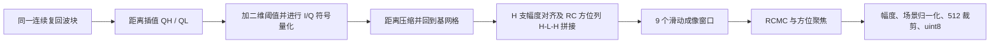

# UCAN 单比特 SAR 序列恢复：独立科研审查与可证伪实验计划

日期：2026-11-14（Asia/Shanghai）  
对象：Argon_v1.md、当前 UCAN 实现、实际 MATLAB 数据生成器、已有 PNG 与实验记录。  
本轮范围：只读源码、文献及数据，进行必要的静态推导和小样本数据审查；未修改项目代码、未启动训练、未运行模型推理。本文是唯一新增的项目文档。

## 1. 决策结论与证据边界

**保留“利用滑窗几何去除重复计算”的方向；撤回 Argon 对三次谐波、绝对幅度标定、严格单向保护、数值必然爆炸及显存收益的强结论。暂不采用组合式 SCQR-UCAN。**

推荐两个研究方向：

1. **第一优先：不改骨干的规范母图恢复，以及同权重的重叠输出融合对照。** 先回答已有序列的信息到底是否超出“一张更宽的图像”，同时取得可量化的效率基线。
2. **第二优先、条件启动：质量条件化的归一化全局聚合。** 先比较区域均值/方差条件化、均匀聚合与原生 Hedgehog 的质量加权；只有质量来源干预支持其机制，才发展为论文主模块。

LKSA 稳定化是恢复可信训练的前置工作，不与序列模块捆绑计功。PBW 的“边值问题”解释、DHD 的“幅度图 FFT 就是谐波物理域”解释不成立；目前不投入完整模型训练。

**当前最严重的问题是评估独立性。** 现有划分按 sequence 名称随机分组，而生产序列之间步进仅 384 列。本轮根据原始窗口坐标统计，验证集 654/738 帧、测试集 2764/2952 帧在训练集中存在完全相同的原始成像窗口。一对跨集合 GT 已直接读图确认完全相同。旧指标仍可用于工程复现和同分布诊断，但不能支持独立场景泛化结论。

全文使用以下证据等级：

- **F：事实。** 本轮直接读到的代码、参数文件、PNG 或划分统计。
- **R：历史记录。** 仓库已有诊断与训练报告，本轮未在服务器重放。
- **D：条件推导。** 在明确假设下由公式或张量尺寸推出。
- **H：待验证假设。** 有合理动机，尚无干预实验支持。
- **X：应撤回的结论。** 与代码/数据不符，或推理不足以支持原来的强度。

审查使用的代码仓库是 `G:/VSCODE-G/SAR_Sequence_Restore`；会话初始的 C 盘同名目录为空。数据生成器及 PNG 位于 `G:/MATLAB-G/SAR Dataset Transformer`。用户已说明权重和训练日志保存在 Linux 服务器，本机没有。因此本文没有新产生的 UCAN PSNR、速度或峰值显存实测。

## 2. 实际任务与生成过程

### 2.1 网络恢复的是归一化幅度 PNG

当前 [SARSingleDataset](../basicsr/data/sar_single_dataset.py "原引用：第 53 行") 将每个 sequence 的 000–008.png 展开为九个独立样本，灰度读取并除以 255。训练裁剪 128×128，LQ/GT 同坐标，不翻转旋转；验证整帧 512×512。网络没有接收复数回波、相位、阈值波形、Q 图或序列元数据。

GT 来自未量化的 60 MHz 基网格回波，经距离压缩、RCMC、方位聚焦、取绝对值、场景分位数归一化、中心裁剪及 uint8 量化。它是**当前 RD 流程得到的参考幅度图**，并非已经证明无噪声、无旁瓣的真实反射率。目标应是恢复全部九帧并保持真实结构，不能把各帧 PSNR 拉成相等本身作为优化目标。

依据：[generate_gt_image.m](<G:/MATLAB-G/SAR Dataset Transformer/src/sarproc/generate_gt_image.m> "原引用：第 1 行")、[focus_base_rc.m](<G:/MATLAB-G/SAR Dataset Transformer/src/sarproc/focus_base_rc.m> "原引用：第 1 行")、[sarflow_normalize_frame.m](<G:/MATLAB-G/SAR Dataset Transformer/src/workflow/sarflow_normalize_frame.m> "原引用：第 1 行")。

### 2.2 2D-SFT 是二维单频阈值，不是报告描述的变标成像算子

实际量化链条是：

$$
e_Q=\operatorname{Interp}_{\rm range}(e;Q),\quad
a_Q=\frac{\sqrt{2/\pi}\,\operatorname{mean}|e_Q|}{10^{\mathrm{STR}/20}},
$$

$$
T_Q(\tau,\eta)=a_Q\exp\{j[2\pi f_r\tau+2\pi f_a\eta+\phi_0]\},\quad
b_Q=\operatorname{csign}(e_Q+T_Q).
$$

实部与虚部分别取符号，零映射为 +1；严格说是每个 I/Q 分量一比特、每个复样本两个符号比特。随后距离压缩并回投影到基网格。

H/L 两支针对同一个 1200×2224 连续回波块分别计算，再做：

$$
\gamma=\sqrt{(P_L+\epsilon)/(P_H+\epsilon)},\qquad
R_{\rm mix}(:,j)=m_j\gamma R_H(:,j)+(1-m_j)R_L(:,j).
$$

其中 $P_H,P_L$ 来自两个边界两侧各 64 列的功率统计；掩膜施加在**距离压缩后的方位列**。九个 1200 列窗口以 128 列步进，从同一混合 RC 中截取，再逐窗 RCMC、方位聚焦，取 600 ROI 后裁成 512。



依据：[量化入口](<G:/MATLAB-G/SAR Dataset Transformer/src/sft/generate_range_2dsft_rc.m> "原引用：第 11 行")、[阈值幅度](<G:/MATLAB-G/SAR Dataset Transformer/src/sft/build_2dsft_threshold.m> "原引用：第 5 行")、[阈值载波](<G:/MATLAB-G/SAR Dataset Transformer/src/sft/build_2dsft_carrier.m> "原引用：第 4 行")、[H/L 混合](<G:/MATLAB-G/SAR Dataset Transformer/src/workflow/sarflow_mix_sequence_rc.m> "原引用：第 6 行")、[功率对齐](<G:/MATLAB-G/SAR Dataset Transformer/src/sarproc/estimate_rc_alignment.m> "原引用：第 18 行")、[实际逐帧生产](<G:/MATLAB-G/SAR Dataset Transformer/src/workflow/sarflow_generate_impl.m> "原引用：第 380 行")。

由此有四项修正：

1. **H/L 掩膜是一个加工过程的来源标签。** 方位聚焦和 RCMC 会混合邻域，图像域边界不是严格的“干净/污染”分界；F4 没有输出图像的外侧上下文，不等于成像时没有接收任何 H 支贡献。
2. **H 区已经被缩放到 L 支的边界功率尺度。** 它并不是独立保留的绝对辐射基准。两侧地物本来可能不同，能量对齐本身也可能改变真实对比度。
3. **归一化使用场景统计。** 不是报告设想的每帧自动归一化；阈值幅度则使用连续回波块统计。二者不能混淆。
4. **列方向是当前数据的滑窗轴。** 参数与裁剪源码还给出一个历史 1 px 起点偏移：首帧最终取原成像窗口第 344–855 列，而逻辑区从完整块第 345 列开始。直接投影 RC 掩膜时，母图中的名义边界为零基坐标 513、1025，而非 512、1024。这不影响 128 步进重叠，但区域掩膜必须沿用真实索引，并把成像扩散带单独评价。此项为源码推导，不主张本轮移动旧数据。

最后一项依据：[ROI 索引](<G:/MATLAB-G/SAR Dataset Transformer/src/sarproc/sar_image_roi_indices.m> "原引用：第 7 行")、[中心裁剪](<G:/MATLAB-G/SAR Dataset Transformer/src/utils/crop_center.m> "原引用：第 3 行")。生成器的 [区域指标函数](<G:/MATLAB-G/SAR Dataset Transformer/src/workflow/sarflow_sequence_metrics.m> "原引用：第 4 行") 已采用实际索引，可作为后续移植依据。

### 2.3 Q 的真实定义推翻了报告的定量谐波结论

本轮读取 `inputs/parameters/FS60_params.mat`：$F_{s,0}=60$ MHz，$B=45$ MHz，PRF=240 Hz，距离/方位窗口均为 1200 点。代码中的 Q 是**相对于 60 MHz 基网格的距离插值倍率**：

$$
F_{s,Q}=Q_{\rm eff}F_{s,0},\qquad F_{s,Q}/B=(4/3)Q_{\rm eff}.
$$

| 数据来源 | 名义 Q | 实际距离采样率 | 实际 $F_s/B$ |
|---|---:|---:|---:|
| H 支 | 2.5 | 150 MHz | 10/3 |
| L 支 | 1.5 | 90 MHz | 2 |
| 全 Q=2 | 2 | 120 MHz | 8/3 |

依据：[resolve_range_grid.m](<G:/MATLAB-G/SAR Dataset Transformer/src/sampling/resolve_range_grid.m> "原引用：第 9 行")；生产 metadata 也确认本项目 H/L 为 2.5/1.5、STR=1 dB、fr/Br=0.9、fa/Ba=0.5。

这里的不同 Q 由同一基网格复回波在量化前数值插值得到，改变的是模拟量化的采样密度；它没有创造原始未量化回波之外的新带外信息，也不是不同帧独立采集的多次观测。

即使接受报告的“零阈值、单一理想 LFM、三次项谱支撑为 3B”的简化模型，L 支也已经处在其所谓 $F_s/B=2$ 临界点，不能套用“Q=1.5 导致全通带三次混叠”的结论。真实模型还加入二维阈值，引入信号与阈值之间的互调；折叠频率、能量和成像残差须由真实链条分析。

因此，**0%、33.3%、66.7%、100% 等数字不能作为本项目的实测比例或物理常数。** 频率支撑的覆盖长度也不等于能量占比；相干项的相位、匹配滤波及多散射体交叉项均会改变能量。报告的 $s^{*(2k+1)}$ 记法未定义为卷积、幂还是共轭，不能构成一般复回波量化展开。

H/L 与全 Q=2 的差别还同时包括 STR（1→0 dB）、fr/Br（0.9→1.3）、fa/Ba（0.5→0.4）、有无 RC 能量对齐、不同输入归一化统计。**两套模型的增益差不能直接相减来估计 H→L 机制。**

### 2.4 幅度可辨识性与 H→L 信息的合理边界

在当前阈值随块幅度自适应的实现中，对正标量 $c$，有 $a_Q(ce)=ca_Q(e)$，从而理想数学下：

$$
\operatorname{csign}(ce_Q+cT_Q)=\operatorname{csign}(e_Q+T_Q).
$$

没有额外幅度元数据或标定观测，就不能从这些比特唯一确定原始绝对幅度。网络可能学习数据分布下的相对幅度映射；H 区也可能提供同场景风格统计，但这不是绝对辐射标定的证明。

Bussgang 分解描述特定统计条件下的线性相关项和不相关失真，既不等于失真独立，也不是任意场景逐点幅度可恢复的定理。参考原始教程 [Demir 与 Björnson](https://arxiv.org/abs/2005.01597)。非线性的 csign 也不宜称为具有线性算子的“零空间”；更准确的是多个输入可能落入同一量化等价类。是否丢失某个弱目标，仍须根据阈值、测量、先验与目标可辨识性判断。

值得检验的 H→L 信息是连续地物结构、场景相关统计、可共享的恢复特征。H 不是 L 的同位置全精度观测；迁移是否可靠取决于相关性，不能先验保证。

## 3. 本轮数据审查结果

### 3.1 序列内重叠：几乎没有额外像素观测

取 `val.txt` 中各场景首次出现的 sequence，覆盖七个场景；对 H/L 与 Q=2 两个版本均读取九帧 LQ/GT。共 14 个版本-序列、252 张 PNG。沿列对齐比较相邻帧的 384×512 重叠区。没有加载网络或对测试集性能选型。

下表 MAE 使用原始 0–255 灰度单位，每项均汇总一条序列的八对重叠区：

| 场景 | H/L LQ 重叠 MAE | Q=2 LQ 重叠 MAE | GT 重叠 MAE（两版本一致） |
|---|---:|---:|---:|
| port | 0.00008138 | 0.00009219 | 0.00002289 |
| sar_figure | 0.00006803 | 0.00008837 | 0.00004387 |
| city1_histeq | 0.00006676 | 0.00005786 | 0.00005086 |
| bangkok | 0.00007121 | 0.00008519 | 0.00004133 |
| city2_histeq | 0.00005786 | 0.00008392 | 0.00005277 |
| filed | 0.00006421 | 0.00008138 | 0.00006167 |
| suburb | 0.00008647 | 0.00008392 | 0.00007947 |

**所有所测 LQ/GT 重叠差异最大值均为 1 灰度级，超过 99.99% 的比较像素相等。** 这些是小样本事实，不外推为全量严格相等。差异的具体浮点/取整来源未另行实验定位。

它支持“规范母图作为首个最小原型”，不支持因检测到任何非零残差就增加帧残差头。对当前 PNG 精度，新增残差头很可能只处理远小于恢复误差的取整差异。

复现用的七个 sequence：

```text
port_rstart_002701_cstart_000013377
sar_figure_rstart_000301_cstart_000004993
city1_histeq_rstart_005401_cstart_000000769
bangkok_rstart_000001_cstart_000003073
city2_histeq_rstart_005101_cstart_000002305
filed_rstart_003901_cstart_000001153
suburb_rstart_004801_cstart_000003457
```

几何上，母图为 512×1536，九帧是其 128 步进裁剪；观测重数为 `[1,2,3,4,4,4,4,4,4,3,2,1]`。总像素处理数与唯一坐标数之比为 3。这是**空间重复比例**，不是独立采样的信息增益。

还观察到 port 样本的输入 PSNR 为 F0=14.2122、F4=14.4551、F8=14.1020 dB。名义上最低 Q 的 F4 并非逐条序列都取得最低 PSNR；地物内容、GT 动态范围和归一化会影响这一指标。因此不能把预设的 V 形 PSNR 曲线当成数据公理。

### 3.2 跨集合同源窗口：已经确认的评估混杂

生产代码按 3×128=384 列间隔创建 sequence，末尾还可能使用更短间隔。帧原始窗口键为：

$$
(\mathrm{scene},\mathrm{rstart},\mathrm{cstart}+128t),\quad t=0,\dots,8.
$$

本轮遍历三个已有 split 文本，统计 val/test 的键是否在 train 中出现：

| 集合 | 帧数 | 训练集中存在同源窗口的帧 | 比例 | 九帧全部存在同源训练窗口的序列 |
|---|---:|---:|---:|---:|
| val | 738 | 654 | 88.62% | 68/82 |
| test | 2952 | 2764 | 93.63% | 286/328 |

这不是用图像哈希推断，而是生成器定义下的窗口坐标统计。它也没有把剩余帧判定为独立；那些帧仍可能与训练窗口部分重叠。

实际读图例证：

- 验证：`sar_figure_rstart_000301_cstart_000004993/000.png`。
- 训练：`sar_figure_rstart_000301_cstart_000004609/003.png`。
- GT：逐像素完全相同。
- LQ：MAE=10.23156/255，最大差=74/255。不同 sequence 的 H/L 掩膜、块阈值及能量对齐使退化不同，但监督目标仍然重复。

现有 [划分说明](splits/sar_single_seed42/README.md "原引用：第 5 行") 确实保证 sequence 名称互斥，却没有保证原始窗口或地面内容互斥。七个场景也都同时出现在三个集合中。

新实验要区分：

- **快速机制诊断集：** 可以使用现有 val 和既有权重，回答同模型受输入干预后的变化；标注为已有分布内、存在同源重叠的诊断。
- **确认集：** 从源场景或原始空间块建立独立划分。同源/重叠原始回波块及全部 Q 变体必须同组；空间块隔离要计入 2224 列完整输入支持域及距离向来源范围，不能只隔离 512 输出。
- **初始化：** 将旧权重微调到新划分，不能消除它已经见过新测试内容的事实。严格确认应从头在新训练划分训练 UCAN 与候选，或者使用真正未接触过的新场景。

当前生产归一化遍历全部场景轨迹，包含各场景 GT 分位数；参数搜索也使用七个场景。若主张未知场景物理泛化，应仅用训练/独立标定数据固定预处理与采集参数，并从回波重新生成相应输入/目标。已有 uint8 PNG 的饱和信息无法通过反归一化完整恢复。固定旧 PNG 可以保留为工程基准，但需说明其场景标定条件。

## 4. UCAN 数学、架构与工程审查

### 4.1 实际张量与共享方式

当前配置为 C=48、window_size=16、4 个 ResidualGroup、share=[N,F,N,F]、每组 4 个 HybridBlock 和 5 个 LKSA；参数量静态逐模块重算为 **683,817**，与接入记录一致。

| 项目 | 实际代码 | 对 Argon 方案的影响 |
|---|---|---|
| Token | PatchEmbed 主要将每像素特征展平；patch_size=1 | 128×512 条带是 65,536 个空间 token，不是一个 token |
| HPA | 每组一个独立 32×32 SDPA 窗口；返回的 attention map 未共享 | 不能把 HPA 当成跨组共享的窗口图 |
| Hybrid 窗口 | 16×16，N 组产生 attention map，F 组复用 | 步长 128 同样可整除 16；每条带为 8×32=256 个窗口 |
| 共享拓扑 | rg1→rg2，rg3→rg4，按相同 block 索引共享窗口图与未映射的 q/k | 既不是跨帧 KV cache，也不是所有模块只计算一次 |
| Shift | shift_size 被存储，但 HybridBlock.forward 没有执行 roll 或移位 mask | 改配置值不会实现移位 |
| SDFL / DFRL | 全局空间线性分支和全局通道分支同时存在 | 原生 UCAN 已有全局统计与信息混合，须与新增模块比较冗余 |
| LKSA | 16 通道；已有横/竖可分离卷积和膨胀横/竖卷积 | DHD 把“方形核替换十字核”当全新能力不符合源码 |
| ESA | 带 Sigmoid 的有界门控 | 不能与无界 LKSA 一起归为相同二阶无界门控 |

依据：[HPA 与 Hybrid 配置](../basicsr/archs/ucan_arch.py "原引用：第 1027 行")、[窗口共享实现](../basicsr/archs/ucan_arch.py "原引用：第 945 行")、[组间共享](../basicsr/archs/ucan_arch.py "原引用：第 1458 行")、[LKSA](../basicsr/archs/ucan_arch.py "原引用：第 507 行")、[ESA](../basicsr/archs/ucan_arch.py "原引用：第 403 行")。

### 4.2 Hedgehog 摘要不等于报告的 24×24 裸外积

实际特征映射：

$$
u_q=W_q q+b_q,\quad \phi_q(q)=\operatorname{softmax}([2u_q,-2u_q]),\quad \phi_q(q)\in\mathbb R^{48},\quad v\in\mathbb R^{24}.
$$

key 使用独立可学习的映射 $\phi_k$；下文为简化记号分别写作 $\phi(q)$、$\phi(k)$。偏置初始为零，但训练后不应从实际公式中省略。

设 $P_i$ 表示实现中的 Fourier 位置变换，则当前空间分支主要为：

$$
M=\frac1N\sum_j(P_j\phi(k_j))v_j^\top\in\mathbb R^{48\times24},\quad
\mu_k=\frac1N\sum_j\phi(k_j),
$$

$$
o_i=\frac{P_i\phi(q_i)M}{\phi(q_i)\mu_k+\epsilon}+\operatorname{LePE}(v)_i.
$$

每个 numerator 摘要为 1152 个浮点数，FP32 下 4.5 KiB；还需要 48 维 key 均值，合计约 4.69 KiB/头/来源集合。24×24 更接近通道注意力矩阵的尺寸。

质量加权必须让分子和分母使用一致的权重与计数，例如：

$$
M_w=\frac{\sum_j w_j(P_j\phi(k_j))v_j^\top}{\sum_jw_j},\qquad
\mu_w=\frac{\sum_jw_j\phi(k_j)}{\sum_jw_j}.
$$

仅平均条带 KV、混合不同长度记忆却保留原分母，会改变输出尺度；等权合并 H/L 两个均值也不等于按 2:1 面积比例的全局聚合。通道门控的广播轴还必须明确。

来源：[HedgehogFeatureMap](../basicsr/archs/ucan_arch.py "原引用：第 25 行")、[SDFL.spatial_brand](../basicsr/archs/ucan_arch.py "原引用：第 591 行")、[DFRL](../basicsr/archs/ucan_arch.py "原引用：第 697 行")。

原始 [Hedgehog 论文](https://arxiv.org/abs/2402.04347) 支持通过可学习特征映射改善 softmax 式选择性，不证明该记忆就是 SAR 的真实 PSF 字典。对单一线性空间注意力，矩阵秩仍受特征维数约束；提高经验有效秩，不等于任意 N 下等价于 full softmax。位置变换后的分子可有符号，也不能直接解释成非负概率加权的物理散射传播。

母图横向加宽会改变展平位置 $p=yW+x$ 的行距。代码按一维位置生成 Fourier 编码，128 裁剪、512 整帧和 1536 宽母图的相对几何编码不完全等同；跨帧聚合不能简单相加各自局部坐标下的 KV。当前 max_sequence_length 用于频率选择，不是硬截断，但长序列外推仍需要实验。

### 4.3 不能在接收块平移后直接复用旧窗口图

共享 attention 的行列分别对应原窗口中的 query/key token。只移动接收块的 V 或重新分窗，旧 attention 便与新 token 不再对应。即使将旧图按置换重排，跨边界的新 token 对也没有在旧窗口中计算过。

此外，16 px 对 16×16 Hybrid 窗口是**整窗移动**，不是跨条带的半窗桥接；若该路径采用移位，半窗应为 8 px，且共享源与接收端必须一致地处理位置、mask 和新窗口关系。32×32 HPA 的半窗才是 16 px。循环移位还必须屏蔽物理上不相邻的两端。

结论：SUC 第一原型保持全部原生窗口。跨界移位不是修补拼接的默认开关，只有明确显示边界交互不足时，才作为独立机制比较；不可与母图一起引入后把收益全部归于折叠。

### 4.4 数值故障的真实证据与最小修复

已有 [故障报告](UCAN_nonfinite_diagnosis_20261109.md) 和 [逐算子 JSON](diagnostics/ucan_nonfinite/iter_129507_rank_1_first_operator.json) 记录：Q=2 在 129507 步的 rank1 前向失败；首个非有限输出是 `rg_2.residual_group.norm_out` 的 FP32 LayerNorm。其输入仍有限，最大幅值约 $2.86\times10^{20}$。连续五个 LKSA 前后幅值明显放大；同一 LayerNorm 的 FP64 诊断输出有限。

因此，**乘性卷积分支放大是有直接证据的风险；“SAR 高峭度必然导致 $x^{2^L}$ 增长、FP16 随后触发 Hedgehog exp 溢出”不是本次事实。** 实际 LKSA 为：

$$
y=\mathrm{channel}(x)\odot[\mathrm{large\_kn}(x)+\mathrm{conv3}(x)].
$$

其中含偏置、GELU、SGFN、残差和可学习系数，不是简单齐次二阶递推。二次上界不能推出每层必然达到该增长率。当前 Hedgehog 使用稳定 softmax 实现，不是报告所写的裸 exp 链条。

下一轮只比较最小候选：原式；在第二乘数上加 $\gamma\tanh(a/\gamma)$；或在实际 LKSA 分支入口做归一化/残差缩放，二者先分开。应保留 `channel(x)` 分支，不能把报告的 $x\odot F(x)$ 直接当源码替换位置。加载相同参数键只表示 checkpoint 结构兼容，不意味着函数不变、精度不降或全网稳定性已获保证。RMSNorm 自身的平方统计也须放在幅值已经失控之前。

该修复应先重放已有失败现场与正常样本，再做短程延续；不需要从头重跑 400k 来定位已知问题。短程无 NaN 仅表示在所测范围内有效。

### 4.5 参数少，不代表激活显存少

静态参数重算：两个 N 组各 183438，两个 F 组各 147526，其余卷积与归一化合计 21889，合计 683817。新增模块的尺寸、插入次数和共享方式未确定之前，Argon 的 +0.008M、+0.018M 等只能作为预算目标，不能当作已核实参数量。

下面按 B=1、FP32、无反向图计单张中间张量，并非峰值实测：

| 张量 | 512×512 帧 | 512×1536 母图 |
|---|---:|---:|
| C=48 特征图 | 48 MiB | 144 MiB |
| 一张 16×16、2-head 的全图窗口 attention | 512 MiB | 1536 MiB |
| 四张被共享保存的上述 attention | 2 GiB | 6 GiB |
| 32×32 HPA 若由 math 后端显式物化一张注意力矩阵 | 2 GiB | 6 GiB |

还有 q/k/v、输出、归一化、旧/新组共享状态、softmax 临时量及训练保存张量。FP32 和相对偏置条件下不能预设 SDPA 必然使用 Flash 后端；源码允许 math 回退。

仅计算窗口 attention 的 QK 与 AV 矩阵乘法，当前 4 个 HPA、8 个 N Hybrid、8 个 F Hybrid 就约需 **180.39 G MAC/512 帧**，未计卷积、投影、线性注意力和位置变换。它是静态组成项，不是完整 profiler FLOPs；若采用每 MAC=2 FLOPs，需要明确这一计数约定。

在窗口大小、通道数固定且大部分算子随像素数线性增长的条件下，母图相对九帧总 MACs 约为 1/3，是合理的工程预期。**但与逐帧串行推理相比，母图单次激活约扩大三倍，峰值显存可能增加，甚至 OOM。** 小型 KV 摘要不能代表整个网络显存。

新增 1×1 投影需按 `位置数×Cin×Cout×插入次数` 计费；FFT 的复数/FP32 工作区、递推的串行依赖和内存搬运也必须计入。所有延迟结论以统一精度、设备、输入大小、批大小的实际计时为准。不要直接调用未经适配的现有 `flops()` 当真值；本文件的旧方法还引用了缺失/不匹配的子方法。

## 5. 对 Argon 核心结论的裁决

| 结论 | 等级 | 审查结果 |
|---|---|---|
| 9 帧对应 12 个 128 条带，空间处理冗余为 3 倍 | F/D | 保留，滑窗沿列；不是 3 倍独立信息 |
| 序列内重叠区几乎重复 | F | 本轮七场景、两版本抽样支持；改为近无损折叠 |
| H/L 完全对应输出图像中纯净/污染的地面分区 | X | 来源掩膜在 RC 域，成像后存在跨界混合及实际裁剪偏移 |
| Q=Fs/B，QL=1.5 导致三次谐波占比翻倍 | X | Q 定义错误、遗漏阈值；比例推导不适用于实际生成器 |
| 全 Q=2 的序列收益 100% 来自 ERF | X | 还需区分融合、边界、位置编码、归一化响应和训练尺度适配 |
| F1 同条带优于 F4 即证明 H 引导 | X | 帧内位置、距边缘、全部上下文和位置编码同时变了 |
| H 区可严格提供辐射标定/干净 PSF | X/H | 绝对标定无依据；场景统计迁移是可检验假设 |
| 线性摘要有利于低开销全局聚合 | D | 保留，但实际为 48×24 加归一化向量及位置处理 |
| H→L 路由实现全网 100% 阻断 L→H | X | 卷积、HPA、通道注意力、前级特征等路径仍混合；单支掩膜不能保证 |
| 母图与质量路由数学上正交且天然互补 | H | 两者都改变全局上下文，可能高度冗余，须做交互消融 |
| LKSA 乘性链是稳定性风险 | R/F | 保留；首次 NaN 位置和精度须按实际记录修正 |
| tanh 能不改变表达能力地根治所有 NaN | X | 改变函数和梯度；只控制局部分支增益 |
| PBW 等价于 Dirichlet 双端边值问题 | X | 没有 PDE、边界真值或唯一性条件；只是有序特征递推 |
| 幅度图 FFT 直接对应回波三次谐波域 | X | 聚焦、取模、裁剪和归一化后不成立；高频差异可来自真实结构 |
| 高 H 占比帧一定是同条带最佳 teacher | H | 固定条带的 Q 未改变，优势可能只有上下文/边界位置 |
| OCE=0 可证明物理机制正确 | X | 单一母图裁剪天然为零，且当前 GT 也存在极少量 1-LSB 差异 |
| 反向路由退化即可证明正向路由物理必要性 | X | 可能是有意施加错误归一化、低质来源或分布外干预；必须有更强对照 |

## 6. 文献核对与创新性判断

检索截至 2026-11-14，以原论文、作者机构页或官方项目为依据，结论如下：

| 工作 | 可核实内容与本项目关系 |
|---|---|
| [UCAN, arXiv:2603.11680](https://arxiv.org/abs/2603.11680) | CVPR 2026 标注可核实。全局 Hedgehog、窗口共享、大核蒸馏是 baseline 已有能力，应从实际适配源码判断增量贡献 |
| [Hedgehog, ICLR 2024](https://arxiv.org/abs/2402.04347) | 学习可表达的线性 attention 映射已有明确先例；复用其摘要不构成新的 attention 原理 |
| [ATD, CVPR 2024](https://arxiv.org/abs/2401.08209) | 已通过自适应字典提供全局信息和相似 token 聚合。TPAMI 扩展的书目信息可检索，但本次机制判断依据可读的原论文 |
| CDQOB-Net、固定阈值慢时间波动 SAR | [作者机构论文列表](https://ceie.szu.edu.cn/info/1018/2405.htm) 确认 2023 去量化网络、2025 慢时间阈值论文和 2019 单频阈值论文确实存在。本轮未取得相关 IEEE 全文，不能把报告声称的全部数学细节视为已核实 |
| 单比特稀疏先验/矩阵补全 | [作者机构页面](https://ee.buaa.edu.cn/info/1071/14143.htm) 确认相关 2026 研究存在；不据此推断一般杂波场景中 H→L 纹理迁移成立 |
| [2026 单比特舰船检测](https://www.mdpi.com/2072-4292/18/21/3748) | 是检测与标签自监督问题，不能直接用其检测收益为图像恢复或辐射保真背书 |
| [GLM-5.2 IndexShare/KVShare](https://z.ai/blog/glm-5.2) | 索引跨层复用、MTP 相关 KV 共享的应用条件与本项目不同；可作工程启发，不能移植速度比例 |
| [CollectiveKV](https://arxiv.org/abs/2601.19178) | 是序列推荐中的跨用户协同 KV 池，不是 SAR 同地面条带的精确前缀缓存 |
| [River-LLM](https://aclanthology.org/2026.acl-long.1746/) | 是自回归 early-exit 缓存缺失处理，不是本文所述跨区域观测融合 |
| CachePort | 本轮没有找到可核实的对应论文标识；应从论证链中删除，除非补充准确来源。未检索到不等于证明其不存在 |

**创新性排序：**

- 母图折叠、overlap-add、同坐标输出平均：成熟的几何/推理思想，工程价值高，单独的架构新颖性较弱。
- 全局字典、quality gate、双向传播、FFT 分支：均有大量先例；组合名称不能替代机制证据。
- 更值得形成的科研贡献是：在真实 SFT 数据链和独立划分下，证明“重复窗口的收益主要来自何种上下文”；进一步用同位置质量干预验证最小质量聚合确有额外收益，同时维持目标保真和可测的效率。是否达到论文贡献强度，由实验决定，不预先宣称“首次”。

## 7. 候选筛选与推荐研究路线

| 方案 | 物理合理性 | 潜力 | 复杂度与风险 | 决策 |
|---|---|---|---|---|
| 简单同坐标输出均值/固定中心权重 | 高，可测的恢复上下文集成 | 中 | 零参数；通常仍需九帧推理 | 必需基线，不包装为主要创新 |
| 原生 UCAN 母图恢复 | 当前数据强支持 | 中至高 | 零新增参数；位置编码外推与单次显存是主要风险 | **P1，先做** |
| SUC 的帧残差头 | 当前证据弱 | 低至未知 | 处理近零输入差异，可能过拟合取整残差 | 第一原型删除；只有完整验证显示有意义差异再考虑 |
| 质量条件化全局聚合 | 合理假设 | 中 | 原生全局分支可能已足够；H 可靠性不是硬保证 | **P2，诊断通过后做** |
| 跨帧窗口图/特征 teacher 共享 | 同位置对齐合理，teacher 优势待证 | 中 | 特征上下文不等价、需缓存大 attention；与母图冗余 | 先用输出融合替代，暂缓深层共享 |
| 接收块单独移位 | 当前设计不正确 | 未定 | 索引与共享 attention 不匹配 | 否决原方案；需独立重设计 |
| PBW | 有序传播是经验设计 | 未定 | 误差递推、串行延迟，与原生全局聚合重复 | 暂不投入；撤回边值物理解释 |
| DHD | 当前物理解释错误 | 未定 | 跨地物频谱误抑制、取模失去相位、已有轴向核 | 暂不投入；只保留前向模型级频谱诊断 |
| SCQR 多模块组合 | 尚无独立机制证据 | 未定 | 难归因、当前工程估算失实 | 暂不立项 |

**P1 真正解决的问题：** 同一地面被重复计算、同一位置的输出受裁剪上下文影响。其相对简单融合的潜在优势是少处理重复像素，并让原生全局分支直接访问宽幅场景。风险是上下文未必有帮助、FOPE 尺寸外推以及峰值显存。性能不提升但质量等价且明显节时，也值得保留为工程结果。

**P2 真正解决的问题：** 原生全局统计是否受不可靠来源或异质地物干扰，以及是否需要按来源质量调整信息使用。优先从一个位置的标量/区域权重开始，使用一致的加权 numerator 与 denominator；再与区域均值/方差的简单条件化比较。风险是模型只学到固定的中间位置标签，或者 H/L 差异实际只是场景风格。只有超过这些简单对照，才保留 Hedgehog 路由复杂度。

两个方向先各自形成证据；不同时加入移位窗口、帧残差头、递推、FFT、新损失或多种稳定化。

## 8. 统一评价、控制变量与统计规则

### 8.1 明确区分四类收益

| 要辨别的收益 | 核心对照 |
|---|---|
| 额外观测 | 九帧全观测折叠 vs 只用 F0、F4、F8 的不重复覆盖；网络和母图尺寸一致 |
| 额外空间内容/上下文 | 同一母图内容整图推理 vs 独立 512 区段；固定中心输入、扩大画布但只重复/镜像中心的对照 |
| 容量 | 同样插入位置、参数、运算的无质量条件模块，以及同预算简单条件化；不能仅拿“参数差很小”排除容量 |
| 质量来源的具体机制 | 同一地物、同一中心像素，仅改变外侧来源质量；再比较错配场景、打乱空间和统计量匹配的来源 |

冻结模型的输入干预检验“现有模型如何使用信息”；独立重训检验“该设计能否学到稳健能力”。二者不能互相替代。

### 8.2 所有实验共同输出的指标

1. **主结果：** F0–F8 各自 PSNR/SSIM、F4、九帧宏平均；延续现有 uint8、crop_border=0、非 Y 通道协议，同时保存未裁剪/裁剪后浮点误差与饱和像素比例。不能把 uint8 与 float 指标混在一列。
2. **按唯一地面坐标：** 每位置等权的 MSE/PSNR 与条带 s=0…11 指标；另报现有逐帧均值。原始九帧重复监督中 L 区占 16/36，而母图均匀监督中占 4/12；必须控制或明确报告这个权重变化。
3. **按区域与边界距离：** 真正索引投影的名义 H/L 掩膜、边界带及 L 内部；记录距 H/L 边界、距帧边界、帧内坐标。同一条带跨窗曲线只能作为诊断关联。
4. **一致性：** 重叠区归一化 MAE、输入/GT 的对应参考值、接缝梯度误差。母图 OCE=0 是构造结果，不是验证物理机制的独立指标；不能用 OCE 越低越好单独挑模型。
5. **散射目标保真：** 依据 GT 预定义亮点/弱点 ROI，报告峰值幅度误差、位置偏移、局部能量、目标漏检和新增伪亮点；有可靠标签时报告固定虚警率下检测率。不得利用模型输出反向挑 ROI。
6. **SAR 点目标指标：** PSLR、ISLR、主瓣宽度/分辨率用于已知孤立点目标或受控仿真，距离/方位分开。定义固定主瓣/旁瓣区域；用强度计算时明确 $I=|z|^2$。不在任意城市纹理上声称测得系统 PSF。
7. **纹理与辐射：** 同质区域的均值、方差、分布/相关长度、边缘梯度及局部对比度。ENL 只能在适用的同质强度区域使用，变大可能只是过平滑。绝对辐射与相位/相干性需保留物理幅度/复数数据后另评，当前 PNG 不支持。
8. **频谱：** 对同一位置的恢复残差做二维方向性谱分析，作为描述性指标。未经前向模型定位的高频环带距离不能命名为“三次谐波抑制比”。
9. **效率：** 完整九帧产物的参数、MACs/FLOPs 口径、实际 dtype/backend、单序列延迟、吞吐、峰值 allocated/reserved 显存；网络纯计算与读图/拼接/写图端到端分别记录。

### 8.3 实验公平性和门槛

- 固定 split、预处理、损失、初始化来源、源场景采样、数据增强、优化器、调度、后处理和 checkpoint 选择规则。新变体不同时改变精度、损失或稳定化。
- 必须控制上下文尺寸与训练裁剪。当前 UCAN 训练时仅见 128×128，直接改成长条输入本身就是一项训练分布变化。
- 同时报告两类预算：相同监督/样本曝光下的能力比较，以及相同 GPU 时间下的工程比较。参数量、MACs、训练曝光无法总同时严格相等，不可用一条“同容量”概括全部。
- 初筛一个配对 seed；确认至少三个训练 seed。按独立场景/空间块做配对差值及区组 bootstrap，报告各场景结果、均值/中位数、置信区间和失败比例。九帧及其重叠条带不当作独立样本；七个源场景时应承认场景级估计精度有限。
- 不把 p>0.05 写成“证明无效”。若置信区间宽且跨过实用阈值，判为证据不足；若上界仍低于预先规定的实用阈值，才进入 No-Go。
- **建议预注册的实用阈值，均非物理常数：** 收益路径以 L/F4 平均增益 ≥0.10 dB、配对置信区间下界 >0 为初筛参考；H 区不劣界 -0.05 dB。效率路径可以允许 PSNR 差值的置信下界 >-0.05 dB，且端到端九帧延迟下降 ≥25%。亮点/弱点保真必须同步满足预定不劣界。关键容忍界在看候选结果前根据正常重复波动和任务需求冻结。

## 9. 可证伪实验矩阵

成本单位：R 为一次 512×512、单卡、FP32 UCAN 前向的实测时间；M 为一次完整母图前向时间，理论主体计算约 3R，实测可能偏离。已有训练记录给出 H/L 400k 在双 4090 上约 58 小时，即约 116 GPU·小时。20k–40k 等单步成本初筛约为 5.8–11.6 GPU·小时/变体；新输入形状必须先测步耗，不能直接承诺这一时间。

### E0：数据独立性、归一化与来源基准

- **科学假设：** 模型比较能反映未见地面恢复能力，而非同源目标复现。
- **对照与控制：** 旧 sequence 随机划分 vs 源场景/空间块隔离划分；按原始完整支持域分组，所有 Q 版本共组。冻结训练数据确定的生成/归一化参数，记录旧 PNG 基准与新标定基准的差别。
- **指标：** 同源窗口/支持域交集、场景数、目标分布、GT/LQ 归一化来源、饱和比例。分离“有重复目标”和“同域相似”两种情况。
- **反证与决策：** 旧划分的独立性已被本轮坐标和读图例证否定。只有隔离清单完成，才 Go 到确认性训练；无法取得独立数据时，研究结论限定为同分布工程改善。
- **成本/权重：** 清单工作 CPU、0 训练。新确认基线需要重训；旧权重仅供机制诊断或真正新增场景评估。
- **产物：** `source_manifest.csv`、分组 split、归一化说明、预先冻结的验证/测试与 checkpoint 选择规则。

### E1：最小 LKSA 稳定化

- **科学假设：** 对已定位的乘性分支控制增益，可避免已知 LayerNorm 溢出，同时保持恢复能力。
- **对照：** 原网络；仅第二乘数 tanh；仅分支前归一化/残差缩放。先重放保存的失败 batch 与正常 batch，再做同 checkpoint、同 batch 顺序、同 LR 的短程延续。两项修复不一开始叠加。
- **控制变量：** FP32、全部其他算子/数据/损失不变；记录函数改变后的 step0 输出偏移。FP64 LayerNorm 仅作故障归因参照，不作为最终效率方案。
- **指标：** 首个异常算子、LKSA 每级分位数与最大幅值、梯度、门控饱和率、正常集 PSNR/亮点误差、额外延迟。
- **反证/决策：** 失败现场仍复现异常、正常点目标被系统压制或相同预算性能明显下降则 Revise/No-Go。只有失败现场有限且短程延续/正常评价通过，才把胜出修复固定到后续所有训练对照。
- **成本/权重：** 现场重放 0 训练；随后约 10k–20k 的成对短训，不重跑完整预算。使用服务器已有 `.pth` 现场和 120k 恢复状态；当前本机没有这些权重。
- **产物：** 幅值轨迹、修复前后同样本输出与指标、稳定化选择记录。稳定性提升不计为序列机制收益。

### E2：冻结 UCAN 的几何、上下文和融合分解——首选下一项

- **科学假设：** 当前序列的主要可用性来自更大空间上下文和恢复结果的裁剪集成，独立重复观测增益很小；规范母图能以更少总计算保持或改善质量。
- **对照：** A：原 UCAN 九帧分别推理。B：将 A 的输出按相同地面坐标等权平均，再裁回九帧。C：只拼 F0、F4、F8，形成无重复覆盖母图，原 UCAN 一次推理。D：九帧输入按坐标等权 fold 后同样推理。E：把 A 中 F0、F4、F8 的输出拼接为三个独立区段，再展开九帧。C−E 检查同样原始地面内容下的跨区段联合处理；D−C 检查重复输入是否提供收益；B−A 检查不同裁剪恢复结果的集成。
- **反事实：** 保持中心 F4 输入像素、画布尺寸与位置不变，把外侧换成中心的镜像/重复，或亮度分布匹配的错配场景。与真实外侧的 C 比较。异常接缝可能造成分布外影响，因此不单靠一个替换结果证明物理性；中心边界带和内部要分别报。
- **控制变量：** 同一固定 checkpoint、原生所有算子、FP32、相同输出后处理；无 tanh/新窗口/新损失。重叠权重先均匀，中心优先权重作为预先固定的简单替代，禁止逐图按 GT 选择最佳来源。
- **指标：** 全部 §8 指标中适用部分，尤其 F4 内部/边界、H 不劣、同条带差异、C/D 差、亮点误差，以及真实 M、峰值显存。
- **反证/决策：** C 与无真实外侧的对照相同，则没有支持利用真实外侧内容；D≈C 则不支持额外重复观测的贡献；B 已达到 C 则深层共享暂不值得。C 精度等价且节时可 Go 为工程路线；C 失败但输入干预有上下文信号则 Revise 为尺度适配；所有简单上下文方案均无收益且不能节时，则 No-Go 到复杂序列网络。
- **成本/权重：** 0 训练。A=9R/序列，B/E 复用输出；C/D 各 M；额外反事实每种 M。完整 val 82 条的核心组为 `82×(9R+2M)`，按实测 M 估算，不写“十分钟内完成”。
- **产物：** `metrics_per_frame/strip/sequence.csv`、上下文干预差值、固定 ROI 图、效率表、No-Go/Revise/Go 说明。

### E3：质量来源的因果干预

- **科学假设：** 在同一中心观测和空间支持下，真实高质量外侧比低质量外侧及场景无关统计更有助于恢复 L。
- **对照：** 选少量同源回波，固定 STR、fr/fa、阈值原点、幅度约定、归一化与 GT，产生同位置不同 Q 的外侧。图像域实验锁住中心 L 像素，只换外侧：同场景 H、同场景较低质量、异场景 H（匹配一阶/二阶统计）、外侧空间块打乱、仅提供区域统计。不要直接拿当前整套 Q=2 数据当纯 Q 干预。
- **控制变量：** 中心像素逐元素固定、画布/位置/面积固定、同权重；同时记录上下文源本身相对其 GT 的质量。图像域替换是网络输入干预，不伪称可由真实雷达独立生成的观测。若另做回波域干预，须承认聚焦会同时改变 L 输入，并把那一支解释为测量过程总效应。
- **指标：** 固定 L 目标的误差、边界与中心响应、结构连续性、亮弱目标；质量收益与外侧地物相关性之间的关系。
- **反证/决策：** 同场景 H 不优于同位置低质来源，或异场景/仅统计条件同样有效，则不支持专门的 H→L 散射字典机制。仅统计有效时改为简单条件化；仅连续边界有效时改为局部上下文研究，不开发全局字典。
- **成本/权重：** 小规模数据重渲染与冻结推理，0 网络训练。先用预先选择的训练/诊断场景，不读取最终独立测试结果选方向。
- **产物：** 配对干预 manifest、固定中心的来源对照表、质量/几何因素的效果分解。

### E4：母图单机制训练与训练尺度对照

- **科学假设：** 同原生 UCAN 在更宽上下文上的训练适配能把 E2 的潜力变成独立数据上的可靠结果。
- **对照：** 新独立划分上的 UCAN 单帧；同权重规模的母图 UCAN；具有相同训练上下文/像素预算的简单大裁剪或三区段基线；简单输出融合。不要只以加宽 0.71M 的单帧网络代替上下文对照。
- **控制变量：** 同种稳定化、从同一随机初始化生成配对实验、同优化器与损失、配对源序列/坐标、相同主损失权重。主比较保持九帧展开监督对应的重数；唯一地面等权另作明确消融。母图只在单通道重建后 unfold，避免复制九份 C=48 特征。
- **训练起点：** 可先试 `64×1536、每卡1条、双卡`，其总输入像素数等于旧 global batch=12 的 128×128；这只是可行起点，不代表独立样本数或梯度噪声等价。单帧/三区段对照使用同源长条切片并匹配采样与监督预算；全高 512 验证另行报告。
- **指标：** 主指标与结构保真、训练曲线按像素曝光/GPU 小时展示、峰值训练显存与推理延迟。
- **反证/决策：** 收益被同上下文简单基线完全解释，或只来自训练分辨率/重数权重改变，则将其归为训练/工程收益。独立集无可用精度或效率收益则 No-Go。达到预注册质量或效率路径则保留。
- **成本/权重：** 一个 seed 的 20k–40k pilot 后再决定完整训练；严格独立划分从头训练。旧权重热启动仅用于旧分布诊断，结果不并入确认表。
- **产物：** 独立 split 上的成对曲线、预算明细、原生母图与简单基线比较表。

### E5：最小质量聚合，检验是否超过常规条件化

- **科学假设：** 对全局信息按实际来源质量加权，优于均匀全局统计和同预算的场景风格条件化。
- **对照：** 原生全局聚合；一个区域标量权重的归一化聚合；均值/方差条件化；相同模块但常数/置乱 Q 标签；同面积随机来源 mask；H 来源、L 来源和对称来源。所有组保留相同中心数据，反向路由仅作其中一个对照。
- **控制变量：** 同母图、同来源 token 数/归一化、相同位置编码约定、相同插入层与训练预算；初始残差贡献为零以恢复原函数。先只改一个确定位置，SDFL/DFRL 的计算与共享兼容要同时说明。保持通道分支不变，并承认它仍是跨区信息通路。
- **指标：** L/F4 与 H 分开、来源替换敏感性、门控使用率/饱和度、目标保真、相同来源数量下的收益和新增 MACs。
- **反证/决策：** 随机标签/任意 H 同样有效则不支持物理质量语义；均值/方差条件化持平则采用更简单模块；只在固定 H-L-H 位置有效则视为位置记忆。只有在 E3 的配对质量干预及独立数据中均有超出简单对照的增益，才 Go 为论文核心。
- **成本/权重：** 在新独立划分上训练的 E4 checkpoint 上微调；各对照同样初始化。先冻结骨干训练小模块进行便宜筛选，再对入选组进行相同全网微调预算；不能用不同冻结策略比较优劣。
- **产物：** 来源与质量干预矩阵、参数/MACs 明细、相对简单条件化的配对效果。

### E6：频谱机制的保留性诊断（当前非优先）

- **科学假设：** 某些残差确与特定量化/阈值互调分量有关，并可在目标保真下定向抑制。
- **对照与控制：** 已知孤立/双目标和杂波的小型回波仿真；未量化、零阈值量化、实际 SFT 量化；在相同场景中独立改变 Q 与阈值频率。分别观察复回波、RC、复成像和幅度 PNG，而非比较不同地物的 F0/F4 平均 FFT。
- **指标：** 已知谱分量/鬼影能量、PSLR/ISLR、分辨率、真目标幅度与位置；幅度图残差谱仅为辅助。
- **反证/决策：** 所谓频带峰值不能随真实前向参数预测移动，或抑制同时损伤真目标，则不支持 DHD 的物理解释。只有定位清楚且简单定向滤波有效，才讨论学习型频域分支。
- **成本/权重：** 小型前向仿真，0 网络训练；可复用 UCAN 作输出比较，但不先训练 FFT 模块。
- **产物：** 同源多阶段谱图和可解释目标指标。失败即停止该分支。

### E7：组合、泛化和效率确认

- **科学假设：** 已分别通过的机制可组合，且改进在不同场景/质量拓扑和实际预算下成立。
- **对照与控制：** 仅对通过 E4/E5 的因子做对应 2×2 消融；全部采用同一稳定骨干、独立 split、损失和训练预算。改变 H/L 位置与宽度、Q/STR/fr/fa，在同场景配对条件下先确认原因，再测试未见组合与未见源场景。
- **指标：** 三 seed 配对区组统计、最差场景、弱目标/虚警、名义区域与真实成像边界距离、质量-速度-显存 Pareto 表；批量和串行九帧分别计时。
- **反证/决策：** 两机制互相抵消或新增模块不超过单模块，则删除组合；泛化失败则缩小适用范围或 No-Go。只有同时通过独立质量/保真和资源约束，才进入论文完整实验。
- **成本/权重：** 完整训练只给胜出方案和必要基线；按旧成本三 seed 一个配置约 348 GPU·小时，实际按测得步耗修正。不能把此阶段承诺为“2–3 天完成”。
- **产物：** 最终独立测试表、统计区间、全部消融与可复现实验配置。

## 10. 分阶段执行与编码 Agent 交接

本节是批准后的工作安排，不是本轮已实施的修改。

| 阶段 | 具体代码/配置入口 | 数据与操作 | 必须交付 | Go / Revise / No-Go |
|---|---|---|---|---|
| 0 基础核查 | 新建独立审查脚本；参考 SARSingleDataset、`sarflow_generate_impl.m`、`sarflow_statistics.m`、现有 split | 建立完整支持域 manifest；冻结旧诊断集/新确认集；服务器核实已有 checkpoint 与失败现场；明确旧 uint8 和新增浮点协议 | 数据来源图、split、归一化契约、checkpoint 表 | 确认集互斥才可训练并报告泛化；旧权重来源不清时先补记录 |
| 1 低成本诊断 | 计划新增 `scripts/diagnose_sar_context.py`，复用 `scripts/eval_sar.py` 的输出形式与 UCANModel.test | 执行 E2；必要时做 E3 小规模同源质量干预；E1 使用现有 `scripts/diagnose_ucan_nonfinite.py` | context 对照 CSV、条带/目标 ROI、资源表、稳定性记录 | 有内容/质量效应才开发相应模块；不能仅凭平均 PSNR Go |
| 2 单机制原型 | 计划新增 sequence dataset/model；薄 wrapper 调用原生 `UCAN.forward`；新增独立 SAR YAML；只在 E1 需要时改 LKSA 实际乘数 | 返回 `[B,T,1,H,W]` 与真实坐标/来源掩膜；沿非滑窗轴共同裁剪；母图恢复后在单通道输出上 unfold；E4 pilot | 可单独开关的原型、训练/像素预算、强简单对照 | P1 达到质量或效率门槛后保留；位置信息/预算混杂未排除则 Revise |
| 3 完整模型与消融 | 若 E3/E5 通过，再修改 `SDFL.spatial_brand` 和 `DFRL.spatial_brand`；评估扩展到 `scripts/eval_sar.py` 或独立序列 evaluator | 一次只引入一个来源权重机制；保持共享关系和一致归一化；先不加移位/FFT/递推 | 独立参数开关、source-shuffle/constant 控制、2×2 消融 | 简单条件化持平即删复杂路由；组合无独立贡献即回退 |
| 4 泛化与效率 | 独立测试 YAML、计时入口；必要的分组评价扩展 | 三 seed、独立场景/空间块、未见质量布局；同 GPU、dtype、backend，预热后同步计时；分别报纯计算与端到端 | 泛化表、保真指标、峰值显存、P50/P95 延迟与吞吐 | 达到预注册实用门槛再锁定论文模型 |

关键实现约束：

- 现有 loader 的独立随机 128 crop 不能直接用于跨帧几何融合。序列裁剪要依据同一全局坐标；相同的“各帧局部 left”不代表同一地面。
- 场景质量掩膜从真实生成索引构造；成像后可另记录连续来源影响近似图。若用 $\sum_j|A_{ij}|^2m_j/\sum_j|A_{ij}|^2$ 表示 H 来源暴露，应标注为忽略相干交叉项的代理，不称为真实有效 Q。
- 第一版 fold 使用等权/固定来源，不引入可学习权重，也不把 GT 品质排序用作推理权重。
- 保持原始 loss；新增 wavelet、OCE 等损失必须独立消融。纯母图展开下 OCE 恒零，其损失没有新增训练信息。
- 现有测试 YAML 指向 `net_g_latest.pth`；历史记录中它对应 H/L 400k，最优 PSNR 却是 300k。按验证指标预先指定 checkpoint，不能在最终测试上改选。
- 根据 [检查点记录](UCAN_checkpoint_retention_20261107.md "原引用：第 5 行")，H/L 最优 PSNR 为 300k、24.6824 dB，最优 SSIM 为 200k、0.7913；Q=2 最优在 110k、24.5978/0.7921，最后保存 120k。它们是历史验证值，既非本轮重现，也非训练预算相等的两套完成模型。
- 不因纯参数少就默认 full-mother fits 24 GB。首先测一次前向的 backend 和峰值；若 OOM，可将同一组诊断全部降为相同 64×1536 长条作有限范围的机制研究，单独标注。随后再研究窗口分块等执行层优化；普通整网切块会改变全局聚合，不能冒充完整母图等价实现。

## 11. 如果现在只做一项：冻结权重的规范母图与重叠融合诊断

**选择 E2，而不是立即训练 SCQR，也不再把“重叠是否一致”当完全未知问题。** 本轮小样本和生成代码已经给出很强的近重复证据；现在缺少的是“已有 UCAN 是否能利用真实外侧上下文，以及值不值得为此训练”。

执行规格：

1. 在服务器固定 H/L 的 `net_g_300000.pth`，依据现有验证记录选择；不依据此次测试结果选 checkpoint。保留当前网络函数，先不改 LKSA、窗口或位置编码。
2. 输入使用现有 82 条 val（只作旧分布机制诊断），第一轮先跑上述七场景样本，确定整图可行性后扩到 82 条。最终独立测试不参与方向筛选。
3. 运行 A 九帧独立、B 输出等权融合、C 三帧无重复母图、D 九帧输入均值母图；E 三区段独立输出直接复用 A。为 C 增加同尺寸“中心重复/镜像外侧”与错配场景外侧，固定中心像素。
4. 先按相同地面坐标比较 F4 四条带、L 内部和边界带；再看 H 保真、弱亮点、全九帧和唯一地面汇总。用已知 GT/输入重叠差作参考，不把 OCE=0 计作独立证据。
5. 分别计 A 完整九帧和母图的时间、峰值显存、实际 attention 后端；不修改计算精度以挽救某一组。

结果如何改变路线：

| 观察结果 | 后续决定 |
|---|---|
| C≈D，且 C 优于真实内容不足的同尺寸对照 | 支持额外空间内容的价值，重复观测贡献小；保留原生母图 P1 |
| B 已达到或超过 C，且开销可接受 | 先采用简单融合；不开发深层跨帧 teacher/KV 共享 |
| C 质量等价但明显节时 | 作为去重复计算的工程改进保留，不宣称 H→L 物理恢复机制 |
| C 有收益，但任意同分布外侧也同样有效 | 转向场景统计/尺度适配；不宣称特定 H 地物字典 |
| C 与中心重复/镜像相当，所有融合也无可用增益 | 缺乏序列上下文的初步支持，暂停复杂序列模块 |
| C 退化但同条带/来源干预显示明确内容效应 | 先查 FOPE、边界、尺度适配及共享状态；用单机制训练 E4 复核 |
| 母图 OOM 或实际延迟不优 | 否定当前实现“直接低成本母图”的工程假设，不能据此否定上下文科学假设；单列执行层优化工作 |
| E3 随后显示同位置更可靠来源确有额外效果 | 才启动最小质量聚合 P2，并与均值/方差条件化竞争 |

这项实验用同一权重、零新增训练参数，同时建立简单融合、输入去重、真实上下文与画布效应的对照。它会直接决定下一笔训练预算用于母图适配、简单条件化，还是停止序列架构扩张。
