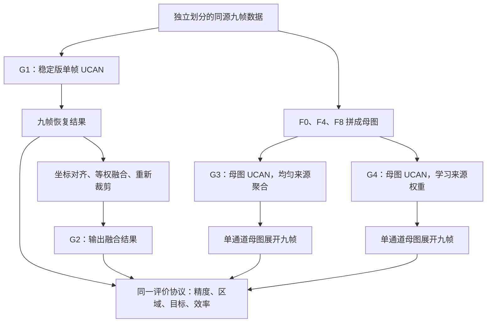
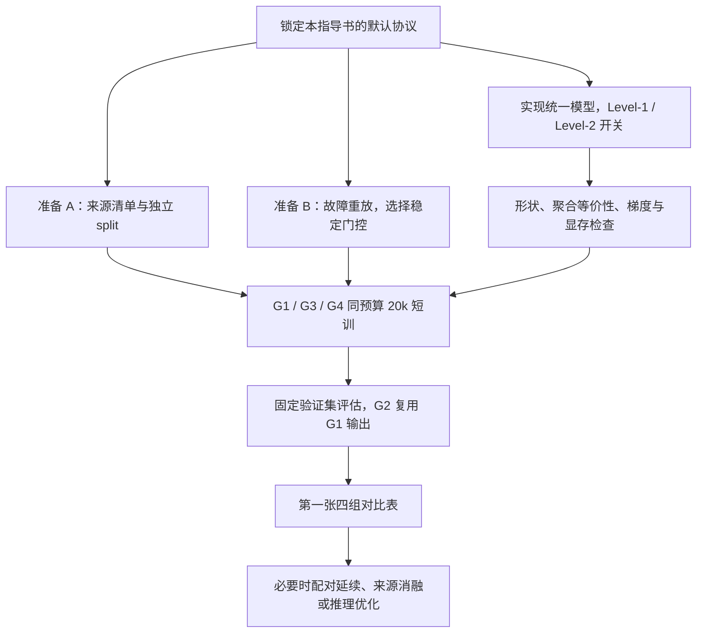
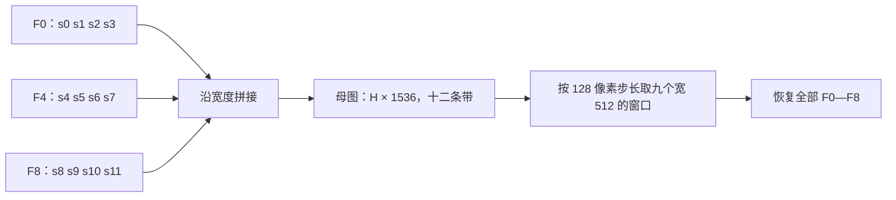
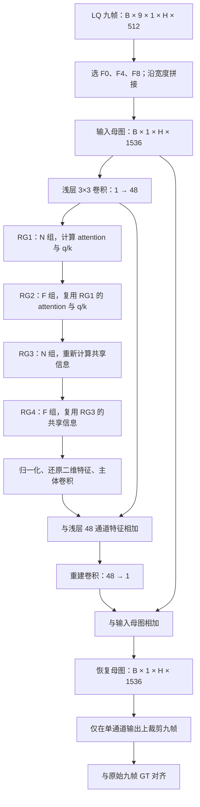
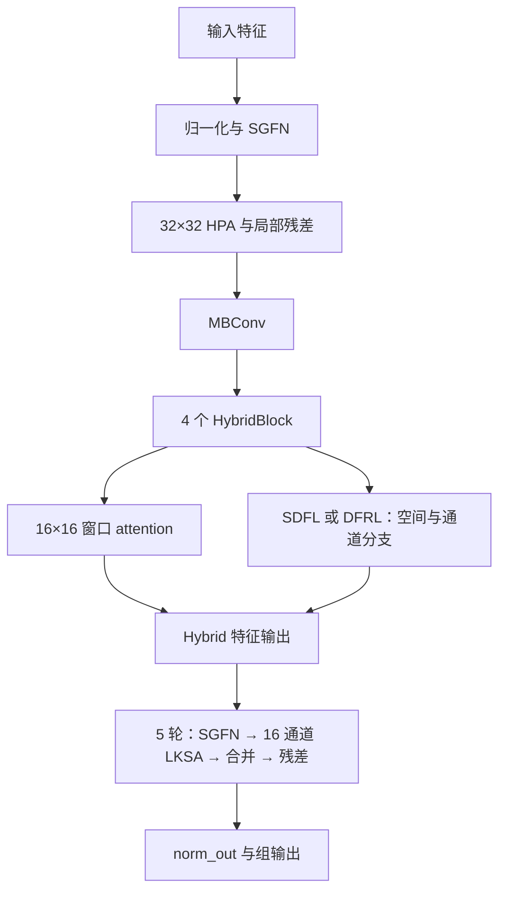
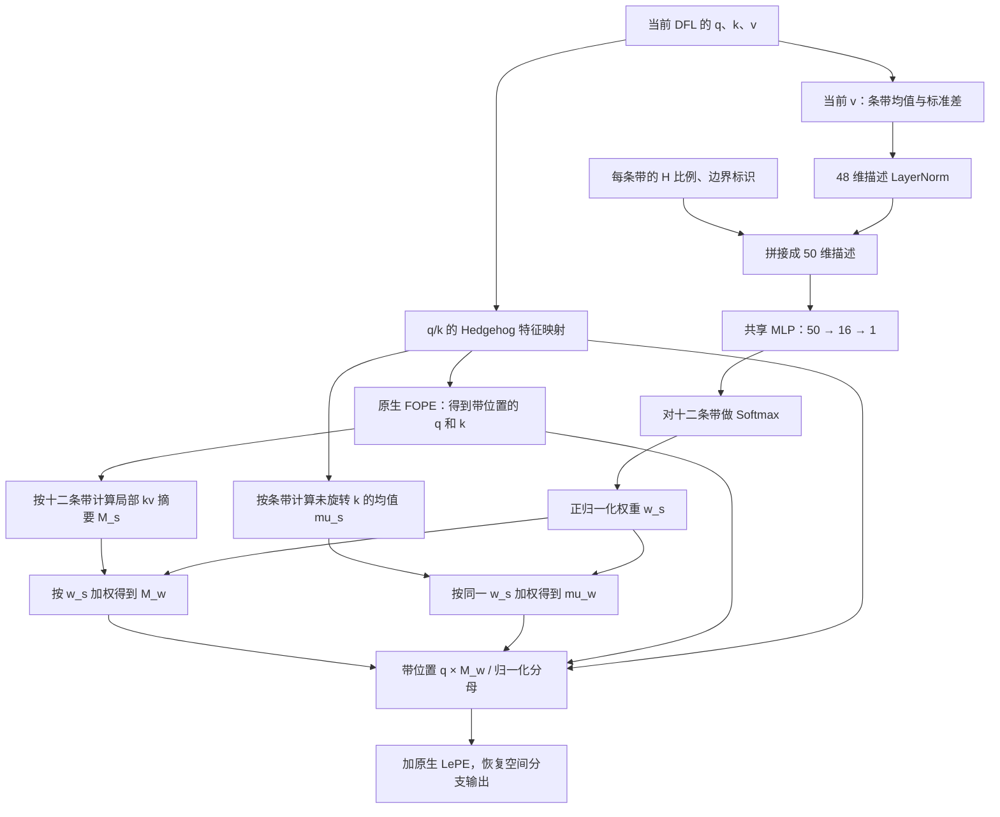
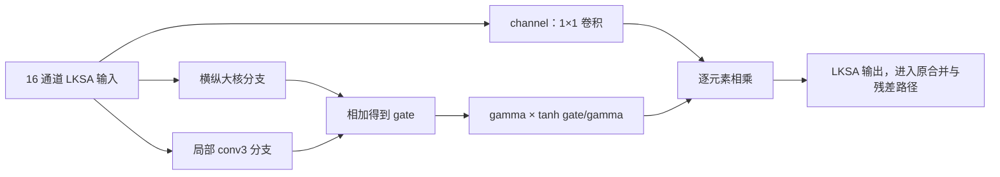
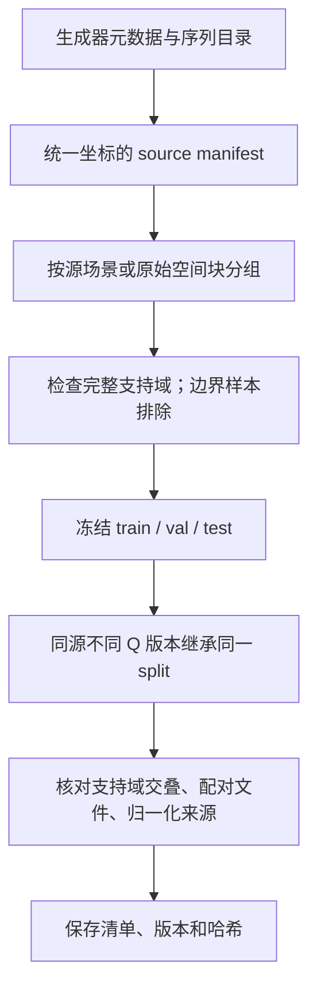
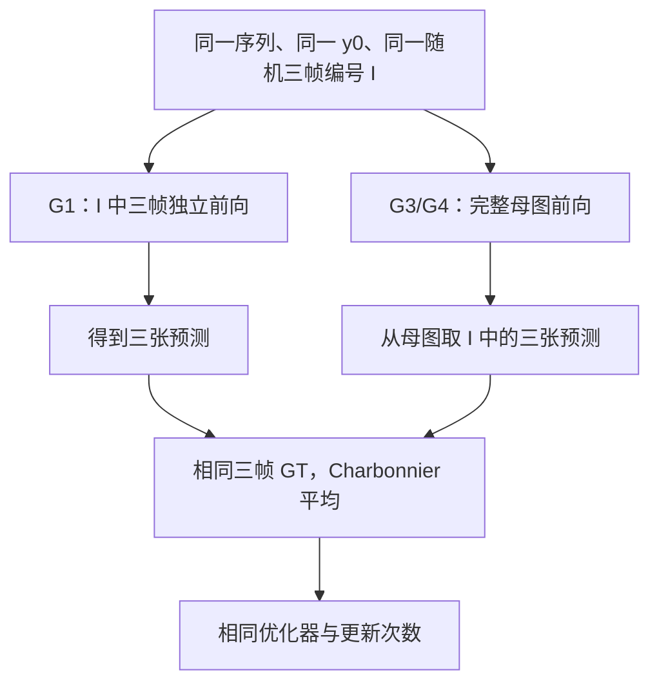
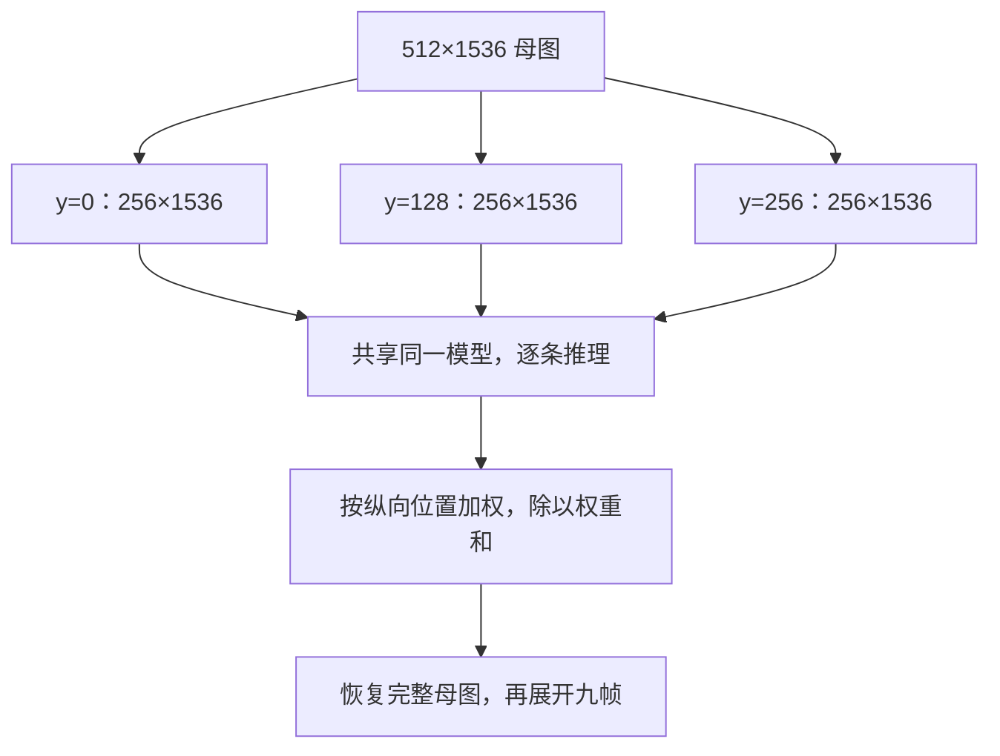

# UCAN 序列恢复实验指导书

日期：2026-11-16。适用硬件：双 RTX 4090，单卡 24 GB。本文用于原型开发、实验执行及导师讨论。

**研究主线：利用滑窗几何组织宽幅上下文，通过条带质量条件化聚合改善单比特 SAR 恢复，同时减少重复区域的网络计算。**

本指导书依据 Argon v2 及后续讨论制定。文中的新增类名、配置项和产物名称是待实现接口；现有仓库已经具备单帧 UCAN、训练框架、评估工具和故障诊断工具。第一轮交付是三个训练配置、四组评估结果。

阅读顺序：讲解模型可看第 1—5 节；编写原型看第 3—8 节；执行实验看第 9—13 节。图使用 Typora 支持的 Mermaid 代码块，公式使用 `$...$` 和 `$$...$$`。

## 1. 总体方案：两个模型级别、四组结果

### 1.1 首轮实验表

| 编号 | 名称 | 网络输入与处理 | 新增训练 | 比较用途 |
|---|---|---|---|---|
| G1 | Single | 九帧分别通过稳定版单帧 UCAN | 一份权重 | 单帧恢复基准 |
| G2 | Single + Fusion | 复用 G1 九帧输出，按地面坐标等权融合后裁回九帧 | 无 | 简单输出融合强基准 |
| G3 | Mother / Level-1 | 拼接母图，原生全局聚合，重建后展开九帧 | 一份权重 | 更宽上下文与去重复处理 |
| G4 | Mother + Quality / Level-2 | G3 加条带可靠性预测与质量加权聚合 | 一份权重 | 新模块的增量贡献 |

G1、G3、G4 使用相同稳定底座和独立数据划分。第一轮默认原生 FOPE、同一基础损失和同一精度。G2 复用 G1 的检查点及输出。



### 1.2 执行主线



这里的并行指工作可以同步推进；开发时无需等待六组冻结诊断全部结束。冻结权重检查作为输入与运行成本检查即可。

## 2. 数据几何：九帧与十二条带

### 2.1 坐标约定

采用零基、左闭右开坐标。图像高度为距离向，宽度为当前数据的方位滑窗轴。帧宽 512，滑窗步长 128，母图宽 1536。

$$
F_t=\mathcal{M}[:,128t:128t+512],\qquad t=0,\ldots,8.
$$

$$
\mathcal{S}_s=[128s,128(s+1)),\qquad s=0,\ldots,11.
$$

| 帧 | 母图横坐标 | 覆盖条带 |
|---|---|---|
| F0 | [0, 512) | s0—s3 |
| F1 | [128, 640) | s1—s4 |
| F2 | [256, 768) | s2—s5 |
| F3 | [384, 896) | s3—s6 |
| F4 | [512, 1024) | s4—s7 |
| F5 | [640, 1152) | s5—s8 |
| F6 | [768, 1280) | s6—s9 |
| F7 | [896, 1408) | s7—s10 |
| F8 | [1024, 1536) | s8—s11 |



横向 H–L–H 是质量来源的总体布局。区域标签按生成器真实索引投影；历史审查记录的名义边界为 x=513、1025，不能直接用帧边界替代。

### 2.2 首轮固定输入构造

默认 `fold_mode=anchor_concat`：从原始 LQ 的 F0、F4、F8 拼接母图，后续三组使用同一读取和归一化规则。九帧坐标均值折叠保留为 `overlap_mean` 消融，不与首轮主表混用。

所有 LQ/GT 使用相同纵向裁剪起点 y0。H=64 时，y0 从 0—448 均匀抽样；全宽保留，不翻转、不旋转。验证使用固定整幅输入或预先固定的长条切块规则。

**GT 保留原始九帧。** 母图输出裁回目标帧后，与该帧原 GT 计算损失和指标；这自然保留了历史数据中少量重叠区 1 灰度级差异。

### 2.3 数据返回接口

建议新增序列数据集 `SARSequenceDataset`，供三种训练配置共同使用。

| 字段 | 单样本形状 / 类型 | 作用 |
|---|---|---|
| `lq_seq` | [9, 1, H, 512]，float32 | 原始九帧配对长条 |
| `gt_seq` | [9, 1, H, 512]，float32 | 原始九帧目标 |
| `quality_desc` | [12, 2]，float32 | H 来源比例和边界邻域标识 |
| `sequence_name` | 字符串 | 追溯来源 |
| `source_group` | 字符串 | 独立场景或空间块编号 |
| `crop_top` | 整数 | 母图纵向裁剪起点 |
| `supervised_frames` | 三个不重复帧编号 | 首轮同步监督采样 |

母图由模型侧的纯几何函数构造，避免数据集与推理脚本分别实现一套拼接逻辑。无需在训练数据返回中同时复制母图和九帧张量。

## 3. Level-1：规范母图 UCAN

### 3.1 整体结构



骨干沿用当前 UCAN：C=48，4 个 ResidualGroup，share=[N,F,N,F]，Hybrid 窗口 16×16，HPA 窗口 32×32，DFL 单头。每组 4 个 HybridBlock、5 个 LKSA。使用同分辨率残差恢复分支。

### 3.2 ResidualGroup 内部



本图用于标明关键处理和修改位置，不展开 HybridBlock 内的所有归一化与残差连接。实际前向顺序沿用现有源码。Level-2 修改 DFL 空间聚合，稳定化修改 LKSA，其他路径保持同一实现。

### 3.3 展开与输出融合

母图展开为确定性切片：每帧从 x=128t 开始取 512 列。训练时只生成需要监督的帧视图，评估时输出全部九帧。不要在 48 通道特征层复制九份特征。

G2 的输出融合先把 G1 的九张恢复浮点图放到共同地面坐标，再按覆盖计数平均，最后裁回九帧。评价前统一裁剪至 [0,1]、转换 uint8。保留浮点中间结果，使融合不受多次 uint8 取整影响。

## 4. Level-2：条带可靠性与质量加权聚合

### 4.1 模块位置和共享范围

首轮在全部 16 个 HybridBlock 的 DFL 空间分支启用相同结构的质量模块：8 个 SDFL、8 个 DFRL。每个模块有独立参数；同一模块内部，十二条带共享一个预测器。组间 q/k 共享仍沿用原接口，各模块根据自身 v 特征预测权重。

这里“共享预测器”指跨条带共享，不指十六层全部共用参数。由 `quality_enabled` 一键切换 Level-1 / Level-2，通道注意力分支和 LePE 保持原生形式。



### 4.2 形状与公式

省略 batch 和单头轴，N=H×1536，d=24。原始投影 q、k、v 的形状为 [N,24]；Hedgehog 映射后 q、k 为 [N,48]，v 仍为 [N,24]。

每条带包含 N_s=H×128 个位置：

$$
M_s=\frac{1}{N_s}\sum_{j\in\mathcal S_s}(P_j\phi_k(k_j))v_j^\top,
\qquad
\mu_s=\frac{1}{N_s}\sum_{j\in\mathcal S_s}\phi_k(k_j).
$$

M_s 形状为 [48,24]，mu_s 为 [48]。FOPE 作用于分子使用的 q/k；分母继续使用未旋转的 Hedgehog q/k，和现有实现一致。

可靠性预测使用当前模块、位置变换之前的 v 统计：

$$
\bar v_s=\operatorname{mean}_{j\in\mathcal S_s}v_j,
\qquad
\sigma_{v,s}=\sqrt{\operatorname{mean}_{j\in\mathcal S_s}(v_j-\bar v_s)^2+10^{-6}}.
$$

$$
z_s=\left[m_s^{\mathrm H},m_s^{\mathrm{edge}},
\operatorname{LN}\!\left([\bar v_s,\sigma_{v,s}]\right)\right]\in\mathbb R^{50}.
$$

只对 48 维特征统计做 LayerNorm，质量标签在归一化之后拼接。统计在 FP32 中计算，使用总体方差；保留统计分支梯度。

$$
a_s=W_2\operatorname{GELU}(W_1z_s+b_1)+b_2,
\qquad
\tilde w_s=\operatorname{softmax}_{s=0,\ldots,11}(a_s).
$$

$$
M_w=\sum_s\tilde w_s M_s,
\qquad
\mu_w=\sum_s\tilde w_s\mu_s.
$$

$$
o_i=\frac{(P_i\phi_q(q_i))^\top M_w}
{\phi_q(q_i)^\top\mu_w+\epsilon}
+\operatorname{LePE}(v)_i,\qquad\epsilon=10^{-6}.
$$

上式把特征向量记为列向量；代码按 batch 矩阵乘法实现。十二条带同面积，Softmax 权重直接加权各条带均值。若后续出现不同面积条带，需显式纳入面积权重。

**空间分组实现要点：** 先将 [B,H×W,d] 还原为 [B,H,12,128,d]，再沿 H 和条带内宽度归约。不能直接把展平序列连续切成十二段；后者得到的是行优先的片段，不是竖直条带。

### 4.3 初始化与参数预算

W1 按常规方式初始化，W2 和 b2 置零，初始权重为 1/12。此时聚合与原生全局均值在数学上等价；验收采用浮点容差。

**零初始化在整个 UCAN 全局初始化之后执行。** 当前 UCAN 构造函数末尾调用 `self.apply(self._init_weights)`，会重新初始化 Linear。实现时在该步骤完成后统一重置所有可靠性预测器的输出层，或者在骨干初始化后挂载预测器。

第一步反向中 W1 梯度为零是零输出层初始化的正常现象；检查 W2 梯度，并在后续更新中检查 W1 是否获得梯度。

采用带 affine 的 LayerNorm(48)、Linear(50,16)、GELU、Linear(16,1)：

| 部件 | 参数量 |
|---|---:|
| LayerNorm | 96 |
| 第一层 Linear | 816 |
| 第二层 Linear | 17 |
| 每个预测器 | 929 |
| 16 个预测器合计 | 14,864 |
| 基于现有 683,817 参数的总量 | 698,681，约 0.699M |

这是上述明确实现的预算，完成代码后以实际模型计数复核。稳定门控 gamma 为配置常量，不增加参数。

### 4.4 质量描述的生成

由每条序列对应的真实生成索引投影得到二值 H 来源掩膜，再对每个 128 列条带求均值，得到 H 比例。对历史 x=513、1025 边界，H 比例依次为：

`[1, 1, 1, 1, 1/128, 0, 0, 0, 127/128, 1, 1, 1]`。

此数组仅适用于该历史布局；读取 manifest 中的边界字段生成，不在网络内部写死。

第一版使用边界两侧各 32 px 的固定邻域作为 `edge` 提示：条带与任一边界邻域相交即置 1。它是明确的边界位置先验。若生成器已有可信的过渡范围元数据，可替换该字段，版本写入 manifest。评价时边界带也采用同一预先固定定义，并标记为名义边界邻域。

记录每层十二个权重、H/L 来源的总权重及归一化熵；用于判断预测器是否在学习。无需预设所有层都必须偏向 H。

## 5. 统一稳定底座与位置编码

### 5.1 LKSA 有界门控

$$
g(x)=\operatorname{large\_kn}(x)+\operatorname{conv3}(x),
\qquad
y=\operatorname{channel}(x)\odot\gamma\tanh(g(x)/\gamma).
$$



先测试 gamma=2 和 4，使用保存的 129507 现场与固定正常诊断样本。记录末端特征最大值、输出有限性、正常样本 PSNR 和亮点峰值误差。两者都通过时，优先选择正常输出偏移较小者。选定 gamma 后，三个新训练组统一使用。

正常样本使用训练/诊断来源，最终测试集不参与 gamma 选择。短程稳定性观察并入启动检查与首轮训练；仅在出现异常时扩大专门诊断。

### 5.2 FOPE 默认与可选消融

默认 `fope_mode=native`，沿当前 H×W 展平索引计算位置编码，允许模型在长条训练中适配。

可选 `block_local`：将宽度按三个 512 列区段重排，在每个 H×512 子块内部计算 q/k 的 FOPE，再还原母图顺序并进行全局聚合。该模式重置各子块局部坐标；跨区段相同局部坐标共享相位。它是可选的位置编码设计，不作为默认的兼容性修补。

首轮主表统一采用 native。block_local 留给配对消融，不增加第一轮主配置数量。

## 6. 独立数据与训练样本契约

### 6.1 来源清单与划分

优先利用生成器提供的源场景、完整回波支持域和坐标元数据。划分有两种可选方式，开始训练前选定一种：

| 模式 | 使用方式 | 适合的研究问题 |
|---|---|---|
| 场景留出 | 整个源场景分配到 train、val 或 test | 未见场景的恢复能力 |
| 空间块隔离 | 在同场景内划定区域，完整支持域必须落在所属区域内 | 同域未见地面的恢复能力 |

空间隔离同时检查距离和方位来源范围，使用完整回波支持域而非仅 512 输出范围。跨分界的样本放入 `excluded`，避免相邻支持域把两侧重新连接。同一来源的全部 Q 版本进入同一集合。场景留出方案先查看各场景的样本量和内容分布，再冻结清单。

`source_manifest.csv` 至少包含：sequence、scene、source_group、支持域四边界、LQ/GT 路径、数据版本、归一化版本、H/L 投影边界、split、排除原因。坐标统一采用一种零基半开区间约定，并保留生成器原始字段用于追溯。



现有 PNG 可作为固定预处理条件下的首轮基准。若重新生成未知场景数据，归一化和生成参数使用训练或独立标定数据确定，并记录与旧 PNG 基准的区别。

### 6.2 三个模型的配对初始化

独立划分上的正式短训从头开始。先创建一份公共稳定 UCAN 初始化，再将相同骨干张量复制到 G1、G3、G4。G4 的可靠性头独立初始化并最后归零输出层。核对公共参数键和值一致。

已有 300k 权重用于几何和推理检查；这类结果保存在诊断目录。初始条件相同，比仅重复设置随机种子更可靠，因为新增模块会消耗额外随机数。

## 7. 公平短训：像素预算与监督目标同时对齐

### 7.1 首轮推荐：同步三帧监督抽样

每个 rank、每次更新抽取 B 条序列，B 初值为 1。对每条序列抽取共同 y0，并从 0—8 中均匀无放回抽取三个帧编号 I。

- G1：这三帧的 H×512 LQ 独立送入网络，计算对应三帧 GT 损失。
- G3/G4：F0/F4/F8 拼接完整 H×1536 输入，只在输出的相同三个帧位置 I 上计算 GT 损失。
- 三组使用相同序列、y0、I；验证和测试均评价全部九帧。

这样每次更新的网络输入像素数相同，监督位置和目标也相同。母图中的额外唯一空间内容是待研究的上下文差异。



设单帧平均损失为 ell_t，则：

$$
L_I=\frac{1}{3}\sum_{t\in I}\ell_t,
\qquad
\mathbb E_I[L_I]=\frac{1}{9}\sum_{t=0}^{8}\ell_t=L_9.
$$

每帧入选概率为 1/3，因此这是九帧等权监督的无偏抽样，保留原九帧重数对应的期望目标。每步实际重数随 I 变化。采样随机流独立于模型随机流，采用可重放采样计划，续训保存采样位置和随机状态。

### 7.2 三种监督模式

| 模式 | 用途 | 定义 |
|---|---|---|
| `sampled_frames` | 首轮 G1/G3/G4 主比较 | 同步抽三帧，目标和像素预算对齐 |
| `all_frames` | 后续训练与损失抽样消融 | 输出九帧全部求平均，确定性覆盖重数 |
| `mother_uniform` | 地面等权消融 | 母图每个位置等权；GT 折叠方式显式固定 |

九帧全监督的条带重数为 `[1,2,3,4,4,4,4,4,4,3,2,1]`，总和 36。GT 完全一致时，母图损失按该重数加权并除以总权重，与展开九帧平均等价。实际主实验直接使用原九帧 GT，避免依赖完全一致假设。

Charbonnier 沿用当前仓库定义：

$$
\rho(r)=\sqrt{r^2+10^{-9}}.
$$

`eps` 是根号内直接相加的值。首轮不加入小波、重叠一致性等辅助损失。

### 7.3 双卡预算示例

| 项目 | G1 | G3 / G4 |
|---|---:|---:|
| 每卡源序列数 | 1 | 1 |
| 每卡网络输入 | 3×1×64×512 | 1×1×64×1536 |
| 双卡总输入像素/更新 | 196,608 | 196,608 |
| 每卡监督目标 | 相同三帧 | 相同三帧 |
| 20k 输入像素曝光 | 3,932,160,000 | 3,932,160,000 |
| 20k 源序列抽样次数 | 40,000 | 40,000 |

B 增大时三组同步增加；若单组显存不足，使用梯度累积匹配有效源序列数与更新次数。该像素量也等于旧 global batch=12、128×128 的每步像素量，但源样本数和空间相关性不同，因此学习率作为新协议的起点单独固定。

## 8. 建议配置与实现入口

### 8.1 首轮默认参数

以下为新实验的建议起点，不代表历史已验证最优设置。

| 项目 | 默认值 |
|---|---|
| 数据 | 原 H/L 版本，新独立 split |
| 模型 | 稳定 UCAN；G3 quality=false，G4 quality=true |
| 输入 | H=64，母图 W=1536；训练共同纵向裁剪 |
| 每卡 batch | 1 条源序列；G1 内部展开三个独立样本 |
| 精度 / GPU | FP32，双卡 DDP；三个配置使用相同后端开关 |
| 初始化 | 公共随机骨干，seed=42；G4 输出层归零 |
| 优化器 | Adam，lr=1e-4，betas=[0.9,0.99]，weight_decay=0 |
| 第一轮预算 | 20,000 个优化器更新 |
| 学习率调度 | 12k、17k 各乘 0.5 |
| 损失 | Charbonnier，eps=1e-9，sampled_frames |
| 验证 / 保存 | 每 2,000 更新；保存初始评价及 best/last |
| 主选权指标 | 固定验证集九帧平均 PSNR |
| 日志 | 每 100 更新记录损失、LR、步耗、显存；定期记录条带权重 |
| EMA / warmup | 首轮关闭 |
| 辅助损失 | 首轮关闭 |
| FOPE | native |
| 质量头 | 50→16→1，GELU，16 个模块各自独立 |
| gamma | 由准备实验在 2、4 中选择，三组一致 |

20k 是独立 pilot。若曲线仍在明显改善，三组按同一规则延续到 40k：恢复 optimizer 和采样状态，20k 后 LR 保持 2.5e-5，30k、36k 各减半。这是明确的延续阶段，不与从头规划的 40k 调度混称。出现需要整体调整 LR 的情况，三个训练配置采用相同的新版本协议。

### 8.2 待实现文件与职责

| 建议入口 | 职责 |
|---|---|
| `basicsr/data/sar_sequence_dataset.py` | 九帧读取、共同纵向裁剪、来源描述和同步监督编号 |
| `basicsr/archs/ucan_arch.py` | 可选稳定门控、质量头、条带摘要和 FOPE 模式 |
| `basicsr/archs/ucan_sequence_arch.py` | 母图包装、fold/unfold、配置入口 |
| `basicsr/models/ucan_sequence_model.py` | 采样/全九帧损失、元数据传递、分布式验证 |
| `scripts/build_sar_source_split.py` | manifest 与独立划分、交叠检查 |
| `scripts/eval_sar_sequence.py` | G1—G4 统一评估、融合、区域与效率记录 |
| `options/SAR/sequence/` | G1/G3/G4 各自训练及评价配置 |

这些名称用于分工，不是已存在的命令。旧单帧默认配置继续对应原生功能；稳定化和序列选项显式开启。

可靠性标签随当前 batch 显式传入；避免把某次输入的质量标签保存在会跨 batch 复用的可变全局状态中。DDP 验证按序列分片、最终归约真实样本数。

### 8.3 开发验收

| 验收对象 | 必查结果 |
|---|---|
| 坐标与 fold/unfold | 用递增坐标图确认每帧 x 起点、条带轴和 y0；输入输出范围正确 |
| GT 对齐 | 原九帧目标不被错误替换为一个拼接 GT；同一 y0 |
| 均匀权重 | G3/G4 共享骨干参数时初始输出在 FP32 容差内一致；可用 atol=1e-5、rtol=1e-4 起检，异常时定位归约差异 |
| 权重归一化 | 每层每样本十二权重和为 1；分子分母使用同一权重 |
| 梯度 | 第一步 W2 有可用梯度；更新后 W1 梯度可达；输入统计梯度有限 |
| 共享接口 | N→F 仍传递原 q/k、attention；标签不改变共享张量的坐标顺序 |
| 稳定底座 | 失败现场与正常样本重放记录；新训练 loss/梯度有限 |
| 保存恢复 | 权重、优化器、LR、采样计划位置与 RNG 状态可恢复；新质量头不被误重置 |
| 显存 | 完成前向、反向、优化器更新后记录峰值；再检查验证模式 |
| 两卡流程 | 不等长验证分片正常归约，所有序列各评价一次 |

优先验收能揭示坐标、梯度和训练状态问题的行为，不为纯包装接口堆叠重复测试。

## 9. 显存与整图推理协议

### 9.1 显存预估

FP32、batch=1 时，四张 16×16 窗口、2-head 的共享 attention 张量合计约：

| 输入 | 这四张共享 attention 的合计 |
|---|---:|
| 64×1536 | 0.75 GiB |
| 128×1536 | 1.50 GiB |
| 256×1536 | 3.00 GiB |
| 512×1536 | 6.00 GiB |

这些是指定四张张量的静态占用。运行中还包括其他组、HPA、q/k/v、临时结果及反向保存张量，整体峰值以实测为准。checkpointing 可用于训练内部激活，但返回并共享的 attention 仍需保留。

### 9.2 推理模式选择

1. 先测 B=1、512×1536 母图完整前向，包括 G3 和 G4。
2. 二者均可运行，则统一采用 `full`。
3. 若需要长条推理，主比较统一使用 `stripe`；G1 的每帧也采用相同纵向切片规则，另存历史原生整帧结果作为补充。

建议 stripe 首试高 256、步长 128，对 512 高输入使用 y 起点 [0,128,256]。不足时可统一改为高 128、步长 64。每个切片保持完整横向覆盖；使用严格正的平滑纵向权重归一化融合，确保图像上下边缘的权重和非零。



每块重新计算全局摘要和条带统计，因此 stripe 是独立推理模式。首版每块使用局部 y 原点计算原生 FOPE；把高度、步长、权重函数、坐标约定写入评价配置。统一模式下再比较各模型的精度和端到端开销。

效率报告以实际完成九帧产物为单位。母图唯一输入面积是九帧总面积的三分之一，是计算节约的几何动机；速度、峰值显存和含重叠切片后的实际工作量单独测量。

## 10. 评价方法与首轮表格

### 10.1 数据与检查点

20k pilot 的模型选择与路线判断使用固定验证集。每组按九帧平均验证 PSNR 选择 best；并额外报告统一 20k 的 last，便于观察选权影响。G2 使用 G1 同一 checkpoint。F4 和区域指标用于解释，不在不同指标之间事后切换选权规则。

方向确定后，固定配置与选权规则，再进行独立 test 评价。最终报告按源场景/空间块汇总，重复帧不作为独立统计单位。

### 10.2 指标定义

| 类别 | 首轮输出 |
|---|---|
| 常规恢复 | uint8、crop_border=0 的逐帧 PSNR/SSIM；F0—F8 均值；九帧均值 |
| 关注区域 | F4；名义 L 内部；H/L 边界邻域；H 内部 |
| 唯一地面 | 对每个唯一坐标等权统计母图 MSE/PSNR，另报条带指标 |
| 目标保真 | 固定 GT ROI 的峰值误差、峰值位置偏差、局部能量与弱点对比度 |
| 模块行为 | 各层条带权重、权重熵、饱和/有限性统计 |
| 效率 | 同设备、同精度的九帧纯网络时延、端到端时延、峰值 allocated/reserved |

区域指标先聚合指定区域的平方误差再计算 PSNR；不把区域 mask 外填零后当整图计算。区域 SSIM 先计算 SSIM map，再按窗口完整位于目标区域的中心取均值，并记录窗口有效边界规则。

名义 L 区由真实掩膜确定；去除两侧 32 px 邻域得到 L 内部。H 内部类似。区域比 F4 更精确，因为 F4 与真实来源边界可能存在 1 px 索引差。

唯一地面指标为单独口径：输入和 GT 均按九帧同坐标均值折叠；G1/G2 的恢复图也按同坐标均值折叠，G3/G4 直接使用预测母图。统一 uint8 后计算或统一保留 float 计算，表头必须标明。推荐同时输出 float 母图 MSE/PSNR及常规 uint8 逐帧指标。

由于 G2 正是 G1 输出的折叠再展开，两者在此唯一地面融合口径下应一致；其差异体现在逐帧结果。这也是检查评价实现的有用关系。

GT ROI 从训练/验证阶段预先定义，固定显示范围；已有 PNG 的强度单位用于归一化幅度保真。涉及系统分辨率、PSLR/ISLR 时另用孤立点目标或受控仿真，首轮不增加该前置工作。

### 10.3 时延测量

固定 GPU、dtype、attention 后端设置、batch 和推理模式。预热后进行同步计时，分别记录纯网络和包含 fold/unfold/fusion 的内存中流水线时延；磁盘读写另报端到端值及缓存条件。使用固定代表序列集，记录 P50/P95 与均值。

G2 的完整流水线时间包含 G1 九帧恢复加融合，不能只把复用已保存图像的融合耗时当作总时延。G1 主口径使用逐帧 batch=1；如另测批量九帧吞吐，单独列行。

### 10.4 核心结果表模板

| 方案 | checkpoint | 九帧 PSNR/SSIM | F4 PSNR | L 内部 PSNR | H 内部 PSNR | 九帧时延 | 峰值显存 |
|---|---|---|---|---|---|---|---|
| G1 Single | 待填 | 待填 | 待填 | 待填 | 待填 | 待填 | 待填 |
| G2 Single + Fusion | 同 G1 | 待填 | 待填 | 待填 | 待填 | 待填 | 待填 |
| G3 Mother | 待填 | 待填 | 待填 | 待填 | 待填 | 待填 | 待填 |
| G4 Mother + Quality | 待填 | 待填 | 待填 | 待填 | 待填 | 待填 | 待填 |

表旁明确标注 split 版本、seed、训练更新数、像素预算、监督模式、完整/切块推理、图像指标口径。另附 F0—F8 曲线、固定场景 ROI 和 G4 十二条带权重热图。

## 11. 操作步骤与交付物

### 阶段 A：数据和骨干准备

1. 冻结数据版本，生成 manifest 与独立 split，核对空间支持域。
2. 用故障现场和固定正常样本选择 gamma；保存简短稳定化记录。
3. 明确边界字段和 32 px 邻域约定，生成十二条带描述。
4. 创建公共骨干初始化，记录哈希与配置。

交付：来源清单、三个 split、稳定化选择、公共初始化摘要。

### 阶段 B：统一原型

1. 完成序列数据集、fold/unfold、三帧监督模式。
2. 接入质量模块和配置开关，确认零初始化顺序。
3. 完成第 8.3 节的坐标、梯度、恢复及两卡验收。
4. 测一组完整训练步与验证前向的显存，确定 batch 和推理模式。

交付：G1/G3/G4 配置、可重放采样设置、运行自检记录。

### 阶段 C：首轮短训与评价

1. 三个配置分别训练到 20k；依可用 GPU 顺序运行即可，不要求三个作业同时启动。
2. 每 2k 统一验证，记录 best 和 last；保存模型、优化器、调度和采样状态。
3. 用 G1 的浮点九帧结果生成 G2。
4. 输出四组主表、F0—F8 曲线、H/L 分区结果、固定 ROI、效率和权重记录。

交付：第一张验证集四组对比表及模型决策。

### 阶段 D：按结果追加最少实验

| 主要观察 | 下一步 |
|---|---|
| G3 比 G1/G2 更好，G4 再有增益 | 保留完整方案，补质量标签与特征统计消融 |
| G3 有收益，G4 与其接近 | 检查质量头是否学到非均匀权重，再决定配对延续或简化模块 |
| G2 已有明显收益，G3 精度相近但更快 | 保留母图效率路线，并检查 G4 是否改善中心区域 |
| G4 主要改善 F4/L，H 轻微下降 | 看固定 ROI 和区域权衡，必要时调整权重强度或引入残差式质量调制 |
| 20k 三组仍在明显上升 | 按共同延续协议推进到 40k，保持比较配对 |
| 母图在某些场景明显退化 | 优先检查坐标/位置模式和边界；利用外侧替换定位，再做小规模配对修订 |

质量头后续消融顺序：全输入 → 仅特征统计 → 仅质量标签 → 常数标签/置乱标签。它直接区分来源标签和内容统计的贡献。必要时再加入均值/方差条件化对照和外侧内容替换。

## 12. 产物目录与复现记录

建议文档和清单放在：

```text
docs/experiments/ucan_sequence_pilot_v1/
    protocol.md
    source_manifest.csv
    train.txt
    val.txt
    test.txt
    stability_summary.csv
    startup_checks.md
    comparison_val.csv
    decision.md
    figures/
```

运行产物沿用仓库布局：`experiments/<实验名>/` 保存配置快照、训练日志、模型与状态；`results/<实验名>/<checkpoint>/` 保存逐帧、逐区域、逐序列和时延数据。推理模式写入配置快照或结果子目录。

每个运行记录：Git commit、环境版本、GPU 型号、split/manifest 哈希、公共初始化哈希、gamma、质量头设置、采样 seed 与恢复位置、实际 batch/累积步数、总更新数、实际步耗、检查点选择和推理方式。

建议命名：`ucan_seq_p1_g1_seed42`、`ucan_seq_p1_g3_seed42`、`ucan_seq_p1_g4_seed42`；G2 使用 `ucan_seq_p1_g1_seed42_fusion` 并引用同一 G1 权重。

## 13. 预算、里程碑与讲解提纲

### 13.1 资源预算

原 UCAN 400k 记录约 58 小时、双卡约 116 GPU·小时，可作为历史参考。新长条与质量头的步耗先测量，不直接按旧迭代数等比例承诺时间。

设三个配置的实测训练步耗分别为 t1、t3、t4 秒，三组 20k 的纯训练墙钟总时间为：

$$
T_{\mathrm{train}}=\frac{20000(t_1+t_3+t_4)}{3600}\ \mathrm{hours}.
$$

均使用双卡时 GPU·小时为上述值的两倍，另加验证和评价开销。先统计稳定运行 100 步后的步耗，再排实际训练时段。

| 里程碑 | 完成标志 |
|---|---|
| M0 | 独立清单与稳定门控确定 |
| M1 | 三配置都可完成训练更新、保存恢复、整序列验证 |
| M2 | 20k 四组主表及关键图齐全 |
| M3 | 选定结构，完成必要来源消融与独立 test |

### 13.2 向导师讲模型的五张图

1. **九帧—母图几何图：** 同一地面被多次覆盖，母图统一组织上下文。
2. **Level-1 总体结构图：** 拼接→UCAN→单通道展开，保留全部九帧输出。
3. **Level-2 聚合图：** 来源标签与当前特征统计预测条带权重，分子分母同步加权。
4. **训练预算图：** 同序列、同裁剪、同监督三帧，输入像素量对齐。
5. **四组结果图：** 单帧、输出融合、母图、质量母图分别回答什么问题。

可用的简短讲解：

> 我们把滑窗序列映射到统一地面坐标，在母图上恢复一次，再裁回九帧。原生 UCAN 提供内容相关的全局交互；新增模块进一步根据区域的质量来源和当前特征统计，学习十二条带的来源权重，并在全局聚合的分子和分母中一致使用这些权重。通过单帧、输出融合、母图和质量母图四组对照，分别衡量联合上下文、处理效率以及质量建模的收益。

## 14. 仓库依据与实现提醒

- [当前 UCAN 源码](../basicsr/archs/ucan_arch.py)：LKSA、SDFL/DFRL、共享路径与初始化顺序。
- [当前单帧配置](../options/SAR/train_ucan_single.yml)：现有骨干、优化器和指标协议。
- [当前单帧数据集](../basicsr/data/sar_single_dataset.py)：读取、归一化和配对裁剪。
- [Charbonnier 定义](../basicsr/losses/basic_loss.py)：根号内 eps 的实际含义。
- [当前评估脚本](../scripts/eval_sar.py)：逐帧、帧位置、逐序列输出。
- UCAN 数值诊断：历史提交 `5993b9e` 中的 `docs/UCAN_nonfinite_diagnosis_20261109.md`，记录 129507 失败现场与幅值路径。
- [独立研究审查（本地讨论归档）](tmp/Argon_v1_independent_review_20261114.md)：生成链路、来源坐标和跨集合交叠；该归档不随当前 Git 提交分发，仓库历史版本见 `bb5f45b`。
- 阶段成果汇报：历史提交 `8bbb9c5` 中的 `docs/阶段成果与后续路线_20261116导师讨论.md`，记录历史指标与 Git 演进。

工作区近期清理的历史文档可通过 `git show 提交号:文件路径` 查看；本指导书已包含首轮执行所需的主要参数和步骤。

本指导书固定原型和首轮实验协议；新增代码、模型训练、独立 split 和新实验数值将在实际执行中产生。实现时优先保证几何正确、可学习聚合、可重放训练和四组评价闭环。
