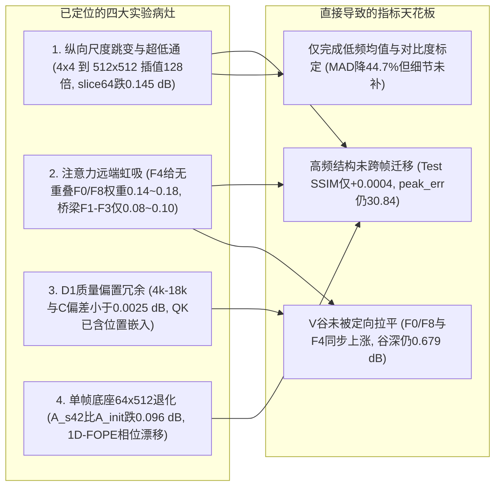
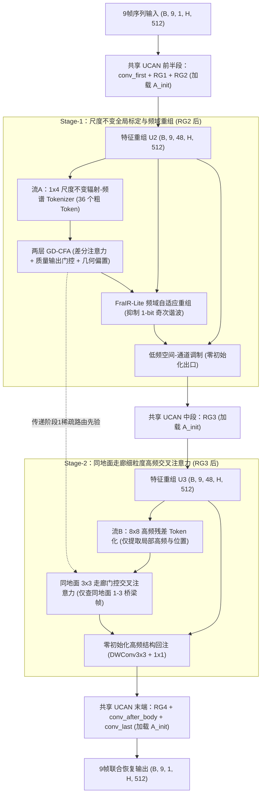
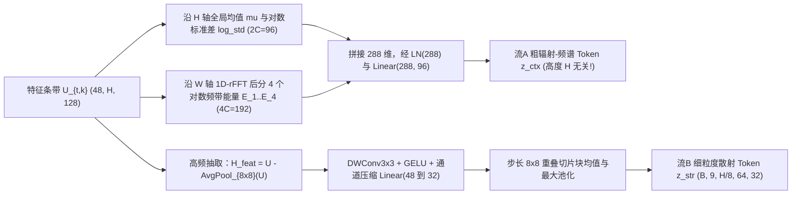
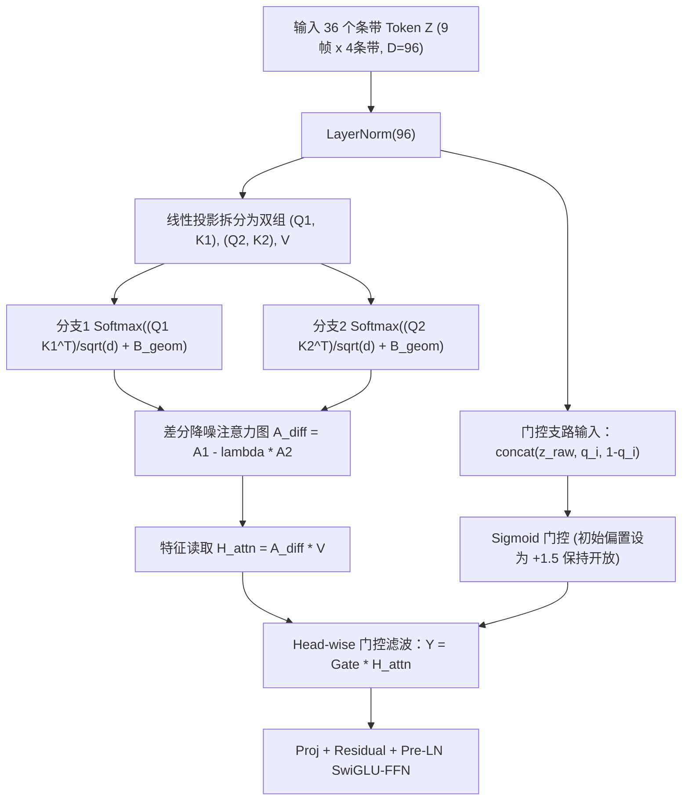
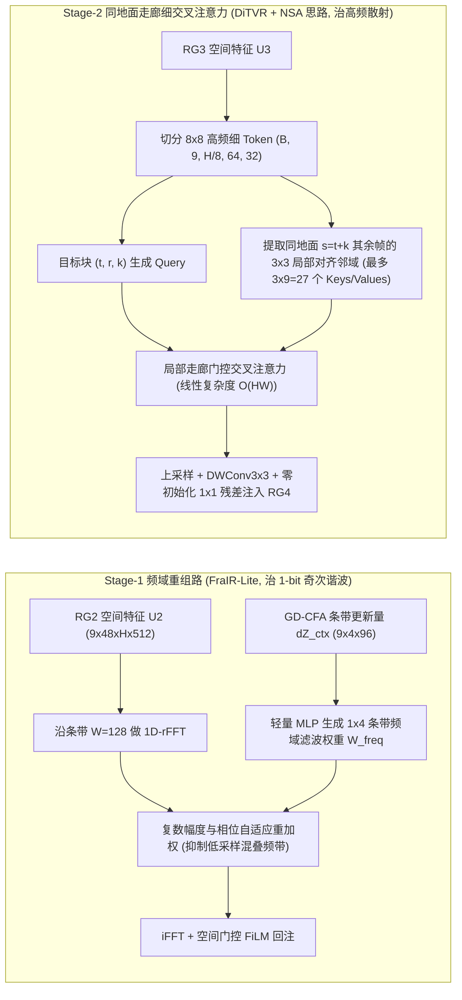

# 架构设计 A：基于当前跨帧 Token 实验演进的 `UCAN-GDT`

> **设计定位**：立足当前 `UCANSequence` 与 `CrossFrameTokenInteraction` 在 `scene_split_v1` 上已完成（`A_init` / `A_s42` / `B_s42` / `C_s42`）及在训（`D1_s42` 至 `18k`）的实测诊断，保持公共单帧底座 `A_init`（`683,817` 参数）**可热启动复用**的工程约束，升级为**门控差分层次 Token Transformer（`UCAN-GDT`：UCAN with Gated-Differential Hierarchical Token Transformer）**。  
> **阅读约定**：文中定量数值均引自仓库实测日志与评估 JSON；新模块性能影响为基于机制的工程推论，待后续消融实验验证。

---

## 1. 核心诊断：当前实验到底卡在哪里？

### 1.1 已验证实测基线汇总（`scene_split_v1`，双卡 RTX 4090）

| 实验组 | 参数量 | Val 九帧 PSNR / SSIM | Test 九帧 PSNR / SSIM | Test $F_4$ PSNR / SSIM | Test $F_4$ 中心 (`k=1,2`) | Test V 谷深 $\overline{F_{0,8}}-F_4$ | Test 重叠 MAD | Test `peak_err` |
|---|---:|---|---|---|---|---:|---:|---:|
| `LQ` 1-bit 输入 | — | `19.6335 / 0.6421` | `21.6359 / 0.7187` | `21.3869 / 0.6969` | `21.3107 / 0.6899` | — | `0.000094` | — |
| `A_init` (`60k`, `128²`) | `683,817` | `21.1216 / 0.7014` | `23.7846 / 0.7681` | `23.4819 / 0.7473` | `23.4005 / 0.7406` | `0.5933 dB` | `1.6156` | — |
| `A_s42` (单帧 `64×512` 续训) | `683,817` | `21.0771 / 0.6978` | `23.6891 / 0.7644` | `23.3267 / 0.7427` | `23.2393 / 0.7359` | `0.7097 dB` | `1.8922` | `31.42` |
| `B_s42` (帧内 `16×16` mask) | `883,441` | `21.0685 / 0.6974` | `23.7029 / 0.7650` | `23.3556 / 0.7425` | `23.2849 / 0.7363` | `0.6878 dB` | `1.8038` | `31.72` |
| `B_s42 + Fusion` | `883,441` | `21.0730 / 0.6979` | `23.7292 / 0.7658` | `23.3755 / 0.7445` | `23.2823 / 0.7373` | `0.6903 dB` | `0.0000` | `30.87` |
| `C_s42` (全开放 `144×144`) | `883,441` | **21.2372 / 0.7027** | **23.8129 / 0.7655** | **23.4709 / 0.7452** | **23.3694 / 0.7384** | `0.6794 dB` | **0.9981** | `30.84` |
| `D1_s42` (`18k` Val 进度) | `890,369` | `21.1886 / 0.7000` | —（在训） | — | — | — | — | — |

> **关键发现**：`C_s42` 相比 `B_s42` 在 Val/Test 九帧取得 `+0.1688 / +0.1100 dB` 净增益、重叠一致性 MAD 骤降 `44.7%`，证明**特征层跨帧交互真实有效**；但 Test `SSIM (0.7655)` 仍低于 `A_init (0.7681)`，V 谷深度仅微缩 `0.0084 dB`（`0.6878 → 0.6794 dB`），距离目标 $Q(\hat{F}_0)\approx \cdots \approx Q(\hat{F}_8)$ 仍有本质差距。

### 1.2 实证故障因果链可视化



### 1.3 `C_s42` 实测数据可视化（Test 集 `F0–F8` V 谷曲线与 $F_4$ 注意力分布）

**1) Test 集逐帧 PSNR 曲线对比（dB）：`C_s42` 平行抬升但 V 谷形态未改观**

| 方案 | `F0` | `F1` | `F2` | `F3` | `F4` (谷底) | `F5` | `F6` | `F7` | `F8` | V 谷深 ($\overline{F_{0,8}}-F_4$) |
|---|---:|---:|---:|---:|---:|---:|---:|---:|---:|---:|
| `A_init` | `24.1309` | `23.9863` | `23.7364` | `23.5566` | `23.4819` | `23.5213` | `23.7146` | `23.9141` | `24.0194` | `0.5933` |
| `A_s42` | `24.0914` | `23.9146` | `23.6184` | `23.4184` | `23.3267` | `23.3815` | `23.6150` | `23.8542` | `23.9814` | `0.7097` |
| `B_s42` | `24.0972` | `23.9231` | `23.6339` | `23.4382` | `23.3556` | `23.4011` | `23.6282` | `23.8592` | `23.9896` | `0.6878` |
| `C_s42` | `24.1837` | `24.0015` | `23.7363` | `23.5499` | `23.4709` | `23.5323` | `23.7522` | `23.9724` | `24.1170` | `0.6794` |
| 增益 `C-B` | `+0.0865` | `+0.0784` | `+0.1024` | `+0.1117` | `+0.1153` | `+0.1312` | `+0.1240` | `+0.1132` | `+0.1274` | `-0.0084` |

**2) `C_s42` Test 集 $F_4$ 条带 $k=0$ ($s=4$) 对 `F0–F8` 平均注意力分布（实测 `f4_attn_16x9.npy`）**

```text
来源帧      地面角色         注意力权重   比例分布图 (每格 ≈ 0.01)
--------------------------------------------------------------------------
F0          两端全 H 锚点    0.1374      ██████████████        <-- 无空间重叠却高权虹吸
F1 (k3)     同地面 s=4 桥梁  0.1034      ██████████
F2 (k2)     同地面 s=4 桥梁  0.0827      ████████
F3 (k1)     同地面 s=4 桥梁  0.0761      ████████              <-- 真正同地面桥梁权重反低
F4 (k0)     自身全 L 目标    0.0784      ████████
F5          右邻过渡         0.0966      ██████████
F6          右邻过渡         0.1125      ███████████
F7          右邻过渡         0.1347      █████████████
F8          两端全 H 锚点    0.1781      ██████████████████    <-- 无空间重叠却获最高权重
```

---

## 2. 多维度演进策略与 2025–2026 顶会思想映射

针对上述四个物理与架构根因，在保持 `A_init` 主干可加载的同时，从五个维度进行精准替换：

| 问题维度 | 原版 `CrossFrameToken` 缺陷 | 演进方案 (`UCAN-GDT`) | 核心借鉴的 2025–2026 前沿论文 |
|---|---|---|---|
| **1. Token 化** | `AdaptiveAvgPool(2,4)` 导致 `H=64` 到 `H=512` 纵向压缩比跳变 8 倍，且抹平高频散射点 | **双流尺度不变 Token 化 (`RSD-Tokenizer`)**：粗流用尺度不变统计+频谱；细流用 `8×8` 高频残差块 | **NSA** (ACL 2025, 粗压缩+细选择协同) + **LWTformer** (CVPR 2026 Findings, 高低频解耦) |
| **2. 跨帧注意力** | 标准 Softmax 导致相干斑/边缘相似背景产生共模注意力弥散与 `F0/F8` 远端虹吸 | **差分跨帧注意力 (`DiffAttn`) + 跨层渐进聚焦 (`PFA`)** | **Differential Transformer** (ICLR 2025 Oral, 双 Softmax 相减抵消共模噪声) + **PFT** (CVPR 2025, 跨层聚焦) |
| **3. 质量条件化** | `D1` 在 logit 上加秩-1 标量 $d_i c_j$，与已含 `(t,k)` 的 `QK` 冗余 | **输出端查询依赖非对称 Sigmoid 门控**：直接调节更新量注入强度而非打分偏置 | **Gated Attention** (NeurIPS 2025 Oral/Best Paper, SDPA 后 Head-specific Sigmoid 门控消除虹吸) |
| **4. 信息回注** | `4×4 → H×512` 纯空间 FiLM（128 倍插值，仅低频标定） | **频空双路回注**：低频/谐波走频域重组适配器；高频走**同地面轨迹走廊细 Token 交叉注意力** | **FraIR** (CVPR 2026, 频域动态重组) + **DiTVR** (CVPR 2026, 轨迹对齐局部邻域 Token 路由) |
| **5. 骨干适配** | `FourierEmbedding` 按 1D `H*W` 编码导致 `H=64` 训练/`H=512` 测试相位漂移；单点 `RG2` 插入后半段感知不足 | **无新增参数 2D 轴向相位分解** + `RG2/RG3` 与 `RG3/RG4` **双阶段分级插入** + `H=64 → H=128` 课程 | **RoPE-Mixed** (ECCV 2024, 2D 轴向频率分解，供跨分辨率对齐) + **UCAN** (CVPR 2026) |

---

## 3. `UCAN-GDT` 总体架构（兼容 `A_init` 热启动）

将原版“RG2 后单点插粗粒度 4×4 FiLM”演进为**“低频全局标定在 `RG2` 后 + 高频对齐补全在 `RG3` 后”的两阶段渐进结构**，并全部保留零初始化恒等出口，确保第 0 步与 `A_init` 严格等价。



### 微创底座修复（零新增参数，直接治好 `A_s42` 退化）
1. **1D-FOPE 改 2D 轴向相位分解**：保持 `FourierEmbedding` 中 `sin_coef / cos_coef` 参数形状与 `A_init` 完全一致，仅将位置坐标生成从 `seq = arange(H*W)` 拆分为 `y_pos`（前半频率）与 `x_pos`（后半频率），彻底消除 `128×128 → 64×512 → 512×512` 的行跨度相位错位。
2. **高度课程微调（`15k + 5k`）**：前 `15k` 步保持 `H=64`（与现预算等价），末 `5k` 步在 `chunk=1` 下切换为 `H=128`（让 `large_window=32` 覆盖完整 4 个窗口且 `LKSA k=23` 无反射截断，4090 实测 `chunk=1, H=64` 仅需 `3.31 GiB`，扩至 `H=128` 仍远低于 `24 GiB`）。

---

## 4. 核心模块一：尺度不变辐射-结构双流 Token 化（`RSD-Tokenizer`）

原版 `GridPatchTokenizer` 对 `H/4 × 128` 做 `AdaptiveAvgPool(2, 4)`，导致 `H=64` 时每个 pool cell 覆盖 `8×32 px`，而推理 `H=512` 时覆盖 `64×32 px`（这也是 `B/C` 切片推理暴跌 `0.145~0.166 dB` 的直接原因）。`RSD-Tokenizer` 将表征拆为两条正交物理流：



- **流 A（尺度不变粗 Token）数学形式**：对于第 $t$ 帧第 $k$ 条带 $U_{t,k} \in \mathbb{R}^{C \times H \times 128}$，沿高度维度执行全高度一阶/二阶矩与距离向平均功率谱统计：

$$
g^{\text{ctx}}_{t,k} = \left[\mu_H(U_{t,k}),\; \log(\sigma_H(U_{t,k}) + 10^{-5}),\; \operatorname{BandPool}_4\!\left(\log(1 + \mathbb{E}_H|\mathcal{F}_W(U_{t,k})|^2)\right)\right] \in \mathbb{R}^{6C}
$$

无论输入高度 $H=64, 128$ 还是 $512$，该描述子的统计尺度与物理频带**完全不变**，同时显式编码了 $Q_L=1.5$ 低采样率在距离向引入的频谱混叠特征。

- **流 B（散射体细 Token）**：在 `Stage-2` 对局部高频残差 $U - \operatorname{AvgPool}_{8\times 8}(U)$ 按固定物理像素网格 `8×8` 提取特征，**固定网格物理尺寸而非固定网格总数**，保证训练（`H=64` 得 `8×64` 细块）与整帧测试（`H=512` 得 `64×64` 细块）感受野像素尺度 1:1 对齐。

---

## 5. 核心模块二：门控差分跨帧 Transformer（`GD-CFA`）

直接对标 `C_s42` 暴露的**注意力 U 型弥散**与 `D1_s42` 暴露的 **logit 偏置冗余**，替换原 `TokenTransformerLayer`：



### 关键数学机制（为什么能治住“远端虹吸”与“V 谷不平”？）
1. **差分注意力抵消 1-bit 共模背景噪声（借鉴 Diff Transformer, ICLR 2025）**：

$$
\operatorname{DiffAttn}(Z) = \left(\operatorname{Softmax}\!\left(\frac{Q_1 K_1^\top}{\sqrt{d_h}} + B_{\text{geom}}\right) - \lambda \operatorname{Softmax}\!\left(\frac{Q_2 K_2^\top}{\sqrt{d_h}} + B_{\text{geom}}\right)\right) V, \quad d_h = 12
$$

SAR 场景中 $F_0$ 与 $F_8$ 共享整体背景杂波统计，普通 Softmax 会把大量权重平均分给远端所有看似“干净”的背景（实测权重合计超 `0.31`）。通过可学习标量 $\lambda = \exp(\lambda_{q_1}\cdot \lambda_{k_1}) - \exp(\lambda_{q_2}\cdot \lambda_{k_2}) + \lambda_{\text{init}}$ 对两个注意力分布做共模相减，背景杂波产生的高均值底噪被抵消，注意力能量**被迫聚焦于真正有高信噪比结构对应的同地面桥梁条带（$s_i = s_j$）或同纹理地物**。

2. **输出端质量非对称门控替代 `D1` Logit 偏置（借鉴 Gated Attention, NeurIPS 2025）**：

$$
G_i^h = \sigma\!\left(W_g^h \left[\operatorname{LN}_q(z_{\text{raw},i}),\; q_i,\; 1 - q_i\right] + b_g^h\right), \qquad O_i^h = G_i^h \odot \operatorname{DiffAttn}_i^h(Z)
$$

与 `D1` 把质量信息塞入已经过饱和的 Softmax logit 不同，Gated Attention 在 **SDPA 输出后逐头施加非线性 Sigmoid 门控**：
- 当目标位于 H 区（$q_i \approx 1$）时，网络可学习将跨帧残差门控调小，防止外部信息污染本帧高质量原貌；
- 当目标位于 L 区（$q_i \approx 0$，即 $F_4$）时，放开跨帧写入阀门，定向向 $F_4$ 倾斜补偿，打破目前 `F0/F8` 与 `F4` 同步涨分的僵局。

---

## 6. 核心模块三：频空双路回注（`FraIR-Lite` + 同地面轨迹走廊细交叉注意力）

针对 `C_s42` “仅低频标定有效、高频散射与 SSIM 停滞”的问题，将回注端一分为二：



### 为什么“同地面走廊细注意力”比原 `detail` 分支更合理？
- 原指导书第 8.2 节的 `detail` 分支**直接把第 2 层的 `4×4` 粗注意力权重 $\beta_{ij}$ 硬复用为像素块 `H/4×128` 的整块加法权重**：不仅块内所有像素被迫共享同一个标量权重（如果存在 1 像素级散射偏移或边界相位差就会直接模糊），且粗 Token 对齐的是统计相似度而非高频结构对齐。
- **改进后的 `Stage-2` 走廊细交叉注意力**：
  1. 严格利用条带滑窗几何，对目标 $(t, y_b, x_b)$，已知其在地面上的绝对像素坐标 $x_{\text{ground}} = 128 t + x_b$，因此其余帧的对应位置无需全局搜索或光流估计，直接索引同地面 $t' \neq t$ 中 $(y_b \pm 1, x_{\text{ground}} \pm 1)$ 的**`3×3` 邻域共至多 `27` 个细粒度 Token**（借鉴 `DiTVR` 轨迹缓存思想）。
  2. 既容忍 1-bit 量化导致的 $\pm 8\text{ px}$ 散射点定位偏移（已在 `A_s42` 测得 `pos_shift ≈ 1.8 px`），又仅在 `27` 个精确定位候选上计算，**彻底杜绝远端背景虹吸**，且计算复杂度严格为 $\mathcal{O}(B \cdot T \cdot H W)$。

---

## 7. 张量维度、参数与显存预算及潜在风险

### 7.1 完整张量流表（以训练 `B=1, T=9, H=64, W=512` 为例）

| 阶段 | 模块 | 输入形状 | 输出形状 | 核心操作说明 |
|---|---|---|---|---|
| **骨干前段** | `conv_first + RG1 + RG2` | `[9, 1, 64, 512]` | `[9, 48, 64, 512]` | 加载 `A_init`，2D 轴向 FOPE，`chunk=3` |
| **Stage-1 Tokenizer** | `RSD-Tokenizer (流A)` | `[9, 48, 64, 512]` | `[1, 36, 96]` | 4 条带/帧，H 轴统计+距离向 4 频带 FFT |
| **Stage-1 序列交互** | `GD-CFA × 2` | `[1, 36, 96]` | `[1, 36, 96]` | 差分双 Softmax + 质量 Sigmoid 输出门控 |
| **Stage-1 频空回注** | `FraIR-Lite + FiLM` | `[9, 48, 64, 512]` | `[9, 48, 64, 512]` | 条带频域滤波 + 1×4 通道调制（零初始化） |
| **骨干中段** | `RG3` | `[9, 48, 64, 512]` | `[9, 48, 64, 512]` | 加载 `A_init`，融合阶段 1 辐射校正特征 |
| **Stage-2 细交互** | `Corridor Cross-Attn` | `[9, 48, 64, 512]` | `[9, 48, 64, 512]` | 8×8 网格提取，27 邻域同地面门控交叉注意 |
| **骨干末端** | `RG4 + conv_last` | `[9, 48, 64, 512]` | `[1, 9, 1, 64, 512]` | 加载 `A_init`，加回原帧残差输出 |

### 7.2 参数预算与显存估算（双卡 RTX 4090，24 GiB）

| 组件 | 参数量估算 | 与 `C_s42` 对比与依据 |
|---|---:|---|
| 公共 `UCAN` 骨干 (`A_init`) | `683,817` | 100% 复用既有实测参数 |
| `RSD-Tokenizer (流A)` (`288→96`) | `~28,300` | 比原 `GridPatchTokenizer (38,208)` 反而减少 `~10K` |
| 两层 `GD-CFA`（含双头差分与质量门控） | `~142,000` | 36 个 Token（原为 144 个），Attention 矩阵缩减 **16 倍** |
| `FraIR-Lite` + 低频 FiLM 回注 | `~36,000` | 轻量条带 1D-FFT 频带复数乘子 + 深度卷积回注 |
| `Stage-2` 同地面走廊细粒度交叉注意 | `~188,000` | 通道压缩至 `D_fine=32`，含 `8×8` 高频编码与零初始化注入 |
| **总参数量** | **~1.078 M** | 仅增 `~0.394 M`（仍是 `HINT 24.87 M` 的 **4.3%**） |
| **预计峰值显存 (`chunk=3, H=64`)** | **~11.8 GiB** | 基准 `C_s42` 实测 `9.86 GiB`，`Stage-2` 细注意力仅增 `< 2 GiB` |

### 7.3 隐含前提与潜在风险（必须提前验证）
1. **热启动特征空间漂移风险**：2D 轴向 FOPE 虽然不改参数形状，但改变了旋转相位映射；若直接加载 `A_init` 后不进行短步适应，前 `1k~2k` iter 可能出现轻微震荡。**对策**：先在单帧 `A_s42` 上验证 2D-FOPE 热启动 + `H=128` 微调能否逆转 `-0.096 dB` 退化。
2. **Stage-2 对高分辨率 `H=512` 的显存与时延影响**：细 Token 数为 `64×64=4096/帧`，虽仅查 `27` 个邻域无需全局矩阵，但 `unfold/gather` 算子在推理 `H=512` 时会增加约 `15%~25%` 显存临时占用（预计总占用 `~11–12 GiB < 24 GiB`）。
3. **验证消融先后顺序建议**：① `2D-FOPE + H=128` 底座修复 $\to$ ② `RSD-Tokenizer + GD-CFA`（验证是否消除注意力虹吸与 `B/C` 切片跌分）$\to$ ③ 叠加 `FraIR-Lite`（看是否压低 `peak_err` 与谐波）$\to$ ④ 叠加 `Stage-2` 走廊细注意力（验收 `Test SSIM` 与 `F4` V 谷拉平度）。
