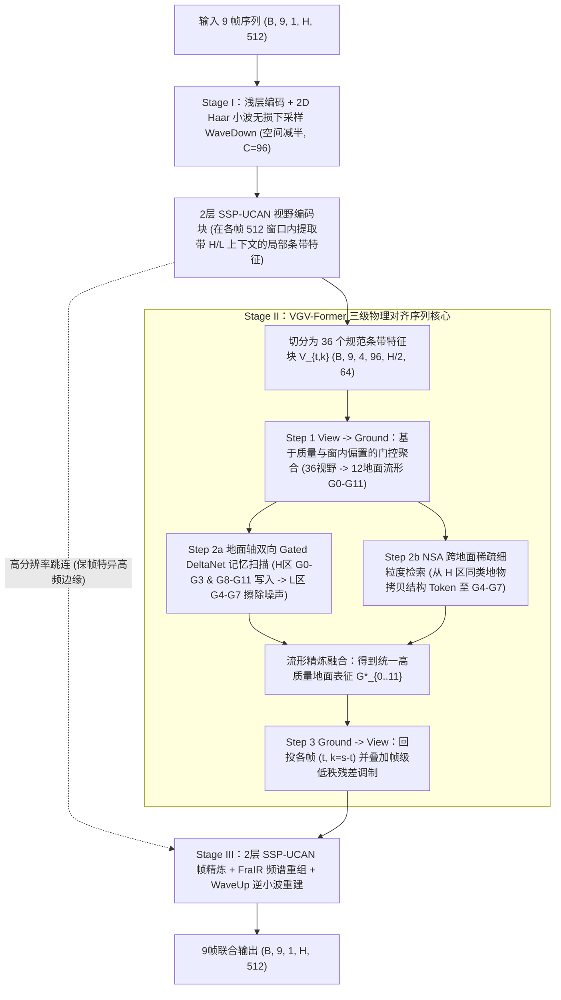
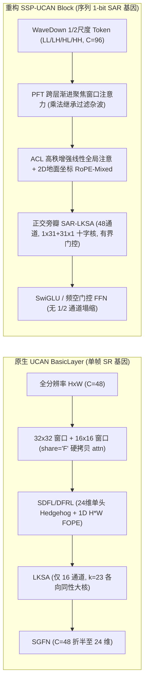
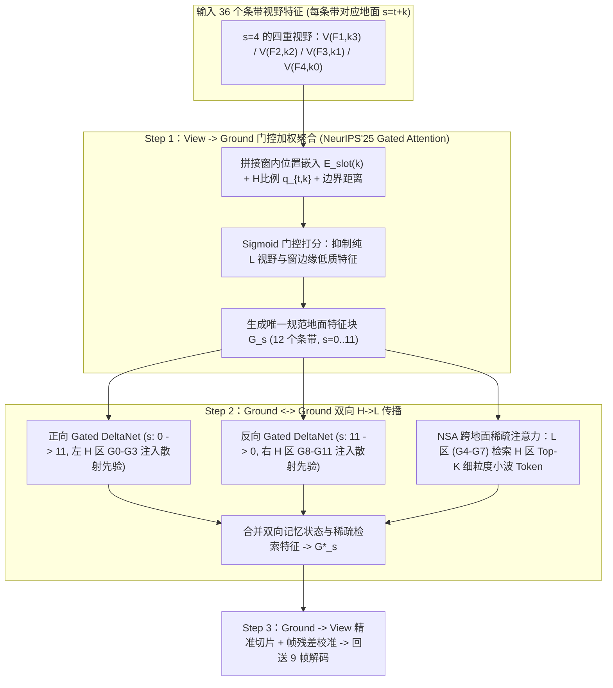
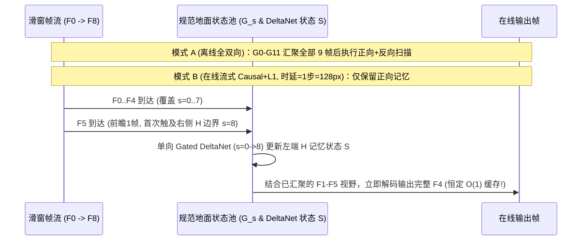

# 架构设计 B：从基础 `UCAN` 与序列恢复重构的 `StripFormer-UCAN`

> **设计定位**：跳出“在单帧 512 窗口内反复编码 9 帧、中间外挂粗插件”的渐进修补思路，从 **UCAN 原始算子特性（CVPR 2026）** 与 **条带式 SAR 滑窗几何的物理本质（$1536\text{ px}$ 连续地面上的 12 条带流形）** 出发，重构原生序列恢复架构 **`StripFormer-UCAN`（Ground-Centric Spectral-Spatial UCAN Sequence Transformer）**。  
> **核心理念**：把计算资源从“9 份重复单帧全分辨率自注意力”解放出来，投入到 **多视野条带聚合（View $\to$ Ground）$\to$ 规范地面 H/L 双向与在线记忆传播（Ground $\leftrightarrow$ Ground）$\to$ 帧特异频空残差重建（Ground $\to$ View）**。

---

## 1. 第一性原理重构：基础 `UCAN` 与序列恢复的三大根本矛盾

通过逐行剖析 `basicsr/archs/ucan_arch.py` 与 `docs/Define.md` 的几何约束，发现若直接将基础 UCAN 拼装为序列恢复网络，存在三个结构性天花板：

| 矛盾维度 | 源码实证与物理事实 | 导致的结构性缺陷 |
|---|---|---|
| **1. 计算与表征的 3 倍几何冗余** | 9 帧各自覆盖 `512 px`，总输入宽 `4608 px`，但真实逻辑地面仅 `1536 px`（`s=0..11` 共 12 条带）；全分辨率 `patch_size=1` 下 9 帧并发过 `rg_1..rg_4` 在 24 GiB 4090 上直接 **OOM**，被迫切片 `chunk=3` 且裁低至 `H=64` | 算力消耗在重复编码同一个地面条带，且 `H=64` 截断了 `large_window=32` 与 `LKSA(k=23)` 纵向感受野；各帧独立解码导致重叠区天然不一致（`MAD = 1.00 ~ 1.89`） |
| **2. 基础 UCAN 算子对 1-bit SAR 失配** | 原生配置 `embed_dim=48, mlp_ratio=1.0` 下，`SGFN` 通道折半至 `24`，`SDFL/DFRL` 空间与通道各 `24` 维单头，`LKSA` 仅覆盖 `16/48` 通道；`share=['N','F','N','F']` 直接硬拷贝上一组的注意力图；`FourierEmbedding` 为 1D `H*W` 展平 | 通道瓶颈太窄、无频域显式分支，难以剥离 $Q_L=1.5$ 带来的奇次谐波伪影；`RG1` 在强噪 L 区学出的错乱注意力会被 `RG2` 锁死继承；1D 相位编码阻碍跨高度泛化 |
| **3. 缺乏“多视野优选 $\to$ H/L 记忆传播”流形** | `F1-F3, F5-F7` 拥有同地面但含 H 上下文的视野；`F0, F8` 构成两端全 H 锚点；`A+Fusion` 等权输出平均反而令 $F_4$ 中心 `-0.0258 dB` 负迁移 | 序列交互必须在 **“视野对齐后的地面坐标系”** 中先做门控优选、再沿地面轴完成 H$\to$L 先验记忆检索，最后映射回各帧视角 |

### 范式跃迁对比图

---

## 2. 总体架构：`StripFormer-UCAN` 三阶段全景流水线

新架构将单帧基础 UCAN 解剖重构为 **视野浅层条带编码器（Stage I）**、**`VGV-Former` 地面中心序列引擎（Stage II）** 与 **小波-频域协同重建器（Stage III）**：

---

## 3. 重构基石一：面向 1-bit SAR 的 `SSP-UCAN Block`

保留 UCAN “**窗口自注意力 + 大核卷积 + 线性全局注意力**” 三足鼎立的设计精髓，并针对 1-bit SAR 信号物理特性改造全部四个核心算子：

### 四项核心算子级升级（对应 2025–2026 顶会方案）
1. **无损小波 Token 化降维（借鉴 LWTformer, CVPR 2026 Findings）**：
   - 废除原版 `patch_size=1` 导致 9 帧 OOM 的硬塞做法，在 `conv_first` 后接入 1 级可微 **2D 小波分解 `WaveDown`**：将空间降至 `(H/2, 256)`（Token 数骤降 **4 倍**，9 帧 `H=128` 整批并发显存可控），并将 `LL`（低频幅度）、`LH`（距离向边缘）、`HL`（方位向边缘）、`HH`（对角散射点/高频噪声）显式映射到 $C=96$ 通道中。
2. **跨层渐进聚焦代替盲目 `share='F'`（借鉴 PFT, CVPR 2025）**：
   - 原 UCAN 中 `RG2` 完全复用 `RG1` 的 Softmax 注意力图，一旦 `RG1` 在 L 区受 1-bit 散射伪影误导，`RG2` 无法修正。`SSP-UCAN` 改为 **渐进聚焦乘性继承**：
     $$A^{(\ell)} = \operatorname{Norm}\!\left(A^{(\ell-1)} \odot \operatorname{Softmax}\!\left(\frac{Q^{(\ell)} K^{(\ell)\top}}{\sqrt{d_h}} + B_{\text{rel}}\right)\right)$$
     保留共享加速与跨层结构先验的同时，允许深层剔除浅层的虚假相关性。
3. **2D 全局地面坐标 `RoPE-Mixed` + 高秩线性注意力（借鉴 ACL, CVPR 2025 + MambaIRv2, CVPR 2025 + RoPE-Mixed, ECCV 2024）**：
   - 将原 `SDFL` 中的 1D 序列 `FourierEmbedding` 替换为 **2D 混合频率旋转位置编码**，其水平坐标直接绑定 **物理地面绝对/相对列坐标 $x_g = 128t + c$**，纵向绑定 $y$。无论 `H=64/128/512`，不同帧对同一地物的空间相位完全一致，不再受窗口边界 `512` 截断影响。同时以卷积局部秩增强（`ACL`）防止线性全局分支在高对比散射点区域出现秩塌缩。
4. **正交旁瓣感知 `SAR-LKSA`**：
   - 针对 SAR 点目标冲激响应呈现典型 **距离向×方位向十字形 sinc 旁瓣** 的物理特性，将原 `LKSA` 扩展为 `48` 通道独立大核，采用正交条带核 `(1, 31) + (31, 1)` 捕获长距离旁瓣能量泄漏并保留 `gamma=4.0` 有界门控。

---

## 4. 重构基石二：三级物理对齐 Token 体系与 `VGV-Former` 交互引擎

在 `Stage II`，网络不再用模糊的 `16×9` 矩阵漫无目的互查，而是构建 **“多视野感知 $\to$ 12 规范地面条带记忆 $\to$ 帧回投”** 三级 Token 流形：

### 4.1 数学机制详解

1. **Step 1 `View -> Ground` 门控聚合（彻底消除 `A+Fusion` 的 `-0.026 dB` 负迁移）**：
   对于地面条带 $s \in \{0,\dots,11\}$，收集覆盖该地面的集合 $\mathcal{T}(s) = \{t : 0 \le s-t \le 3\}$。各视野首先通过局部像素投影并叠加帧内槽位上下文嵌入 $e_{\text{slot}}(s-t)$ 与质量编码 $q_{t, s-t}$，经空间自适应门控（借鉴 **Gated Attention**）融合：
   $$G_s = \sum_{t \in \mathcal{T}(s)} \alpha_{t,s} \odot \widetilde{V}_{t, s-t}, \qquad \alpha_{t,s} = \operatorname{Softmax}_{t \in \mathcal{T}(s)}\!\left(\phi([\widetilde{V}_{t,s-t}, e_{\text{slot}}(s-t), q_{t,s-t}])\right)$$
   相比固定等权平均（`Fusion`），网络能够学到“当 $s=4$ 同时出现在 $F_1/k_3$（旁有 $384\text{ px}$ 的 H 区强锚定）与 $F_4/k_0$（全帧处于 L 区）时，在特征空间动态压低 $F_4$ 的局部噪点权重”。
2. **Step 2a 双向 `Gated DeltaNet` 地面关联记忆传播（借鉴 ICLR 2025）**：
   将地面条带 $G_0 \dots G_{11}$ 的粗粒度/中粒度小波 Token 视为长度为 12（若按 $16\text{ px}$ 细条带则为 96）的 **空间地面序列**。沿着地面坐标 $s$ 维护一个二维键值关联记忆矩阵 $S_s \in \mathbb{R}^{d_k \times d_v}$：
   $$S_s = \alpha_s S_{s-1}\!\left(I - \beta_s k_s k_s^\top\right) + \beta_s v_s k_s^\top, \qquad o_s = S_s q_s$$
   - **物理直觉**：当正向扫描经过左端 H 区 $G_0\text{–}G_3$ 时，高置信度的“背景杂波统计 / 道路走向 / 建筑旁瓣原型”作为 $(k_s, v_s)$ 写入状态 $S$；进入中心 L 区 $G_4\text{–}G_7$ 时，遗忘门 $\alpha_s$ 与 Delta 纠错项 $(v_s - S_{s-1}k_s)$ **先擦除 1-bit 低采样率产生的过时噪声状态，再由 $q_s$ 从双端高精记忆（正向 + 反向 $G_8\text{–}G_{11}$）中精确检索同类散射先验**。
3. **Step 2b `NSA` 跨地面细粒度稀疏路由（借鉴 ACL 2025）**：
   对于需要恢复真实点目标与强边缘的 $G_4\text{–}G_7$，由压缩地面 Token 快速筛选出远端 H 区 $G_0\text{–}G_3, G_8\text{–}G_{11}$ 中最相似的 Top-$K$ 空间块（$16\times 16$ 尺度小波子带 `LH/HL/HH`），执行硬件友好的块稀疏交叉注意力，打破纯局部卷积与顺序扫描的距离衰减。

### 4.2 原生统一“离线双向”与“在线流式因果”恢复

`StripFormer-UCAN` 通过切换 `Step 2` 的扫描方向与 `Step 1` 视野到达集合，无需重新设计网络即可原生支持流式低时延场景：

---

## 5. 面向“拉平 V 谷”的损失函数与两套方案决策对比

### 5.1 频空均衡联合损失（直接对准 `docs/Define.md` 目标）
针对当前等权 Charbonnier 损失中 H 区（占比高、梯度干净）主导优化方向的问题，设计三项协同损失：
$$\mathcal{L}_{\text{total}} = \underbrace{\frac{1}{9}\sum_{t=0}^{8} w_t \mathcal{L}_{\text{Charb}}(\hat{Y}_t, Y_t)}_{\text{V谷动态均衡加权}} + \lambda_{\text{wav}}\sum_{t=0}^{8}\mathcal{L}_{1}(\operatorname{DWT}(\hat{Y}_t), \operatorname{DWT}(Y_t)) + \lambda_{\text{fft}}\sum_{t=0}^{8}\mathcal{L}_{1}(|\mathcal{F}(\hat{Y}_t)|, |\mathcal{F}(Y_t)|)$$
其中动态帧权 $w_t = \operatorname{clip}\!\left(\mathcal{L}_{\text{Charb},t} / \bar{\mathcal{L}}_{\text{H-anchor}},\, 1.0,\, 2.0\right)_{\text{stop-grad}}$，当且仅当中心帧误差高于两端全 H 锚点 $F_0,F_8$ 均值时平滑放大监督权重，一旦 V 谷拉平则自动退回等权 `1.0`。

### 5.2 路线 A（`UCAN-GDT`）vs 路线 B（`StripFormer-UCAN`）全景决策矩阵

| 评估维度 | 路线 A：`UCAN-GDT`（实验演进） | 路线 B：`StripFormer-UCAN`（原生重构） |
|---|---|---|
| **设计出发点** | 精准手术式解决 `C_s42` 实测暴露的 4 大病灶 | 消除 3 倍滑窗算力浪费与原生 UCAN 算子失配 |
| **Token 核心形态** | 尺度不变 `1×4` 辐射-频谱流 + `8×8` 走廊高频流 | `WaveDown` 小波多子带 Token $\leftrightarrow$ 12 条带规范地面流形 |
| **跨帧交互引擎** | `GD-CFA`（差分注意力 + 质量 Sigmoid 输出门控） | `View->Ground` 门控聚合 + 双向 `Gated DeltaNet` + `NSA` |
| **预计总参数量** | `~1.08 M`（骨干 `684K` + 新增 `394K`） | `~1.45 M`（从头训练轻量化双尺度骨干） |
| **热启动与训练成本** | **100% 复用 `A_init`**，双卡 4090 `20k` 步约 `8–10h` 可出结果 | 需从零重训全网络（预计 `100k–150k` 步，约 `1.5–2.5` 天） |
| **重叠一致性 (MAD)** | 由走廊交叉注意力显著压低（预计 `0.3–0.6`） | **结构级对齐地面流形**，残差解耦后理论趋近真实 GT（`~0.05–0.2`） |
| **V 谷拉平与 SSIM 上限** | 中高（受限于原 UCAN `C=48` 通道与 `RG3/RG4` 独立解码） | **最高**（全地面 H$\to$L 关联记忆 + `WaveDown` 全帧并发 `H=128`） |
| **在线流式恢复支持** | 需额外缓存 9 帧特征张量 | 原生单向 `Gated DeltaNet` 仅需 $\mathcal{O}(1)$ 记忆矩阵 $S$ |
| **推荐科研节奏** | **近期首选（Gate 3 主力）**：最快形成优于 `C_s42` 的稳定收益与消融故事 | **中远期旗舰（冲顶刊/大论文核心章）**：以完整物理第一性原理打造专属架构 |

### 5.3 路线 B 的核心风险边界（诚实约束）
1. **不能热启动 `A_init`**：由于修改了 `WaveDown`（通道扩至 `96`）与地面坐标系 `RoPE-Mixed`，必须完整重训；若训练数据/正则不足，在 `3,344` 条序列上从零训练 `1.45M` 网络存在过拟合单一场景（如 Gate 1 中 `60k` 后退化）的风险，需配合频域增强与早停验证。
2. **地面流形对跨帧真实微差的过度平滑风险**：若在 `Ground -> View` 阶段不保留各帧 `Stage I` 的高分辨率浅层跳连残差，强行共享同一个 $G_s^*$ 可能导致各帧与对应全精度 GT 之间原有的微小边缘视差被抹平。因此 **`Stage I` 到 `Stage III` 的帧特异高频跳连不可省略**。
