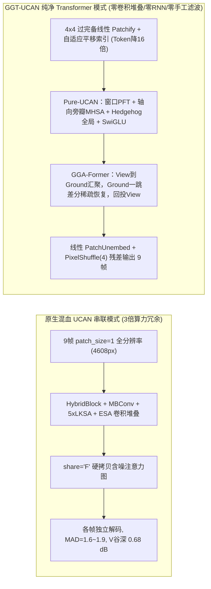
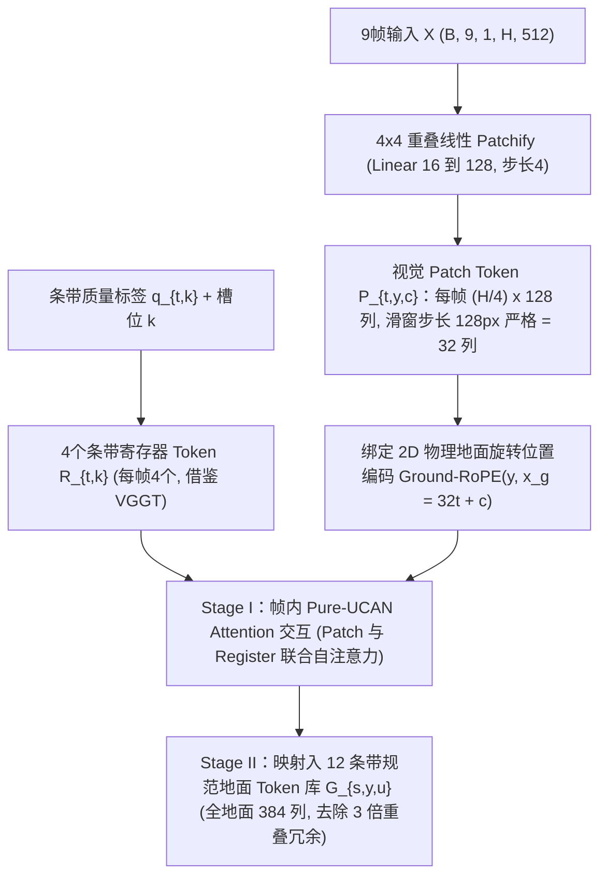
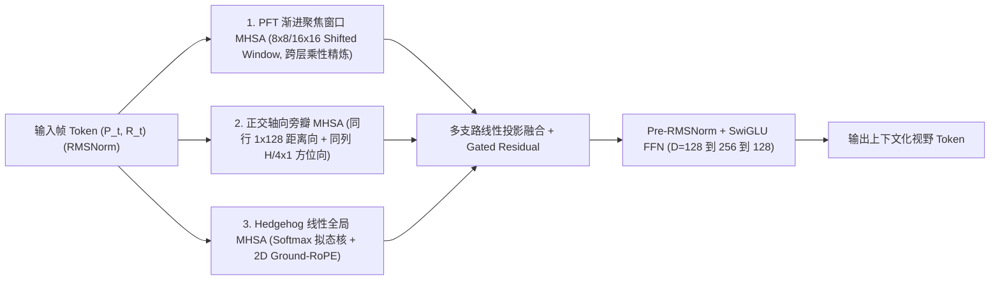
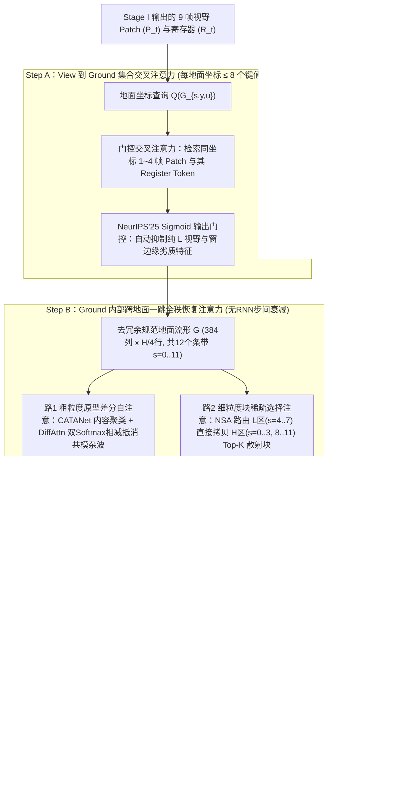
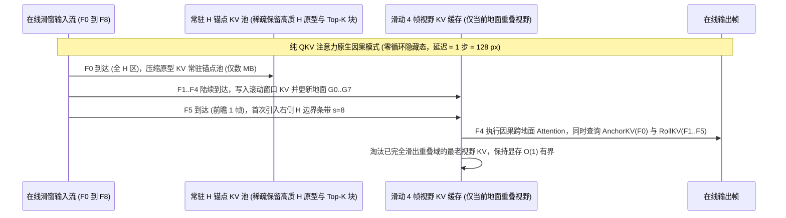

# 架构设计 B：纯净 Transformer 血统重构的 `GGT-UCAN`

> **审阅与重构定位**：经血统审查，上一版基于状态递推与小波滤波金字塔的混合设计混入了线性 RNN、SSM 及手工频域滤波模块，不符合“纯净 Transformer 血统”。本版从 **UCAN 原始纯注意力基因（CVPR 2026）** 与**条带式 SAR 连续滑窗几何（$1536\text{ px}$ 地面流形）**重新出发，剥离 `MBConv / 5×LKSA / ESA` 等重卷积与一切循环/小波组件，构建全程由 `Linear Patchify + RMSNorm + QKV Attention + RoPE + SwiGLU` 组成的原生序列纯 Transformer——**`GGT-UCAN`（Ground-Geometry Alternating Pure Transformer）**。

---

## 1. 血统纯化审查与第一性原理重构

### 1.1 原生 UCAN 的“半卷积混血”病灶与纯 Transformer 破局准则

| 审阅对象 | 混血/非纯结构问题 | `GGT-UCAN` 纯净 Transformer 替换准则 |
|---|---|---|
| **空间降采样与显存瓶颈** | 原生 `UCAN` 采用 `patch_size=1` 全分辨率序列，9 帧 `4608 px` 并发过 4 个 `RG` 在 24 GiB 卡直接 OOM，被迫截断至 `H=64` | `4×4` 过完备线性 Patchify (`16→128` 维) + 自适应滑动索引（ICCV 2025），Token 数直降 **16 倍**，9 帧 `H=128` 可整批并发无截断 |
| **原生 UCAN 卷积堆叠** | `BasicLayer` 在 `4×HybridBlock` 外硬叠了 `MBConv`、`5×LKSA`（16 通道大核）与 `ESA`（占算子与非有限故障主因） | **彻底剥离 `MBConv / 5×LKSA / ESA`**，仅保留并强化其“局部窗口 + Hedgehog 全局线性注意力”纯自注意力双核 |
| **十字形旁瓣与局部建模** | 依赖 `5×LKSA` 静态固定大核捕捉点目标旁瓣，且 `SGFN` 通道折半为 24 维导致表征塌缩 | **正交轴向自注意力（Row/Col Axial MHSA）**动态对齐距离-方位向十字旁瓣 + **SwiGLU** 前馈网 |
| **序列状态记忆方式** | 非 Transformer 路线通过矩阵递归隐藏态传播 H→L 信息，易受步间衰减限制 | **1-Hop 全秩 QKV 跨地面注意力**直接从 $F_0,F_8$ 检索；在线流式通过**锚点常驻滚动 KV-Cache** 原生实现 |

### 1.2 血统纯化与范式跃迁对照图

---

## 2. 纯 Transformer 三级 Token 体系（Patch + Register + Ground Latent）

`GGT-UCAN` 仅依赖纯线性投影生成三种职责正交的 Token，不再使用多尺度卷积金字塔或手工变换：

### 为什么 `4×4` 线性 Patchify + `Ground-RoPE` 天生契合滑窗 SAR？
1. **严格整数列对齐**：每帧宽 `512 px` 经 `4×4` Patchify 后变为 `128` 列 Patch，而滑窗步长 `128 px` 严格对应 **`32` 个 Patch 列**。因此第 $t$ 帧第 $c$ 列 Patch 的物理地面列坐标为精确整数 $x_g = 32 t + c \in \{0,\dots, 383\}$。
2. **2D 混合频率旋转编码（借鉴 RoPE-Mixed, ECCV 2024）**：将旋转角直接绑定 $(y, x_g)$ 而非帧内一维序号 `H*W`。于是跨帧观察同一地物目标的所有 Token（如 $F_1/k_3, F_2/k_2, F_3/k_1, F_4/k_0$）在注意力内积中**天然具有零相位差几何对齐**，且完全免疫训练高度（`H=128`）与整帧推理高度（`H=512`）的尺度跳变。
3. **条带质量寄存器 Token（借鉴 VGGT, CVPR 2025）**：每帧注入 4 个与图像块并行的 Register Token $R_{t,k} = E_{\text{slot}}(k) + \operatorname{MLP}(q_{t,k})$，专门在帧内自注意力中吸收该窗口的 H/L 混合上下文与量化偏置，不污染空间 Patch 的细节坐标。
4. **平移等变保护（借鉴 Adaptive Translation Equivariance, ICCV 2025）**：在 `4×4` Patchify 与末段 `PatchUnembed` 中引入自适应滑动相位偏移索引，消除纯线性块划分在点目标强边缘处的块效应。

---

## 3. 纯化单帧基石：`Pure-UCAN Attention Block`（剥离卷积包袱）

保留 UCAN（CVPR 2026）“局部细粒度 + 全局线性上下文 + 跨层复用”核心思想，将其全部算子纯化为标准 `Pre-RMSNorm + Attention + SwiGLU` 结构：

- **跨层渐进聚焦升级 UCAN `share='F'`（借鉴 PFT, CVPR 2025）**：不再把第 1 层含噪窗口注意力硬拷贝给第 2 层，而是通过乘性重归一化 $A^{(\ell)} = \operatorname{Norm}(A^{(\ell-1)} \odot \operatorname{Softmax}(Q^{(\ell)}K^{(\ell)\top}/\sqrt{d_h}))$ 逐层淘汰 L 区 1-bit 杂波伪相关，既保留了计算加速又防止锁定噪声。
- **正交轴向 MHSA 替代 `5×LKSA`**：SAR 点目标冲激响应呈沿距离向与方位向延展的十字形旁瓣。通过同行 `1×128` 与同列 `(H/4)×1` 一维自注意力（复杂度仅 $\mathcal{O}(HW(H+W))$），无需任何大核卷积即可在整个成像窗内动态抑制强散射点旁瓣遮蔽弱目标的现象。

---

## 4. 序列核心：`VGGT` 式交替纯注意力引擎（`GGA-Former`）

在 `Stage II`，借鉴 **VGGT（CVPR 2025）** 的多视角交替注意力思想，围绕 **12 条带规范地面流形 $G_{s,y,u}$** 构建三步全纯 QKV 交替周期：

### 4.1 关键纯注意力公式

1. **Step A 视野门控优选（替代 `A+Fusion` 盲目平均）**：
   对于地面条带坐标 $(s,y,u)$，键值集合 $\Omega_{s,y,u} = \{(P_{t,y,32s+u-32t},\, R_{t,s-t}) : t \in \mathcal{T}(s)\}$ 至多含 $8$ 个 Token。引入逐头 Sigmoid 门控（**Gated Attention, NeurIPS 2025 Oral**）：

$$
G_{s,y,u} = G^{(0)}_{s,y,u} + W_O\!\left(\sigma(W_g [G^{(0)}_{s,y,u}, q_s]) \odot \operatorname{MHSA}_{\text{cross}}\!\left(Q(G^{(0)}_{s,y,u}),\, K(\Omega_{s,y,u}),\, V(\Omega_{s,y,u})\right)\right)
$$

相比固定等权平均（`A+Fusion` 实测令 $F_4$ 中心退化 `-0.0258 dB`），网络显式依据同地面多视野的寄存器质量特征动态剔除劣质视野。

2. **Step B 跨地面一跳差分与稀疏检索（`Diff Transformer` + `CATANet` + `NSA`）**：
   - **粗原型全局广播**：借鉴 **CATANet（CVPR 2025）** 将地面内容聚类为 $M$ 个语义原型，采用 **Differential Attention（ICLR 2025 Oral）** 计算双 Softmax 相减 $(A_1 - \lambda A_2)V$，将 1-bit 相干斑产生的背景共模相似度归零，实现两端全 H 区到中心全 L 区 $G_4 \sim G_7$ 的**一跳零衰减辐射与杂波先验直传**；
   - **细粒度块稀疏选择**：借鉴 **NSA（ACL 2025）**，利用粗注意力分布为 $G_4 \sim G_7$ 中的每个局部结构块筛选 H 区 Top-$K$ 相似纹理/角反射器块执行全秩 QKV 交互，解决“只标定低频均值、不补全高频散射点”的顽疾。

### 4.2 纯 Transformer 在线流式模式：锚点常驻滚动 `KV-Cache`（零 RNN 状态）

对应 [跨帧Token交互实验指导书.md](跨帧Token交互实验指导书.md) 第 13.4 节的 `Causal+L1` 在线恢复需求，纯 Transformer 无需任何循环隐藏态矩阵，直接依靠 **Block-Causal Mask + 分级 KV-Cache** 实现精确检索与恒定显存：

---

## 5. 参数预算、方案对比与纯 Transformer 风险边界

### 5.1 参数与计算量估算（按 `H=128, W=512, D=128, 4×4 Patchify`）

| 模块 | 参数量估算 | 计算复杂度与显存特性 |
|---|---:|---|
| 重叠线性 `Patchify(16→128)` + 自适应索引 + 寄存器 | `~42 K` | 空间 Token 由 `65,536` 骤降至 `4,096/帧`（9 帧 `H=128` 可单卡/双卡并发） |
| `Stage I / III` 共 4 层 `Pure-UCAN Block` | `~690 K` | 窗口 PFT + 轴向 MHSA + Hedgehog 线性全局，**零 `5×LKSA` 与 `MBConv`** |
| `Stage II` 2 轮 `GGA-Former`（`V2G` + 差分 `CATA/NSA` + `G2V`） | `~740 K` | `V2G/G2V` 为 $\le 9$ 键值 $\mathcal{O}(1)$ 集合注意力；`G2G` 仅在 12 条带流形计算 |
| 线性 `PatchUnembed(128→16)` + `PixelShuffle(4)` | `~48 K` | 纯线性像素映射加回输入残差 |
| **总计（`GGT-UCAN`）** | **~1.52 M** | 仍仅为 `HINT (24.87 M)` 的 **6.1%** |

### 5.2 修正后的双路线最终决策矩阵

| 对比维度 | 方案 A：`UCAN-GDT`（基于当前实验演进） | 方案 B：`GGT-UCAN`（纯净 Transformer 重构） |
|---|---|---|
| **架构血统** | 原生混血 `UCAN` 骨干 + 门控差分 Token 插件 | **100% 纯净 Transformer**（零卷积堆叠 / 零 RNN / 零小波或 FFT 手工层） |
| **热启动能力** | **直接加载 `A_init`（`683,817`）**，20k 步约 `8–10 h` 验证 | 彻底更换 `4×4` Patchify 与纯注意力骨干，**必须从零训练** |
| **算力冗余度** | 保留 9 帧全分辨率骨干计算（3 倍几何冗余，`chunk=3`） | 通过 `4×4` Patchify 降 16 倍 Token，并于 12 条带地面流形去冗余交互 |
| **流式因果能力** | 需修改绝对帧嵌入并保留全帧中间状态 | **Block-Causal + 锚点常驻滚动 KV-Cache** 原生一跳检索 |
| **核心风险与工程约束** | 仍受限于原 UCAN `C=48` 窄子空间上限 | 纯 `4×4` Patchify 在强散射点边缘易现块接缝，且 3,344 条训练序列下缺少卷积归纳偏置更易过拟合，**必须配合 ICCV'25 自适应滑动索引、DropPath 与 V 谷动态均衡损失** |
