# 单比特 SAR 跨帧 Token 交互实验指导书

更新日期：2026-11-16。本文采用最新讨论确定的模型与实验规格，配套简要汇报见[阶段成果与后续路线](阶段成果与后续路线.md)。结构与参数为拟实施规格，实验结果在运行后填写。

**研究主线：将单比特 SAR 序列中的每帧图像表征为一个或多个 token，通过 Transformer 的跨帧交互，利用前后帧的空间上下文辅助中间低质量帧恢复，并完成全部九帧的联合恢复。**

全文围绕三个问题展开：一帧如何生成 token？token 在帧间传递什么信息？这些信息如何进入图像重建？

本版替代此前以母图为主的实验设计。模型始终保留九帧及其来源身份；滑窗几何用于编码对应关系和引导信息传递。主模型采用每帧 16 个区域 token，在 UCAN 的 RG2 与 RG3 之间插入一次跨帧交互模块；帧级 token、`1+4` 层次 token 和同地面细节传递作为明确的扩展实验。

本版统一采用保留布局的小网格 tokenizer，以新独立划分上的公共单帧基线 A_init 热启动全部核心实验。质量分支增加 D0/D1 配对控制；接口规定采用纯张量重排与逐帧验证。均值、标准差 tokenizer 保留为后续对照。

## 1. 用一张图理解研究目标

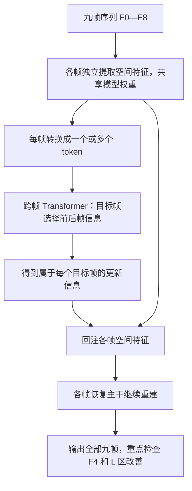

可直接讲解为：**每帧先保留自己的空间细节，再产生能够参与序列交互的紧凑描述；目标帧通过注意力选择其他帧的信息，利用接收结果调整自己的恢复特征。**

输入、输出均保留序列轴：

$$
X\in\mathbb R^{B\times9\times1\times H\times512}
\quad\longrightarrow\quad
\widehat Y\in\mathbb R^{B\times9\times1\times H\times512}.
$$

这里的序列表示滑窗位置的连续变化。交互采用双向注意力，使每帧都能访问前后帧；帧序、地面位置和质量来源由明确的元数据与编码提供。

## 2. 九帧各自能够提供什么

### 2.1 滑窗几何与帧角色

每帧宽 512，步长 128。第 t 帧覆盖地面横坐标 [128t,128t+512)，t=0…8。下面用理想 H–L–H 布局说明帧角色；实现中的质量标签采用生成器真实索引投影。

| 帧 | 名义 H/L 构成 | 在模型中的潜在作用 |
|---|---|---|
| F0、F8 | 全 H | 提供较可靠的场景结构和散射特征上下文 |
| F1、F7 | 3/4 H、1/4 L | 在单帧内同时看到较多 H 与相邻 L 区域 |
| F2、F6 | 1/2 H、1/2 L | 将更深入 L 区的区域与 H 上下文共同编码 |
| F3、F5 | 1/4 H、3/4 L | 覆盖更多中心 L 内容，同时保留一侧 H 上下文 |
| F4 | 全 L | 重点改善的中心帧，同时保留自身输入提供的恢复依据 |

F0 与 F4 在输出覆盖范围上相邻但不重叠；F8 与 F4 同样如此。中间六帧提供重叠区域和不同视野，是跨帧表征交互的重要来源。

### 2.2 同一地面，可以有多个带上下文的表征

将每帧沿宽度切成四个 128 px 条带。第 t 帧的局部条带 k 对应全局地面条带：

$$
s=t+k,\qquad k=0,1,2,3.
$$

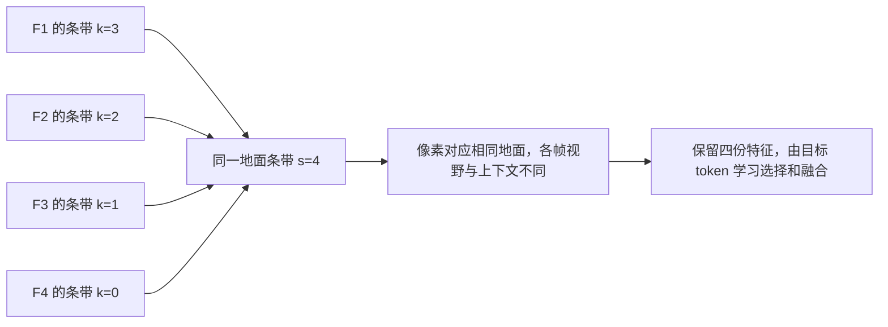

单帧 UCAN 的卷积、窗口交互和全局分支会让区域特征包含本帧上下文。因此，即使重叠输入近似相同，经过编码后的特征也可能有不同的恢复价值。跨帧模型学习如何使用这些上下文化表征。

F4 四个条带可直接访问的同地面来源如下；同一纵向区域 r 一一对应。

| F4 局部条带 | 地面 s | 其他同地面帧与槽位 |
|---|---:|---|
| k=0 | 4 | F1/k3、F2/k2、F3/k1 |
| k=1 | 5 | F2/k3、F3/k2、F5/k0 |
| k=2 | 6 | F3/k3、F5/k1、F6/k0 |
| k=3 | 7 | F5/k2、F6/k1、F7/k0 |

这张表解释了桥梁帧如何接近 F4 的内部区域：来源不只覆盖中心边缘，也覆盖两个中心条带。两端锚点则通过全局 token 内容交互提供非同地面上下文。

## 3. Token 是什么：描述子、位置和空间细节

### 3.1 三个对象各司其职

| 对象 | 形状示例 | 表示的信息 | 如何使用 |
|---|---|---|---|
| 空间特征块 U_i | [48,H/4,128] | 区域内每个位置的恢复特征 | 保留在空间分支；可选用于对齐细节传递 |
| Token 描述子 z_i | [96] | 区域特征的紧凑、可学习摘要 | 形成 q/k/v，参与序列 Transformer |
| 元数据 p_i、q_i | 帧序、区域、地面坐标、H 比例 | 来源身份、对应关系及质量来源 | 位置编码、几何偏置、质量偏置 |

区域 token 是特征描述，不是预先赋予语义的“干净目标”或“噪声类别”。它学到的内容由恢复任务驱动。

标准 token attention 的 Value 是描述子投影后的向量。可选细节路径另用同地面空间特征作为载荷，由 token 注意力提供选择权重；两者有不同的张量形状和计算成本。

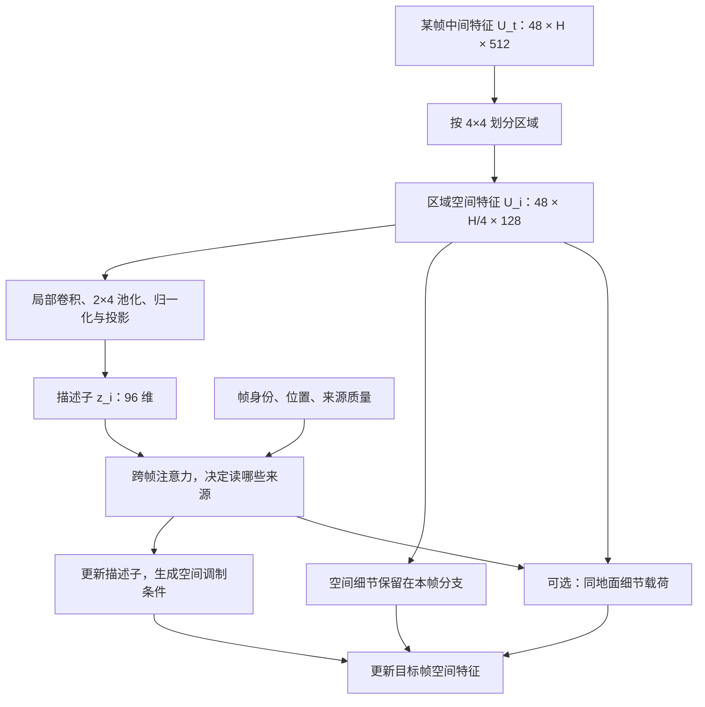

### 3.2 先做哪一种粒度

| 变体 | 每帧 token | 九帧总数 | 交互侧重点 |
|---|---:|---:|---|
| Global | 1 | 9 | 场景和帧级条件 |
| Strip | 4 | 36 | 四个横向条带的对应关系 |
| Region，首轮主模型 | 16，4×4 网格 | 144 | 横向对应和纵向区域差异 |
| Hierarchical | 1+4 | 45 | 帧级全局条件与条带信息互补 |

整帧压成一个 token 适合作为全局条件，但空间细节仍由原单帧分支保留。主模型选择 16 个区域 token，让不同位置能接收不同的序列信息。

### 3.3 主模型的 token 生成

在 RG2 输出处通过纯转置与重排恢复每帧二维特征 U_t，通道 C=48。区域 i=(t,r,k)，r、k 均为 0…3，每块尺寸为 [48,H/4,128]。主 tokenizer 采用以下确定规格：

$$
g_i=\operatorname{Flatten}\left(\operatorname{AdaptiveAvgPool}_{2\times4}\left(\operatorname{GELU}(\operatorname{DWConv}_{3\times3}(U_i))\right)\right)
\in\mathbb R^{384}.
$$

$$
z_i=W_{\mathrm{tok}}\operatorname{LN}_{384}(g_i)+b_{\mathrm{tok}}
\in\mathbb R^{96}.
$$

局部卷积为 48 通道深度卷积，kernel=3、stride=1、padding=1、带 bias；在各区域内执行。池化得到 [48,2,4]，按通道、行、列固定顺序展开；LayerNorm(384) 带仿射参数，Linear(384,96) 带 bias。所有步骤保留梯度，所有帧和区域共享参数。

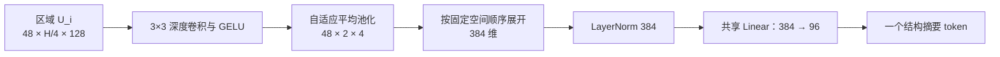

小网格保留粗粒度布局，使投影能区分区域内部不同位置；完整空间特征继续保留在主干。均值与标准差仅保留为 tokenizer 对照：逐通道取均值及 sqrt(总体方差+1e-6)，拼接后经 LN(96)→Linear(96,96)。比较时保持区域坐标、交互模块和回注一致，记录生成器参数差异。

## 4. 模型总结构与 UCAN 插入位置

### 4.1 首轮：一次帧间交互，前后各保留一段帧内处理

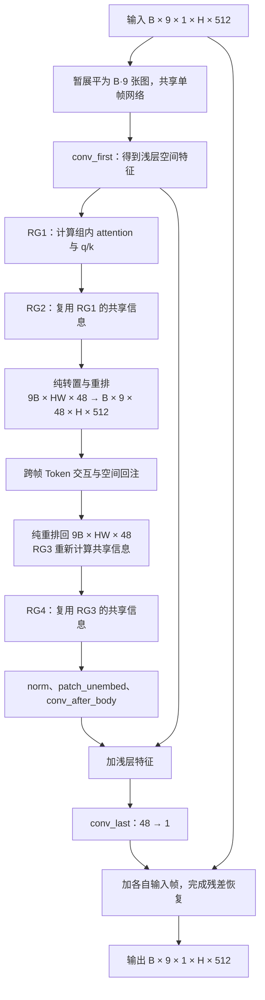

RG1→RG2、RG3→RG4 的共享成对关系继续使用原代码。新模块放在 RG2 之后、RG3 之前，在中等深度接收已经上下文化的单帧特征，后半段进一步重建。

临时将 B 和 T 合并只用于共享单帧计算；进入交互模块时恢复序列轴。UCAN 内部 FOPE 继续作用于各帧 H×512；新的帧间位置关系由 token 模块单独编码。

数据集每次返回一条完整九帧序列。将 [B,9,1,H,512] 合并为 [9B,1,H,512] 仅改变批次排列，九帧使用同一套编码权重，各帧尚未交换信息。恢复 B、T 后，只有同一序列的 144 个 token 共同参与 attention，不跨样本混合。

### 4.2 张量流

| 步骤 | 形状 | 解释 |
|---|---|---|
| 输入 | [B,9,1,H,512] | 原始九帧 |
| RG2 原始输出 | [9B,H×512,48] | 源码中的通道后置序列 |
| 重排后的空间特征 | [B,9,48,H,512] | 每帧完整空间表征 |
| 区域切分 | [B,9,4,4,48,H/4,128] | r 为纵向区域、k 为横向条带 |
| token | [B,9,4,4,96] | 每个区域一个描述子 |
| 序列化 | [B,144,96] | 固定索引 i=16t+4r+k |
| 每层 q/k/v | [B,4,144,24] | 4 个头，每头维度 24 |
| 每层 attention | [B,4,144,144] | 行是目标，列是来源 |
| token 更新量 | [B,9,96,4,4] | 按目标帧恢复网格 |
| 空间调制 | 两个 [B,9,48,H,512] | 通道缩放与偏置 |
| 回注特征 | [B,9,48,H,512] | 更新后的空间表征 |
| RG3 输入 | [9B,H×512,48] | 纯重排回原接口 |
| 输出 | [B,9,1,H,512] | 全部九帧 |

区域切分必须先恢复 H、W 再分 r、k。直接将行优先展平序列均分为 16 段不对应上述网格。

RG2 后先将 [9B,HW,48] 转置为 [9B,48,HW] 并恢复空间与序列维度，回注后按逆操作还原。两次转换均不增加归一化：顶层 patch_embed 带有可选 LayerNorm，不能再次直接调用它完成此处回转。H/W 使用当前实际特征尺寸；如发生 padding，记录原尺寸并在输出裁回。恒等回注验收同时覆盖这些形状转换。

## 5. 序列位置、地面位置与质量来源

### 5.1 每个 token 的身份

对于 i=(t,r,k)：

$$
s_i=t+k,\qquad
x_i=128(t+k+\tfrac12),\qquad
y_i=y_0+(r+\tfrac12)H/4.
$$

保留帧编号 t、帧内行列 r/k、全局地面坐标 x/y 和质量标签 q_i。共同纵向裁剪保证同序列的同一 r 对应相同纵向范围。

首轮加入可学习的帧、行、列嵌入：

$$
Z_i^{(0)}=z_i+E_{\mathrm{frame}}(t)+E_{\mathrm{row}}(r)+E_{\mathrm{col}}(k).
$$

它表达“这个区域来自哪一帧、在帧内什么位置”。跨帧的地面对应关系由下面的相对偏置表达。

### 5.2 几何偏置

每个注意力头使用三个相加的小查找表：

$$
b_{\mathrm{geom}}^{h}(i,j)
=R_s^h(s_i-s_j)+R_r^h(r_i-r_j)+R_t^h(t_i-t_j).
$$

表长分别为 23、7、17；4 个头合计每层 188 个参数。两层各自持有偏置表，首轮初始化为零。

同地面关系满足 s_i=s_j、r_i=r_j。相对地面距离、帧距离和帧内位置共同让模型区分“同地面不同视野”与“不同地面相关内容”。初版不强制注意力只集中在同地面来源。

训练高度 H=64 时每格高 16，整帧 H=512 时每格高 128。横向对应关系保持一致，纵向 token 的实际覆盖尺度变大；记录 H，并通过统一整帧验证或共同切片推理评价这种尺度适配。首轮 r 偏置使用网格行距离，实际 y 坐标保留供后续连续坐标消融。

### 5.3 质量来源标签

q_i 为该区域投影到生成器 H 来源掩膜后的覆盖比例，范围 [0,1]。它表示来源构成，实际可靠性由内容特征与质量分支共同学习。

真实质量输入只提供给实验 D（即 D1）的质量偏置器；D0 使用固定常数替代。B/C 的 tokenizer、位置嵌入和几何偏置不读取 q_i。实际索引采用 manifest 中的边界，沿用历史生成器时核对 x=513、1025 的投影约定。

固定 H–L–H 布局下，来源比例可由位置推断。D1−D0 衡量显式提供质量来源编码的价值；变化质量布局下的适应性留待后续实验。

## 6. Transformer 内部：谁查询谁，传递什么

### 6.1 两层 Pre-LN Transformer

首轮 D=96、4 heads、FFN 隐藏维 192、2 个 block，attention dropout 和 FFN dropout 均为 0。

$$
Q^h,K^h,V^h=\operatorname{Proj}^h(\operatorname{LN}(Z)),
$$

$$
L_{ij}^{h}=\frac{(Q_i^h)^\top K_j^h}{\sqrt{24}}
+b_{\mathrm{geom}}^h(i,j)+b_{\mathrm{quality}}^h(i,j)+\mathcal M_{ij},
\qquad
A_{ij}^{h}=\operatorname{softmax}_{j}(L_{ij}^{h}).
$$

$$
Z'=Z+W_O\operatorname{Concat}_{h}\!\left(\sum_j A_{ij}^{h}V_j^h\right),
\qquad
Z^{\mathrm{next}}=Z'+\operatorname{FFN}(\operatorname{LN}(Z')).
$$

每一行 i 是一个目标区域的读取分布。不同 F4 区域拥有不同的 Query，因此可以选择不同来源；这里的 Query 与来源比例 q_i 是不同变量。来源 j 的 Value 是学习后的特征描述，接收的内容随目标注意力而变化。

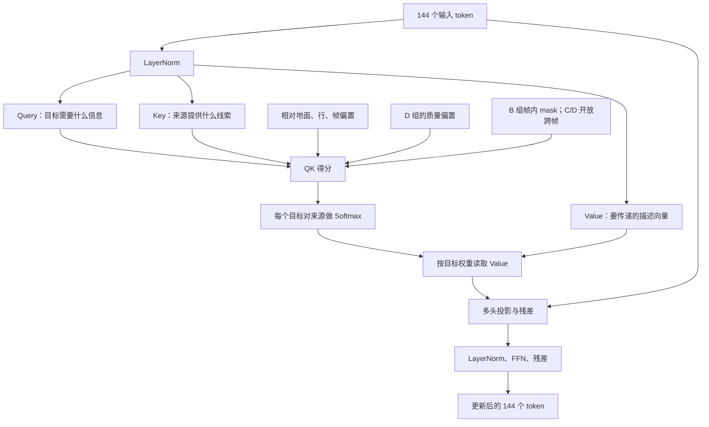

### 6.2 两层交互的含义

第一层直接交换各帧的初始区域描述。第二层可以读取已经吸收其他来源信息的描述，形成 token 层面的多跳交互。当前原型一次提取、两层 token 交互、一次回注，然后进入后续帧内恢复。

多次“空间编码→帧间交互→空间更新”属于后续深度消融；第一版不在每个 RG 之间都插模块，以保持原共享关系清楚。

### 6.3 B/C 对照的 attention mask

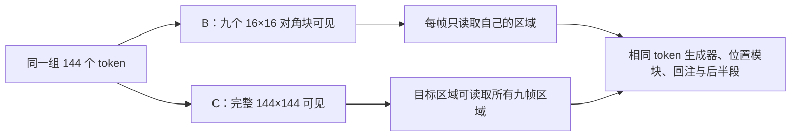

B 的 mask 在 t_i=t_j 时为 0，否则为负无穷；C 的 mask 全为 0。B/C 都创建并使用相同几何偏置、位置嵌入和网络参数，差别仅是帧间可见性。首轮使用同一 dense attention 计算形式，便于控制实现路径。

## 7. 质量条件化：来源可靠性与目标需求

### 7.1 来源和目标分别建模

实验 D 在 C 的得分中加入质量偏置，沿用 Argon 的双因子思路：

$$
b_{\mathrm{quality}}^h(i,j)=d_i^h\,c_j^h.
$$

来源得分 c_j 根据 token 内容和 q_j 预测；目标需求 d_i 根据 token 内容和 q_i 预测。两者每头一个值：

$$
c_j=\operatorname{MLP}_{\mathrm{src}}([\operatorname{LN}(Z_j),q_j]),
\qquad
d_i=2\operatorname{sigmoid}\!\left(\operatorname{MLP}_{\mathrm{tgt}}([\operatorname{LN}(Z_i),q_i])\right).
$$

LN 复用该 Transformer block 的注意力输入归一化；两个 MLP 均为 97→16→4，GELU。每层有独立偏置器，跨帧、跨区域共享。

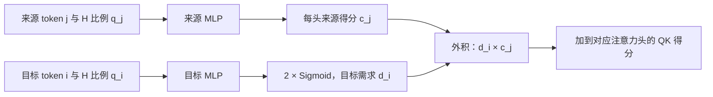

质量偏置改变目标对来源的选择，不直接指定某个帧必须作为 teacher。较低质量的目标是否更依赖外部来源，由需求系数和实际注意力一起观察。

### 7.2 初始化

两个 MLP 的隐藏层正常初始化，输出层均置零。此时 c_j=0、d_i=1，质量偏置为零，D 从 C 的 attention 形式起步。结合回注出口零初始化，梯度先到回注出口，出口更新后到来源分支输出层，再逐步进入目标分支；具体检查见第 15.3 节。

不要把 d_i 直接初始化成零再与零来源得分相乘。使用上述 Sigmoid 参数化，让初始需求为 1。零初始化在 UCAN 的全局初始化之后执行，恢复 checkpoint 时不再次重置。

### 7.3 D0/D1：区分动态内容偏置与质量标签的贡献

| 方案 | 偏置模块 | 质量输入 | 比较含义 |
|---|---|---|---|
| C | 无来源×目标偏置器 | 不读取 | 跨帧 token 基准 |
| D0 | 与 D1 完全相同的 97→16→4 双分支 | 所有区域固定 q=0.5 | 内容驱动的动态偏置对照 |
| D1，即主表 D | 与 D0 相同 | 真实 H 来源比例 | 显式质量来源条件 |

D0/D1 复制全部共同初始参数，使用相同采样、优化器与训练预算，均从 A_init 出发。D1−C 衡量整个质量条件化模块的增量，D1−D0 衡量真实来源标签相对常数标签的作用；D0 仍可利用 token 内容和其中的位置身份。D0 作为首轮质量配对补充，与 D1 同期训练，不增加另一套模型结构。

## 8. 信息如何回到图像：两条互补路径

### 8.1 首轮默认：空间—通道调制

两层 Transformer 后计算每帧 token 更新量：

$$
\Delta Z_t=Z_t^{\mathrm{out}}-Z_t^{(0)}.
$$

按原 r/k 顺序还原成 4×4 网格，投影为 48 通道，再插值到 H×512：

$$
V_t=\operatorname{Upsample}\!\left(\operatorname{Grid}(P_{\mathrm{pre}}\Delta Z_t)\right).
$$

$$
[a_t,b_t]=P_{\mathrm{out}}\!\left(\operatorname{GELU}(\operatorname{DWConv}_{3\times3}(V_t))\right),
$$

$$
\widetilde U_t=U_t\odot(1+\tanh(a_t))+b_t.
$$

P_pre 为 96→48 投影，DWConv 为 48 通道深度卷积，P_out 为 48→96 的 1×1 卷积。缩放使用 tanh，使调制倍数位于 (0,2)；偏置由重建训练学习。

首轮不对增量 ΔZ 额外添加末端 LayerNorm。记录其幅值、回注幅值及 tanh 饱和比例；若持续放大影响训练，再成对比较在 P_pre 前加入 LN(96) 的设置，并计入额外参数。

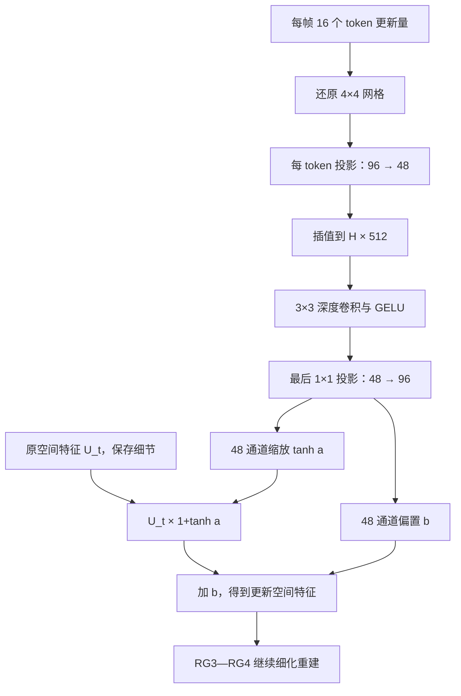

token 提供区域级条件，乘性调制作用于仍包含高频变化的 U_t，因此能影响细节通道的使用。新的空间细节也可由后半段恢复主干结合本帧输入生成。

**初始恒等回注：** 只将最后 P_out 的权重和偏置置零，前面的 P_pre、DWConv 正常初始化。这样起点为 U_t 不变，同时 P_out 可获得梯度。将多个串联线性环节同时置零可能阻断学习，初始化验收要检查更新后的梯度可达性。

### 8.2 第二轮可选：同地面细节伴随传递

保留 Argon 的“描述子负责选择、空间载荷传递细节”设计。对目标 i=(t,r,k)，仅从其他帧的同地面区域读取完整空间特征：

$$
\mathcal J(i)=\{j=(t',r',k'):t'\ne t,\ r'=r,\ t'+k'=t+k\}.
$$

从最后一层 token attention 取各头平均的权重，限制到 J(i) 后重新归一化：

$$
\bar A_{ij}=\frac14\sum_{h=1}^{4}A_{ij}^h,
\qquad
\beta_{ij}=\frac{\bar A_{ij}}{\sum_{j'\in\mathcal J(i)}\bar A_{ij'}},\quad j\in\mathcal J(i).
$$

若没有有效来源或分母小于数值阈值，细节更新直接置零；正常情况下按上式归一化。F0/k0 的 s=0 和 F8/k3 的 s=11 为明确的空集样例。实现先生成有效掩码与安全分母，再对有效目标归一化，避免先计算 0/0 后掩码；无效目标在输出投影后仍置零，以排除投影 bias 的影响。空间更新为：

$$
R_i=\sum_{j\in\mathcal J(i)}\beta_{ij}\,P_V(U_j),
\qquad
\widetilde U_i^{\mathrm{detail}}=\widetilde U_i+P_D(R_i).
$$

P_V 常规初始化，P_D 零初始化；使用所有目标的更新前 U_j 同步读取，避免按帧循环顺序产生递推依赖。无需构建所有 144×144 对的高维特征副本，只对每个同地面小组聚合。

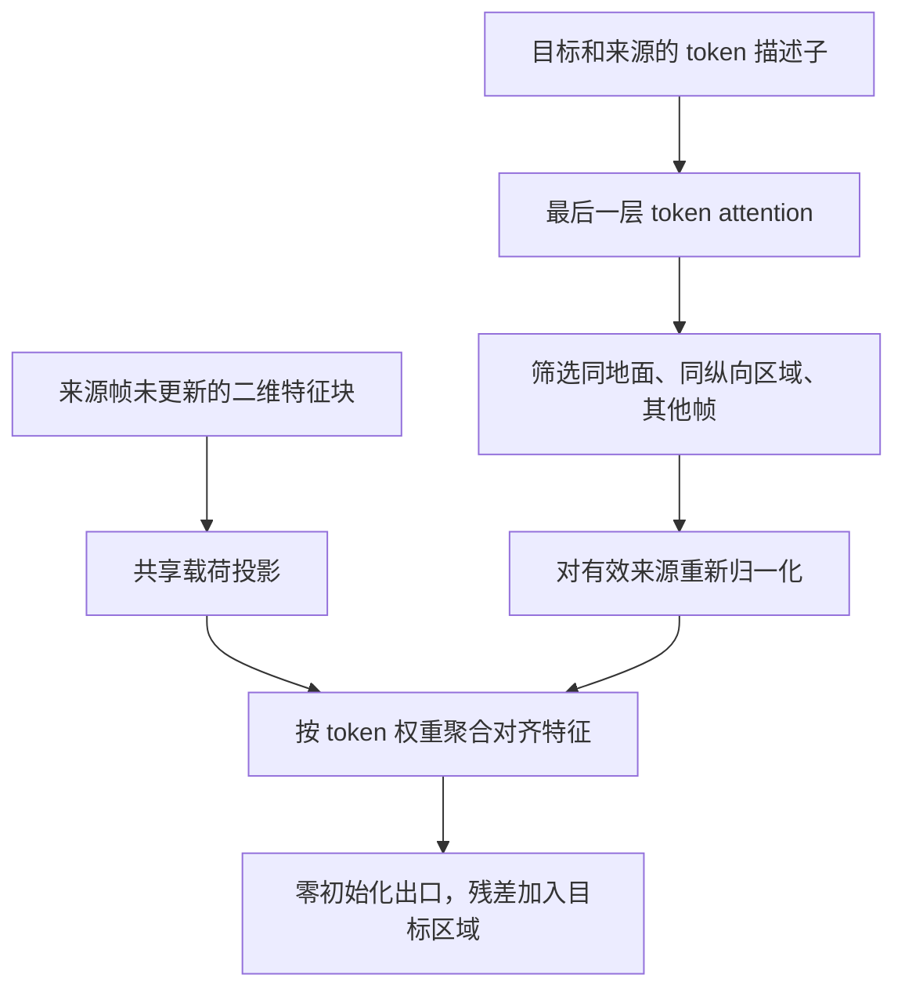

非同地面内容通过 token 条件路径参与恢复；像素位置对齐的细节传递只使用 J(i)。首轮 A/B/C/D 全部关闭 detail 路径，第二轮在 C 或 D 上成对比较开关，避免改变 C−B 的实验含义。

### 8.3 联合训练：使后半段学会使用更新特征

用 E、G、R 分别表示 UCAN 前半段、交互回注模块和后半段重建网络，整体为 U=E(X)、U'=U+G(U)、预测图像=R(U')，并保留 UCAN 原有浅层及图像残差。三部分使用全部九帧恢复损失共同优化，不长期冻结后半段。F4 的恢复误差可经交互通路训练其他帧的特征编码与来源选择。

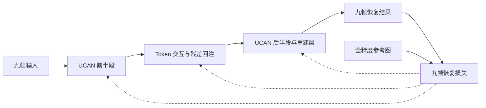

零初始化使相同骨干下的初始输出与 A 等价，随后共同训练。B/C 配对训练衡量跨帧收益；固定模型关闭回注仅作为依赖性诊断，与重新训练的对照分开记录。后半段是否正确利用新信息，以独立验证集图像误差和细节表现判断。

## 9. F4 收到信息的具体路径

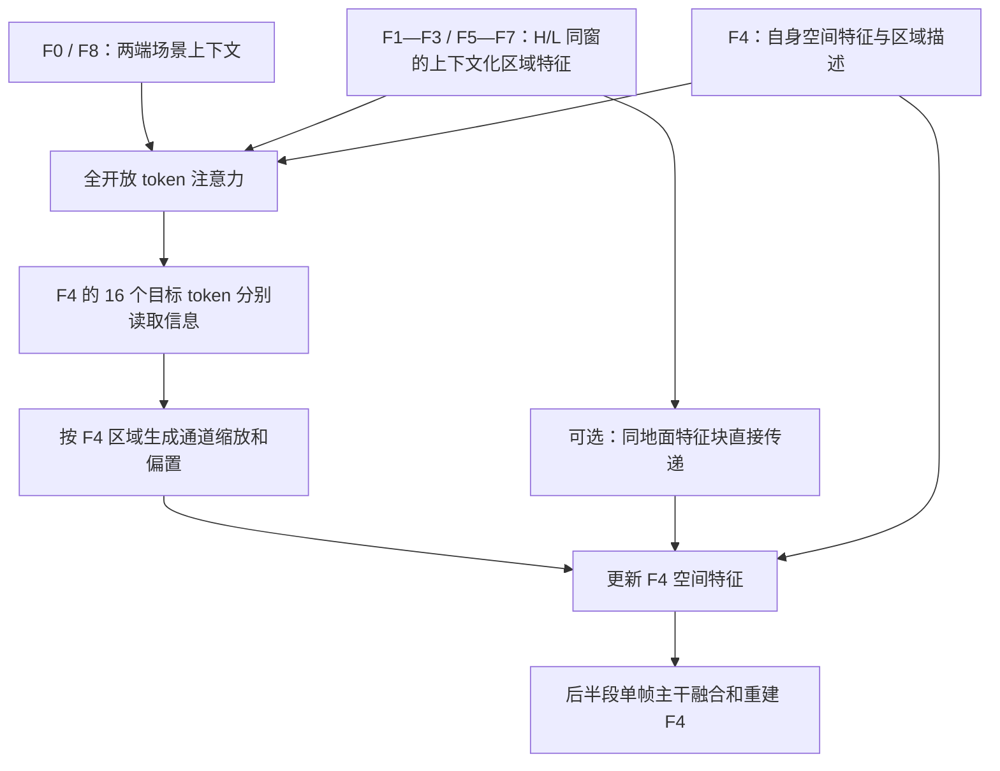

以 F4 的第一个条带为例：它在 F1、F2、F3 中也有同地面区域，但来源帧的视野不同。RG1—RG2 先形成各帧的区域表征；F4 的查询根据内容和几何关系选择来源，D 再加入质量条件；回注后 RG3—RG4 将接收条件和自身细节融合。

同理，F4 中间两个条带可以访问第 2.2 节表中的桥梁帧。全开放注意力允许它们直接读取相关帧；不要求信息机械地逐帧接力。若以后研究相邻帧传递，可单独比较局部序列 mask 与全开放 mask。

这里描述的是设计提供的信息路径。实验重点测量该路径对同一个 F4 目标带来的误差变化，并观察不同区域使用了哪些来源。

## 10. 首轮核心实验：A/B/C/D

| 组别 | Token 模块 | 几何 / 位置 | 帧间 mask | 质量偏置 | 回注 |
|---|---|---|---|---|---|
| A | 无 | 单帧原生 | 各帧独立 | 无 | 无 |
| B | 16 token/帧、2 层 | 与 C 相同 | 仅同帧可见 | 无 | 空间—通道调制 |
| C | 与 B 完全相同 | 与 B 相同 | 全开放 | 无 | 与 B 相同 |
| D | C 加质量偏置器 | 与 C 相同 | 全开放 | 来源×目标 | 与 C 相同 |

三个主要差值：B−A 观察新增 token 表征与调制的作用；C−B 观察开放跨帧交互的作用；D−C 观察整个质量条件化模块的增量。主表 D 即 D1；同期补充 D0 常数标签对照，以 D1−D0 衡量显式来源标签的贡献。

单帧输出融合 A+Fusion 作为辅助基准，直接复用 A 的浮点恢复结果做同坐标平均再裁回九帧，不占新增训练配置。

### 10.1 相同训练条件

四组及 D0 读取相同源序列、相同纵向裁剪和全部九帧目标，使用同一稳定底座、初始化来源、精度、损失、优化器和调度。B/C 公共参数逐项复制，D 从同一公共模块初始化并增加零初始质量偏置；D0/D1 复制完整初始参数。只设置相同随机种子不能代替参数逐项复制。

有些相对帧偏置在 B 中因 mask 而没有梯度，这是帧间不可见的自然结果。B/C 仍保持相同模块、相同参数集合和相同 dense attention 路径。

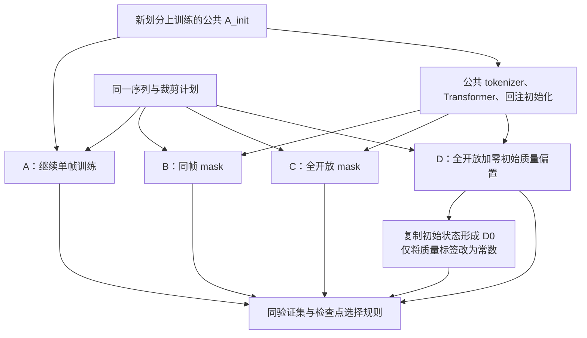

### 10.2 数据与初始化轨道

新独立划分按源场景或完整回波支持域建立，同源的不同 Q 版本同组。空间分块检查两轴支持范围，跨边界样本按清单排除；保留生成和归一化版本。

LKSA 有界门控作为统一底座：保留 channel 分支，对 gate 使用 gamma×tanh(gate/gamma)。在保存的失败现场和正常样本上从 gamma=2、4 中选定后统一使用。当前方案把它列为准备工作，其效果以实际检查为准。

主要实验路线采用公共基线热启动：

1. 在新训练划分上训练带统一稳定底座的单帧 UCAN，由新验证集九帧平均 PSNR 选择 A_init，并记录训练曲线、步数与额外预训练成本。既有单帧配置可作为起点，按新数据验证进展确定预算；不要求固定训练到某个历史步数。
2. A/B/C/D 及 D0 加载同一 A_init 骨干。A 也继续训练相同的 20k 更新，作为匹配预算的基准；所有组从新建的优化器和同一短训调度开始，新增模块采用配对初始化。
3. 前后两段 UCAN 与新增模块联合训练。共同预训练成本单列一次，各实验组另列增量训练成本；初始化等价只针对相同稳定骨干与相同输入、推理模式。

已有 300k 权重可用于快速接口与机制试验，单列为旧权重诊断轨道。随机初始化短跑用于可行性筛选，学习率和训练长度另行验证，不直接套用本版热启动的 20k 调度作为主要恢复结论。

## 11. 数据裁剪、损失与短训配置

### 11.1 共同纵向裁剪

序列输入完整保留每帧 W=512。九帧使用相同 y0 和 H，第一轮 H=64，随后可比较 H=128；不做独立横向裁剪，不旋转翻转。

一个序列的输入像素数为 9×64×512=294,912。双卡每卡一条序列时，每次更新为 589,824 像素，四组相同；20k 为 11,796,480,000 输入像素曝光。

本版全部九帧都参与输入和监督，不沿用旧母图方案中的三帧抽样协议。A 的九帧可微批处理，B/C/D 在交互点汇集同一序列的完整特征。

### 11.2 数据字段

| 字段 | 形状 / 类型 | 用途 |
|---|---|---|
| lq_seq | [9,1,H,512] | 序列输入 |
| gt_seq | [9,1,H,512] | 原始配对目标 |
| token_quality | [9,4,4,1] | D 的 H 来源比例 |
| frame_ids | [9] | 真实帧身份，顺序实验时一同追踪 |
| crop_top、crop_height | 整数 | 纵向坐标和尺度 |
| sequence_name、source_group | 字符串 | 划分与追溯 |

区域坐标可由 frame_ids、网格和裁剪信息确定。所有 GT 保留各帧原始数值。

### 11.3 损失与预算

首轮所有帧等权 Charbonnier：

$$
\mathcal L=\frac{1}{9B}\sum_{b,t}
\operatorname{mean}_{u,v}\sqrt{(\widehat Y_{b,t,u,v}-Y_{b,t,u,v})^2+10^{-9}}.
$$

这里 eps 与当前仓库一致，直接加在根号内。F4 为重点观察对象，首轮不额外提高其损失权重，以便首先测量结构本身的效果。

| 参数 | 首轮建议 |
|---|---|
| 输入 | B_seq=1/卡，T=9，H=64，W=512 |
| 骨干 | UCAN C=48，share=[N,F,N,F]，统一 LKSA 稳定底座 |
| 插入 | RG2 后、RG3 前，一次 |
| Token | 4×4=16/帧，D=96 |
| Token 生成 | 区域内 DWConv3×3→GELU→2×4 池化→LN(384)→Linear(384,96) |
| Transformer | 2 层，4 heads，FFN ratio=2，Pre-LN，dropout=0 |
| 回注 | bounded FiLM，detail=false |
| 初始化 | 全部组加载新划分公共 A_init，重新建立优化器，前后段均参与训练 |
| 优化器 | 热启动 Adam，lr=1e-4，betas=[0.9,0.99]，weight_decay=0 |
| 预算 | A/B/C/D 及 D0 各 20k 优化器更新；seed=42；公共预训练单列 |
| 调度 | 12k、17k 各乘 0.5 |
| 损失 | 九帧等权 Charbonnier，eps=1e-9 |
| 验证 / 保存 | 每 2k；记录 best 和 last |
| 主选权指标 | 验证集九帧平均 PSNR |
| 精度 | FP32，四组相同后端开关 |
| EMA / warmup | 首轮关闭 |

上述为热启动 pilot 起点。若需要延长比较，四组及 D0 同步延续至 40k，20k 后保持 LR=2.5e-5，30k、36k 再各减半；恢复 optimizer 与采样状态。资源允许时，对入选组和关键对照增加随机种子。

## 12. 显存、参数与推理执行

### 12.1 区分小型 attention 与完整模型成本

144×144 的 token attention 每头 20,736 项；4 heads、FP32、B=1 时单层权重约 0.316 MiB。九帧空间特征、UCAN 内部 attention、反向保存状态和 FiLM 空间运算仍是主要资源项。

在下列具体定义下，B/C 新增参数预算如下；完成代码后用实际模型计数复核：

| 模块 | 参数预算 |
|---|---:|
| Tokenizer：DWConv48、LN(384)、Linear(384,96) | 38,208 |
| frame/row/col 嵌入，共 17×96 | 1,632 |
| 两层 Transformer，含各自几何偏置 | 149,944 |
| 回注：96→48、DWConv48、48→96 | 9,840 |
| B/C 新增合计 | 199,624 |
| B/C 加现有 683,817 参数骨干 | 883,441，约 0.883M |
| D0/D1 两层的来源/目标 MLP 新增 | 6,544 |
| D0/D1 预计总量 | 889,985，约 0.890M |

Tokenizer 参数为深度卷积 480、LN 768、线性投影 36,960，共 38,208。预算假设 qkv/out Linear 带 bias，FFN 为 96→192→96，每个 block 两个 affine LayerNorm；回注投影带 bias；质量分支复用注意力 LN。统计 tokenizer 对照为 9,504 参数，比主 tokenizer 少 28,704；表中不含可选 detail 或增量末端 LN。模型参数仍较紧凑，实际时延还需计入九帧骨干和空间回注。

### 12.2 首次运行与显存控制

先完整运行前向、反向和 optimizer step，记录峰值，随后再决定每卡 batch。输入像素量用于比较，不代替显存实测。

现有配置 use_checkpoint=false。首次容量试跑可开启已有 block checkpoint，实测与关闭时的显存、耗时及输出一致性；该开关仍需把跨组共享 attention 作为输出保留，不能据此假定九帧必然装入显存。输入像素为三倍，不代表总显存恰为三倍。确定策略后，各配对实验使用一致的重计算设置并记录。

内存紧张时依次采用：减少每卡源序列 batch；checkpoint 部分训练 block；分帧执行骨干前后段；最后统一调整裁剪高度或精度。若使用梯度累积，四组保持相同有效源序列数和优化器更新次数。

每卡一条序列、H=64 的输入像素量为旧单帧每卡 6 张 128×128 的三倍，启动时优先完成真实反向测量。若采用 checkpoint，优先评估把 RG1→RG2 或 RG3→RG4 的完整配对计算作为重计算单元：共享 attention 在配对内部使用，只返回配对后的空间特征。这样可减少为反向保留的中间量，配对执行时的瞬时工作显存仍需实测。每卡 batch 已为 1 时，不再通过减少源序列 batch 解决容量问题。

### 12.3 完整九帧推理的数据依赖

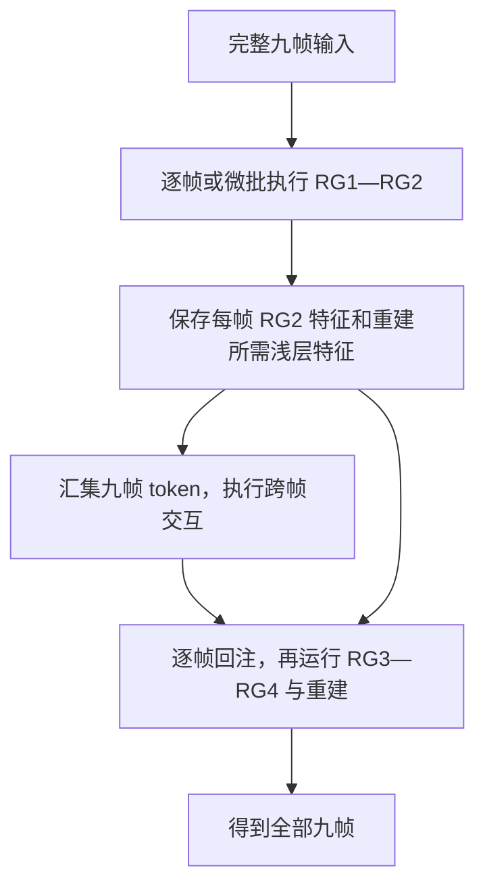

首轮 detail=false 时，跨帧部分只依赖紧凑 token；空间特征可按帧存储或在显存紧张时转移，额外搬运计入端到端时延。启用 detail 后要额外满足同地面载荷读取的存储需求。

首选整帧 H=512 评价。如果使用纵向切片，九帧同步切片，A/B/C/D 统一高度、步长、融合函数。例如高度 128、步长 64，按固定正权重融合；这会改变纵向上下文和 token 覆盖尺度，作为单独推理模式记录。

## 13. 第二轮实验：粒度、桥梁帧与细节路径

### 13.1 Token 粒度与层次化

先比较 K=1、4、16，统一 D、Transformer 深度与训练协议。K=1 回注为全帧条件；K=4 为 1×4 网格；K=16 为 4×4 网格。对应几何表的纵向范围随网格变化，报告实际参数差异。

Argon 的 `1+4` 作为单独层次变体：每帧一个全局 token、四个条带 token，总计 45。全局 token 没有唯一地面位置，添加 global/strip 类型嵌入；帧相对偏置用于所有 token，精确地面偏置仅用于 strip-to-strip。

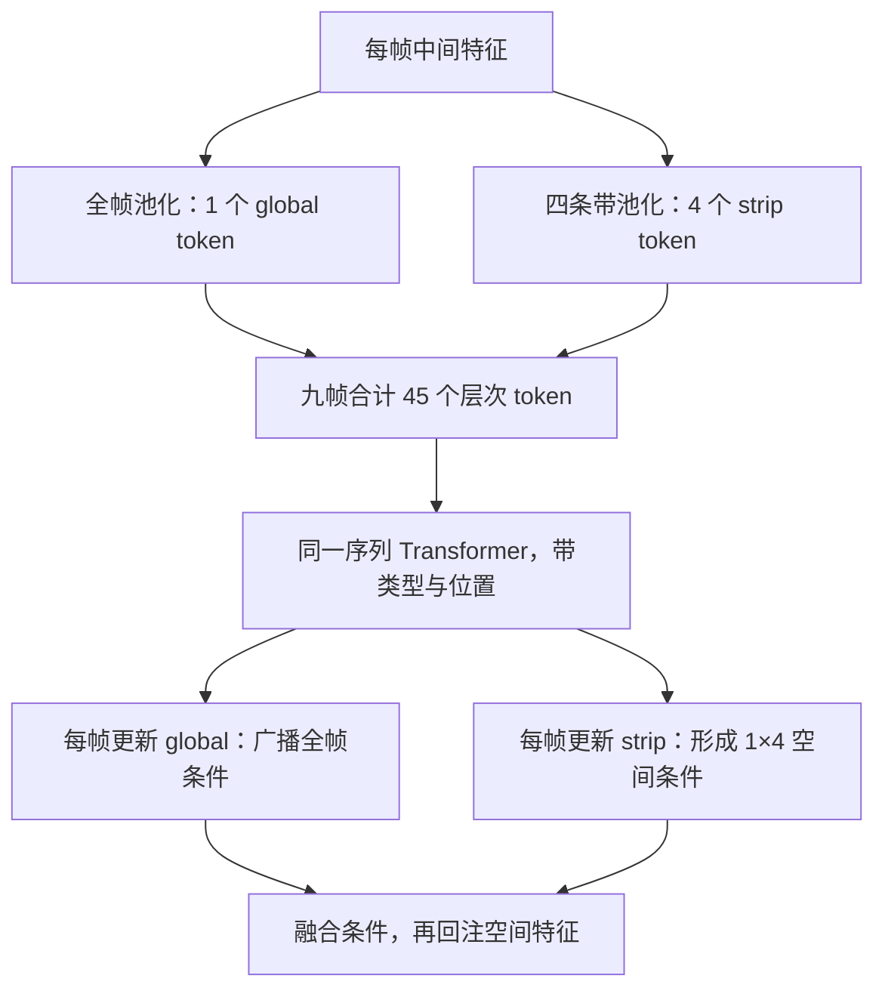

这样可以比较“帧级整体描述是否补充了区域描述”，而不必一开始同时开发两套 9×9 和 36×36 attention。

### 13.2 质量和回注消融

首轮安排 C、D0、D1 配对比较。后续按增量顺序开展：小网格 tokenizer 与均值＋标准差 tokenizer；D 去掉目标需求只保留来源偏置；真实 q 与置乱 q；最佳 C/D 的 FiLM 与简单加法回注；同地面 detail 分支。固定布局下，另行改变质量布局可检验质量来源编码对新分布的适应性。

detail 消融使用相同 token 模型和训练预算，明确冻结/微调策略。保存有效来源数量、归一化载荷权重及贡献强度，联合检查细节保真。

### 13.3 序列关系实验

| 实验 | 操作 | 解释目的 |
|---|---|---|
| 帧排列一致性 | 同时重排图像、帧身份、质量与坐标，输出逆排列 | 检查实现按元数据处理帧，而非错误依赖数组位置 |
| 错配身份 | 图像不动，仅错配帧/位置元数据；保持其他条件 | 观察模型对正确序列几何的依赖 |
| 几何消融 | 配对训练移除地面偏置或帧序编码 | 区分内容、几何、帧身份各自的作用 |
| 桥梁来源屏蔽 | 在所有 token 层禁止选定桥梁帧作为跨帧 key/value | 观察哪些来源支撑中心恢复 |
| 两端来源屏蔽 | 屏蔽 F0/F8 的跨帧 key/value | 观察非重叠两端上下文的作用 |
| 同地面与全开放 | 配对训练同地面 mask 与全开放 mask | 比较对齐补充和更广上下文 |

全开放 attention 对一致的 token 重排列应保持相应输出重排列。仅重排存储顺序并一同移动坐标，不应被解释为破坏了序列语义。

来源屏蔽作用于所有交互层；如启用 detail，也同步屏蔽载荷来源，避免第二条路径绕过屏蔽。固定模型的屏蔽实验描述依赖性，配对重训描述结构能力。两类结果分开记录。

## 14. 评价、图表和结果判断

### 14.1 首轮主表

| 方案 | 参数量 | 九帧 PSNR/SSIM | F4 PSNR/SSIM | F4 中心条带 | H 内部表现 | 九帧时延 | 显存 |
|---|---|---|---|---|---|---|---|
| A 单帧 | 实测 | 待填 | 待填 | 待填 | 待填 | 待填 | 待填 |
| A+Fusion | 同 A | 待填 | 待填 | 待填 | 待填 | 待填 | 待填 |
| B 帧内 token | 实测 | 待填 | 待填 | 待填 | 待填 | 待填 | 待填 |
| C 跨帧 token | 同 B | 待填 | 待填 | 待填 | 待填 | 待填 | 待填 |
| D1（D）真实质量条件化 | 实测 | 待填 | 待填 | 待填 | 待填 | 待填 | 待填 |
| D0 常数质量配对补充 | 同 D1 | 待填 | 待填 | 待填 | 待填 | 待填 | 待填 |

F4 中心条带指 k=1、2，对应本帧 x=[128,384)。它比单独平均 F4 更直接反映中心内部恢复。另报四个条带的误差与固定散射点 ROI。

### 14.2 指标与选权

沿用 uint8、整帧 crop_border=0 的 PSNR/SSIM，输出逐帧、帧位置、逐序列结果。区域 PSNR 根据区域 MSE 计算；区域 SSIM 使用有效局部窗口，不以 mask 外填零代替区域评价。

每 2k 在固定 val 上验证，按九帧平均 PSNR 选择 best，并记录统一 20k 的 last。F4、H/L 和 ROI 用于解释恢复分布。固定方案后评价独立 test，按源场景/空间块汇总差值。

名义 H/L 与边界邻域按生成器坐标定义；固定 ROI 检查峰值误差、位置偏移、弱点局部对比度和新增亮点。整体序列质量提高与 F4 改善一起呈现。

**序列验证接口：**按完整源序列分配验证样本，每条只推理一次、不跨 rank 补齐重复。得到 [B,9,1,H,512] 后按 b、t 拆成单帧，再分别调用图像转换与指标函数；记录 sequence_id、frame_id、各自 LQ/GT 路径。分布式归约每个帧位置的指标和与计数，再得到 F0～F8 与九帧平均。输出文件名包含序列和帧身份。

现有 DistributedValidationMixin 按单图路径和计数组织，需要序列适配。tensor2img 会先 squeeze(0)，因此 [1,9,1,H,W] 可能被转成拼图，不能把未报错当作验证正确。禁止以九帧拼图计算主指标；以逐帧离线评价对照序列验证输出，并检查总数为序列数×9、每个帧位置各出现一次。训练、推理、路径命名、统计与保存统一保留帧身份。

### 14.3 最值得画的六类结果图

1. **F0—F8 曲线：** 输入与 A/B/C/D 输出 PSNR，展示序列各位置的增益。
2. **F4 分区误差图：** 固定灰度范围及误差范围，对比中心、边缘和散射点。
3. **目标到来源热图：** 将 F4 的 token attention 按来源帧汇总，展示不同区域的来源选择。
4. **同地面来源图：** 对固定 s、r，展示不同帧对应区域及细节路由权重。
5. **质量需求与来源得分图：** 展示 d_i、c_j 和实际 attention 的关联。
6. **屏蔽前后差值图：** 同一 F4 输入，比较屏蔽不同来源后的恢复变化。

attention 图用于展示模型读取行为，和输出误差及来源干预一起解释。可以先对 F4 的 16 个目标、全部来源按帧聚合得到 16×9 图，比直接展示 144×144 更容易讨论。

### 14.4 效率口径

记录同 GPU、同 dtype、同纵向切片协议下的完整九帧流水线，预热后同步计时，报告纯网络与端到端 P50/P95、峰值 allocated/reserved。完整时延包括 tokenizer、token 交互、回注和必要搬运。

A+Fusion 的端到端成本包含 A 的九帧推理。序列模型的目标是恢复收益与可用开销的平衡，不预设几何面积缩减带来的三倍加速。

## 15. 实施步骤、验收与交付

### 15.1 推荐实施顺序

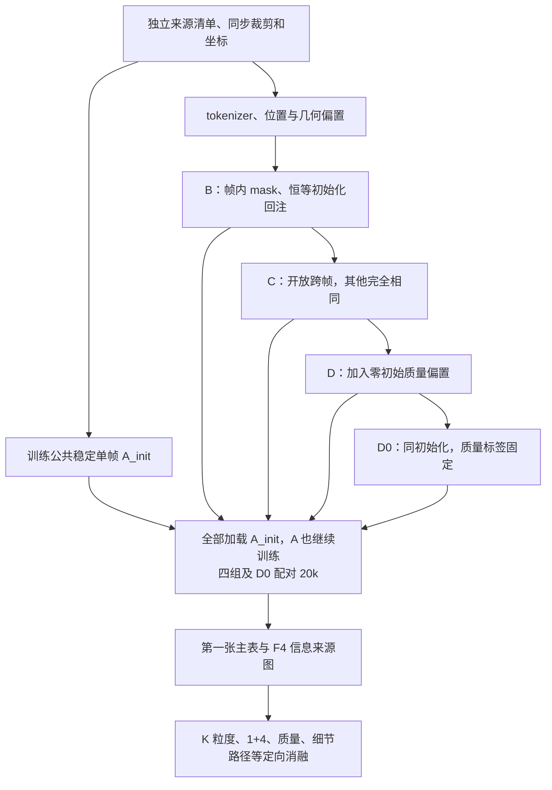

### 15.2 建议代码职责

| 拟新增 / 修改位置 | 职责 |
|---|---|
| 序列数据集 | 读取九帧、同步纵向裁剪、来源标签和坐标 |
| 独立 token 模块 | tokenizer、位置编码、两层 attention、质量偏置、回注 |
| UCAN 序列适配 | RG2 后纯张量重排插入；保持成对共享接口；恢复全部九帧 |
| 序列模型包装 | 九帧损失、按序列分片并逐帧验证、帧路径及命名、状态保存 |
| 统一 evaluator | A/B/C/D、输出融合、区域/来源分析、效率 |
| options/SAR 下独立配置 | A/B/C/D 共享默认值，仅开启相应差异 |

本文提供设计与操作规格，代码实现另行执行。先集中实现一个可切换模块，避免为 B/C 建立两份独立网络逻辑。

### 15.3 关键验收

| 检查 | 预期行为 |
|---|---|
| 坐标样例 | F1/k3、F2/k2、F3/k1、F4/k0 的 s 都为 4 |
| 区域切分 | 用二维递增坐标图验证 r/k 方向与还原顺序 |
| 接口往返 | [9B,HW,48] 与空间特征纯重排互逆，不额外调用带 LN 的 patch_embed |
| B 的隔离 | 改变其他帧输入，本帧输出不变；所有路径均遵守 mask |
| C 的可达性 | 回注出口完成更新后，F4 损失能够反传到其他帧特征 |
| 恒等初始化 | 共享骨干时 B/C/D 初始输出与 A 在浮点容差内一致 |
| 质量起点 | c=0、d=1，D 的 attention 与 C 在相同输入下等价 |
| 初始化覆盖 | UCAN 全局初始化后再执行特殊零初始化；加载权重不重置 |
| 梯度 | 连续执行前向、反向、更新，按下表检查传播阶段，不要求初始所有模块非零 |
| D0/D1 配对 | 模块、参数初值和采样一致，仅质量标签为常数/真实值；标签固定仍可学习内容 |
| detail | s=0、11 及低分母目标安全置零；只读取更新前同地面来源；无效目标最终更新为零 |
| 序列评价 | 序列总数×9 帧，逐帧结果与离线评价一致，各 rank 无重复；不计算拼图主指标 |
| 重排列 | 图像与元数据一致重排后，逆排列输出与原结果一致 |
| 保存恢复 | 模型、optimizer、LR、采样及 RNG 状态恢复，四组配对采样可追溯 |

新模块零初始化只保证起点的函数关系，训练后的效果由实验测量。数值等价验收使用 FP32 容差，并在失败时定位具体操作。

梯度检查使用非退化的合成输入和目标，连续执行 forward→backward→optimizer.step，每次清空梯度并记录梯度范数。零初始化分支的典型传播阶段如下：

| 阶段 | 预期首先获得学习信号的部分 |
|---|---|
| 第一次反向 | 回注 P_out；UCAN 骨干仍通过原空间主路学习 |
| P_out 更新后 | P_pre、DWConv、tokenizer、attention，以及来源质量分支输出层 |
| 来源输出层更新、c 不再全零后 | 来源隐藏层及目标需求分支输出层 |
| 目标输出层更新后 | 目标需求分支隐藏层 |

上述为检查顺序，不规定第三步所有参数必有非零梯度。B 中被 mask 排除的几何项等可自然保持零梯度；按有效路径检查梯度有限及逐步可达。为避免偶然对称造成误判，可在若干更新后分别检查来源与目标分支的有效梯度。

### 15.4 产物

文档、清单和结果摘要保存到 `docs/experiments/cross_frame_token_v1/`；模型和训练状态沿用 `experiments/`，逐帧结果沿用 `results/`。

每组记录 Git commit、manifest/split 哈希、A_init 来源与公共预训练成本、采样计划、tokenizer 类型、token 粒度、位置模式、mask、quality/detail 开关、gamma、重计算设置、实际 batch、步数、推理切片和 checkpoint 选择。

首轮交付：公共 A_init、A/B/C/D 四个核心配置和权重、D0 配对补充、A+Fusion 辅助结果、核心主表及质量标签配对结果、F0—F8 曲线、F4 ROI、16×9 来源图、训练成本与下一轮选择。

## 16. 向导师讲解的顺序

1. **任务：** 九帧质量与视野不同，重点利用前后帧帮助中间 low 帧，输出全部九帧。
2. **表征：** 每帧保留完整空间特征，同时生成一个或多个可参与序列交互的 token。
3. **关系：** 帧身份描述来源，地面坐标描述对应关系，质量标签补充来源构成。
4. **交互：** 目标区域通过 Query 读取其他帧的 Key/Value；不同目标拥有不同来源权重。
5. **重建：** token 更新调制目标帧特征；可选的对齐载荷路径补充直接细节传递。
6. **证据：** B/C 仅改变跨帧可见性，D 增加动态质量条件模块，D1/D0 检验显式标签；再比较 token 粒度与桥梁来源。

可直接口述：

> 我们研究的核心是如何把一帧 SAR 图像表示为适合序列 Transformer 交互的 token。第一版将每帧中间特征划分为十六个区域，保留各帧身份和地面对应关系，让九帧的一百四十四个 token 联合交互。中间帧的不同区域可以选择不同前后帧的信息，交互结果再作为空间和通道条件送回恢复主干。这样既保留单帧的细节表征，又建立了明确的跨帧信息路径。通过帧内 token、跨帧 token 和质量条件化三个层次的比较，检验序列信息及来源质量如何改善中心帧恢复。

## 17. 仓库依据

- [UCAN 架构](../basicsr/archs/ucan_arch.py)：RG1→RG2、RG3→RG4 共享关系，RG2 后的插入位置，以及全局初始化逻辑。
- [UCAN 模型包装](../basicsr/models/ucan_model.py)：现有单帧训练与验证前向接口。
- [当前数据集](../basicsr/data/sar_single_dataset.py)：单通道读取、归一化和配对裁剪。
- [当前配置](../options/SAR/train_ucan_single.yml)：骨干设置与历史训练协议。
- [损失定义](../basicsr/losses/basic_loss.py)：Charbonnier 的 eps 口径。
- [评价脚本](../scripts/eval_sar.py)：逐帧和帧位置指标输出。
- [分布式验证](../basicsr/models/distributed_validation.py)、[图像转换](../basicsr/utils/img_util.py)：序列分片、逐帧转换与汇总的适配位置。
- LKSA 故障与历史实验可通过 Git 记录追溯；本版设计结合用户提供的 Argon 两次思考整理，采用可直接比较的跨帧 token 原型。
