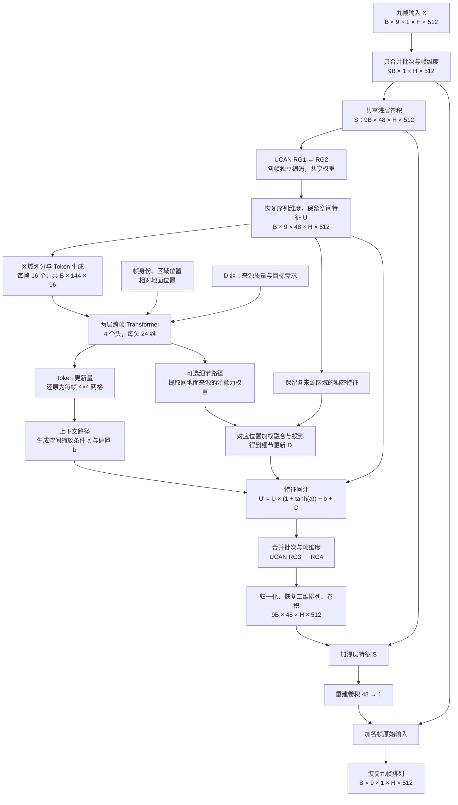
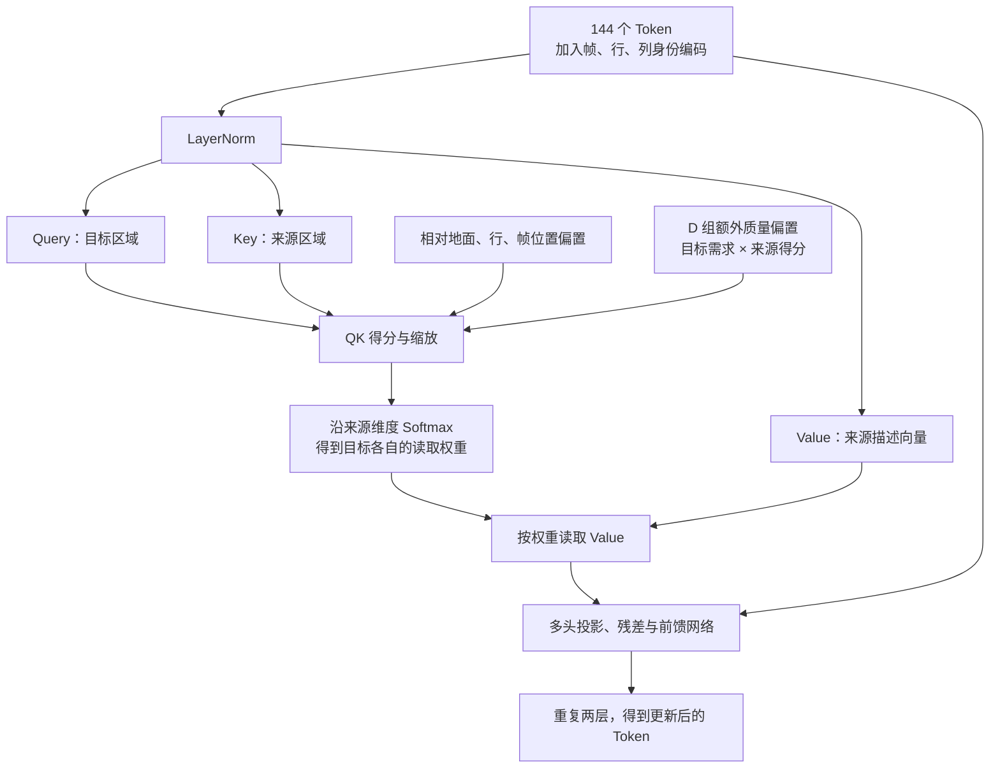
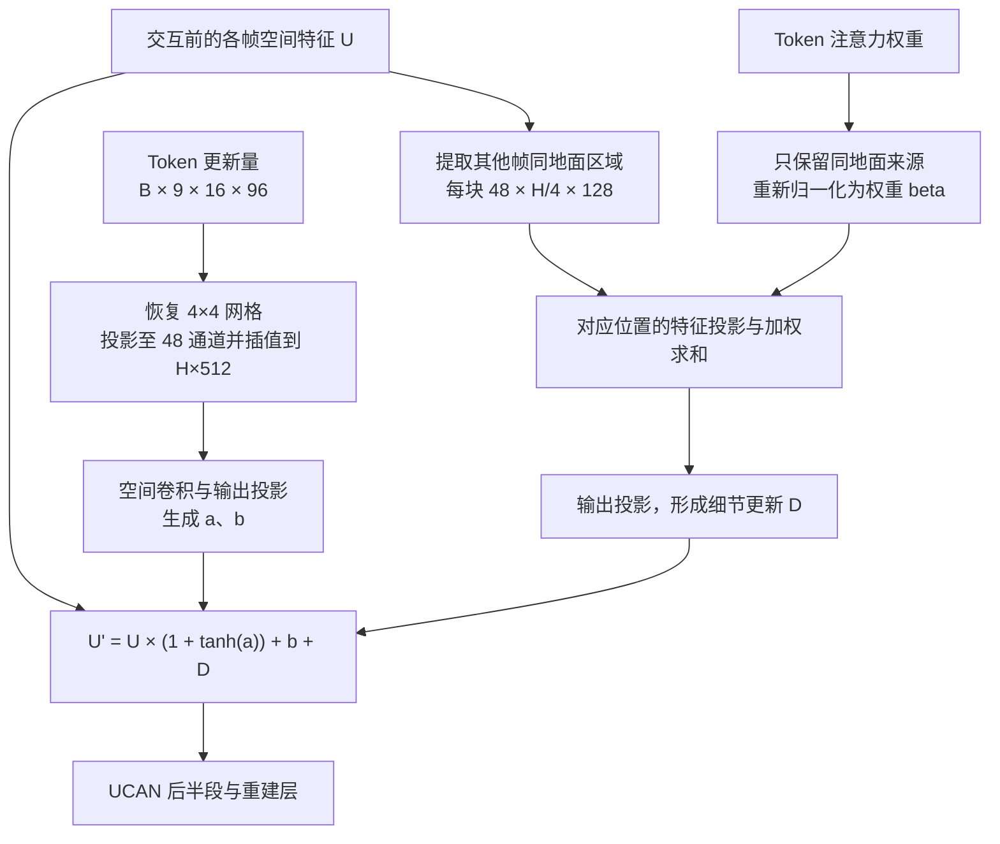
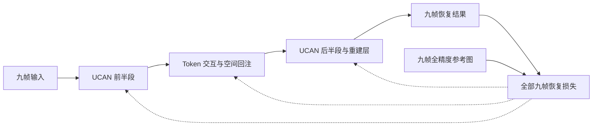

# 单比特 SAR 序列恢复：阶段讨论报告

日期：2026-11-16

## 一、已有实验情况

已完成 SwinIR、HINT、UCAN 三种单帧恢复基线的训练与验证，建立逐帧、逐序列评估流程。当前研究由单帧恢复推进到九帧联合恢复，重点改善中间低质量帧 F4。

**原 H/L 数据上的历史验证结果：**

| 模型     |         参数量 | 最佳 PSNR（dB） |       对应迭代数 |    最佳 SSIM |
| ------ | ----------: | ----------: | ----------: | ---------: |
| SwinIR |    11.498 M |     24.1864 |     493,358 |     0.7849 |
| HINT   |    24.871 M | **24.8042** |     813,496 | **0.7939** |
| UCAN   | **0.684 M** |     24.6824 | **300,000** |     0.7913 |

历史训练预算不同，PSNR 与 SSIM 的最佳值分别统计。UCAN 参数量约为 HINT 的 **2.75%**，最佳验证 PSNR 相差 **0.1218 dB**，体现出较好的精度与模型规模平衡。

**UCAN 完成 400k 训练后的测试结果：**共 328 条序列、2,952 帧。

| 评价范围 | 输入 PSNR（dB） | 恢复 PSNR（dB） | PSNR 提升（dB） | 恢复 SSIM |
|---|---:|---:|---:|---:|
| 全部九帧平均 | 21.0284 | 24.1317 | +3.1033 | 0.7841 |
| 中心低质量帧 F4 | 20.7483 | 23.7613 | +3.0130 | 0.7630 |
| 左端高质量帧 F0 | 21.2616 | 24.3756 | +3.1140 | 0.8032 |
| 右端高质量帧 F8 | 21.3435 | 24.6251 | +3.2816 | 0.8036 |

九个帧位置均有恢复增益，F4 恢复后仍比两端均值低 **0.7390 dB**，是下一阶段的重点改善对象。

此外，UCAN 在 Q=2 实验中达到验证 PSNR **24.5978 dB**，后期出现数值失稳；已定位到 LKSA 乘性分支的特征放大，为后续稳定化提供了明确方向。

数据依据：[SwinIR 日志](../experiments/swinir_sar_single/train_swinir_sar_single_20260914_133542.log)、[HINT 日志](../experiments/hint_sar_single_archived_20261021_151605/train_hint_sar_single_20261015_151705.log)、[UCAN 日志](../experiments/ucan_sar_single/train_ucan_sar_single_20261103_162812.log)、[测试汇总](../results/ucan_sar_single/net_g_latest/sar_test/frame_position_summary.csv)、[Q=2 日志](../experiments/ucan_sar_single_q2/train_ucan_sar_single_q2_20261106_160014.log)。

## 二、UCAN 的优点、缺点与选择原因

| 方面 | 判断 |
|---|---|
| 优点：轻量且精度较好 | 约 68 万参数，历史验证精度接近 HINT，适合在此基础上增加序列交互模块。 |
| 优点：空间建模基础完整 | 结合局部窗口、较大范围空间特征和全局聚合，可继续承担单帧细节提取与重建。 |
| 优点：已有实验积累 | 已具备完整训练、测试和故障诊断记录，便于开展有依据的结构改进。 |
| 缺点：缺少显式跨帧交互 | 当前逐帧独立恢复，F4 无法主动利用前后帧的上下文与不同视野下的区域特征。 |
| 缺点：存在稳定性问题 | Q=2 训练暴露出乘性分支放大，需要统一采用稳定化处理。 |
| 缺点：参数少不等于显存低 | 高分辨率注意力仍有显存开销，九帧训练需要配合裁剪与显存优化。 |

**选择 UCAN，是因为它以较小模型规模提供了较好的单帧恢复基础，适合把新增模型能力集中用于跨帧信息交互。**

## 三、后续改进方向与实验规划

**研究主线：将每帧图像表征为一个或多个 Token，通过 Transformer 的跨帧交互，利用前后帧信息促进中间低质量帧恢复，同时恢复全部九帧。**

模型流程：**九帧分别提取特征 → 每帧生成区域 Token → 跨帧注意力交互 → 信息回注各帧特征 → 输出九帧恢复结果。**

首轮采用每帧 16 个区域 Token，保留帧身份与空间对应关系。Token 生成采用保留布局的小网格池化与可学习投影；跨帧信息通过空间调制回注，并设置可选的同地面细节传递路径。以下为拟实现结构。

### 3.1 完整结构：先独立编码，再跨帧混合，最后逐帧重建

图中 B 为序列批次大小，H 为图像高度；训练采用 H=64，每帧保持完整宽度 512。UCAN 空间特征为 48 通道，区域 Token 为 96 维。

**合并到 9B 只用于批量执行单帧编码，不产生跨帧混合。真正的序列交互发生在每条序列的 144 个 Token 之间。**插入点位于 RG2 与 RG3 之间，保留 RG1→RG2、RG3→RG4 原有的注意力共享关系。后半段接收的始终是完整空间特征。

### 3.2 Token 生成：压缩区域，同时保留粗粒度空间布局

每帧特征划分为 4×4 个区域。H=64 时，每个区域为 48×16×128；先提取局部结构，再池化成 2×4 小网格，按固定位置顺序投影成一个 Token。

所有帧和区域共享同一个生成器。固定网格顺序使投影能够区分区域内部不同位置；完整细节继续保留在空间特征分支。原先的均值、标准差方案作为 Token 生成方式的对照。

| 阶段 | 张量形状 | 含义 |
|---|---|---|
| 九帧空间特征 | B × 9 × 48 × H × 512 | 各帧独立编码后的完整特征 |
| 区域划分 | B × 9 × 4 × 4 × 48 × H/4 × 128 | 两个 4 分别表示区域行、列 |
| 区域 Token | B × 9 × 16 × 96 | 每帧 16 个结构摘要 |
| 跨帧序列 | B × 144 × 96 | 同一序列内九帧共同交互 |
| 每层 Q、K、V | B × 4 × 144 × 24 | 4 个头，每头 24 维 |
| 每层注意力矩阵 | B × 4 × 144 × 144 | 行为目标区域，列为来源区域 |
| Token 更新网格 | B × 9 × 96 × 4 × 4 | 按所属帧及区域位置恢复排列 |
| 回注后的空间特征 | B × 9 × 48 × H × 512 | 供 UCAN 后半段继续重建 |

### 3.3 跨帧交互：目标区域选择有帮助的来源

区域索引为帧 t、纵向区域 r、横向条带 k，其地面条带编号为 s=t+k。同地面区域满足 s 和 r 相同；位置编码与相对偏置使模型区分同地面不同视野和其他区域上下文。九帧采用相同纵向裁剪，保证对应关系。质量分支结合 Token 内容与区域 H 来源比例学习来源得分和目标需求。

### 3.4 两条回注路径：上下文指导与同地面细节传递

**上下文路径为首轮默认配置。**用两层交互前后的 Token 差值恢复每帧 4×4 网格，投影到 48 通道并插值到 H×512，通过空间卷积产生 a、b，调整目标帧已有特征。

**同地面细节路径作为独立开关。**从最后一层注意力取各头平均，仅保留其他帧的同地面来源并重新归一化，用所得权重融合对应区域的稠密特征。

例如 F4 左侧条带与 F1 第四条带、F2 第三条带、F3 第二条带对应相同地面。它们经不同视野下的编码后，可提供不同的上下文化特征；融合时保留区域内部的空间排列。没有有效同地面来源时 D=0；所有来源均取自本次回注前的特征。

### 3.5 联合训练：让交互模块与重建网络共同适应

虚线表示损失对三个部分共同反向传播。回注的最终输出层零初始化，使起点满足 a=b=D=0、U'=U；后续通过联合训练学习有效更新。F4 的恢复误差能够沿跨帧路径训练来源选择及来源特征编码。以独立验证集的恢复成绩和模块对照判断改进效果。

### 3.6 对照实验与执行安排

**首轮预备的对照实验：**

| 组别  | 方案                  | 回答的问题                 |
| --- | ------------------- | --------------------- |
| A   | 单帧 UCAN             | 单帧恢复基准是多少？            |
| B   | UCAN + 仅帧内 Token 交互 | 增加 Token 模块本身能带来多少收益？ |
| C   | UCAN + 跨帧 Token 交互  | 前后帧信息能否进一步改善 F4？      |
| D   | C + 质量条件化交互         | 显式利用质量来源能否提升信息选择效果？   |

直接复用 A 的输出进行重叠区域平均融合，作为无需额外训练的辅助对照。

B/C/D 统一使用保留布局的 Token 生成器和相同回注结构；B 仅允许帧内交互，C/D 开放跨帧交互。首轮四组均关闭同地面细节路径，随后在选定的跨帧方案上单独开启，比较其额外细节收益。

执行安排：

1. **同步准备：**按源场景或空间支持域建立独立划分，减少现有划分中的重叠；确定统一的 LKSA 稳定化设置，完成 Token 模块原型。
2. **首轮短训：**四组采用相同数据、训练预算和评价方式，先运行 20k 步。保留九帧完整横向视野，沿高度配对裁剪，控制训练显存。
3. **比较结果：**重点看 F4 及其内部区域的 PSNR/SSIM，同时报告九帧平均、高质量区域保真度、整段推理时间和峰值显存。以 C 对 B 判断跨帧收益，以 D 对 C 判断质量条件的贡献。
4. **后续深化：**围绕有效方案比较每帧 1、4、16 个 Token，分析前后帧贡献，并探索同地面区域的细节传递；随后延长训练，形成完整结果。

下一阶段的核心产出是：**一张四组对比表，以及能够解释“哪些前后帧信息帮助了 F4 恢复”的实验结果。**
