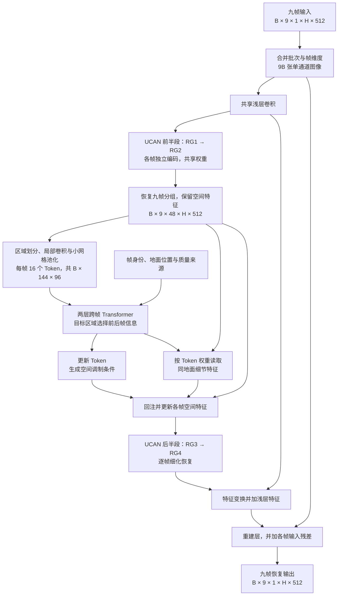

# 单比特 SAR 序列恢复：阶段讨论报告

日期：2026-11-16

## 一、已有实验情况

已完成 SwinIR、HINT、UCAN 三种单帧恢复基线的训练与验证，建立逐帧、逐序列评估流程。当前研究由单帧恢复推进到九帧联合恢复，重点改善中间低质量帧 F4。

**原 H/L 数据上的历史验证结果：**

| 模型     |         参数量 | 最佳 PSNR（dB） |       对应迭代数 |    最佳 SSIM |
| ------ | ----------: | ----------: | ----------: | ---------: |
| SwinIR |    11.498 M |     24.1864 |     493,358 |     0.7849 |
| HINT   |    24.871 M | **24.8042** |     813,496 | **0.7939** |
| UCAN   | **0.684 M** |     24.6824 | **300,000** |     0.7913 |

历史训练预算不同，PSNR 与 SSIM 的最佳值分别统计。UCAN 参数量约为 HINT 的 **2.75%**，最佳验证 PSNR 相差 **0.1218 dB**，体现出较好的精度与模型规模平衡。

**UCAN 完成 400k 训练后的测试结果：**共 328 条序列、2,952 帧。

| 评价范围 | 输入 PSNR（dB） | 恢复 PSNR（dB） | PSNR 提升（dB） | 恢复 SSIM |
|---|---:|---:|---:|---:|
| 全部九帧平均 | 21.0284 | 24.1317 | +3.1033 | 0.7841 |
| 中心低质量帧 F4 | 20.7483 | 23.7613 | +3.0130 | 0.7630 |
| 左端高质量帧 F0 | 21.2616 | 24.3756 | +3.1140 | 0.8032 |
| 右端高质量帧 F8 | 21.3435 | 24.6251 | +3.2816 | 0.8036 |

九个帧位置均有恢复增益，F4 恢复后仍比两端均值低 **0.7390 dB**，是下一阶段的重点改善对象。

此外，UCAN 在 Q=2 实验中达到验证 PSNR **24.5978 dB**，后期出现数值失稳；已定位到 LKSA 乘性分支的特征放大，为后续稳定化提供了明确方向。

数据依据：[SwinIR 日志](../experiments/swinir_sar_single/train_swinir_sar_single_20260914_133542.log)、[HINT 日志](../experiments/hint_sar_single_archived_20261021_151605/train_hint_sar_single_20261015_151705.log)、[UCAN 日志](../experiments/ucan_sar_single/train_ucan_sar_single_20261103_162812.log)、[测试汇总](../results/ucan_sar_single/net_g_latest/sar_test/frame_position_summary.csv)、[Q=2 日志](../experiments/ucan_sar_single_q2/train_ucan_sar_single_q2_20261106_160014.log)。

## 二、UCAN 的优点、缺点与选择原因

| 方面 | 判断 |
|---|---|
| 优点：轻量且精度较好 | 约 68 万参数，历史验证精度接近 HINT，适合在此基础上增加序列交互模块。 |
| 优点：空间建模基础完整 | 结合局部窗口、较大范围空间特征和全局聚合，可继续承担单帧细节提取与重建。 |
| 优点：已有实验积累 | 已具备完整训练、测试和故障诊断记录，便于开展有依据的结构改进。 |
| 缺点：缺少显式跨帧交互 | 当前逐帧独立恢复，F4 无法主动利用前后帧的上下文与不同视野下的区域特征。 |
| 缺点：存在稳定性问题 | Q=2 训练暴露出乘性分支放大，需要统一采用稳定化处理。 |
| 缺点：参数少不等于显存低 | 高分辨率注意力仍有显存开销，九帧训练需要配合裁剪与显存优化。 |

**选择 UCAN，是因为它以较小模型规模提供了较好的单帧恢复基础，适合把新增模型能力集中用于跨帧信息交互。**

## 三、后续改进方向与实验规划

**研究主线：将每帧图像表征为一个或多个 Token，通过 Transformer 的跨帧交互，利用前后帧信息促进中间低质量帧恢复，同时恢复全部九帧。**

整体采用“先独立、再混合”的结构：UCAN 前半段分别提取各帧特征，每帧生成 16 个保留粗粒度空间布局的区域 Token；九帧共同交互后，将上下文和同地面信息送回各帧，由 UCAN 后半段完成重建。

**拟实现的完整模型结构：**B 表示序列数，H 表示输入高度；训练时 H=64，每帧宽度保持 512。

Token 负责描述区域和选择来源，空间特征保留细节；前半段、交互模块和后半段通过九帧恢复损失共同训练。

**实验安排：**

1. **建立公共起点：**完成独立数据划分和训练稳定化，在新训练集上训练公共单帧 UCAN，作为后续实验的统一起点。
2. **开展首轮验证：**基线与改进模型从相同骨干权重出发，均继续训练 20k 步，比较单帧恢复与跨帧交互效果，并检验质量来源信息的作用。
3. **推进细节恢复：**首轮先验证 Token 上下文回注，再加入图中的同地面细节传递；根据结果调整 Token 粒度并延长训练。
4. **形成结果：**逐帧评价，重点报告 F4 及其内部区域、散射点与边缘的恢复表现，同时给出九帧平均 PSNR/SSIM、推理时间和峰值显存。

目标是验证：**前后帧的哪些信息能够帮助 F4，以及跨帧交互能带来多少实际恢复收益。**
